# RB-01 Avionics 3D SynthView

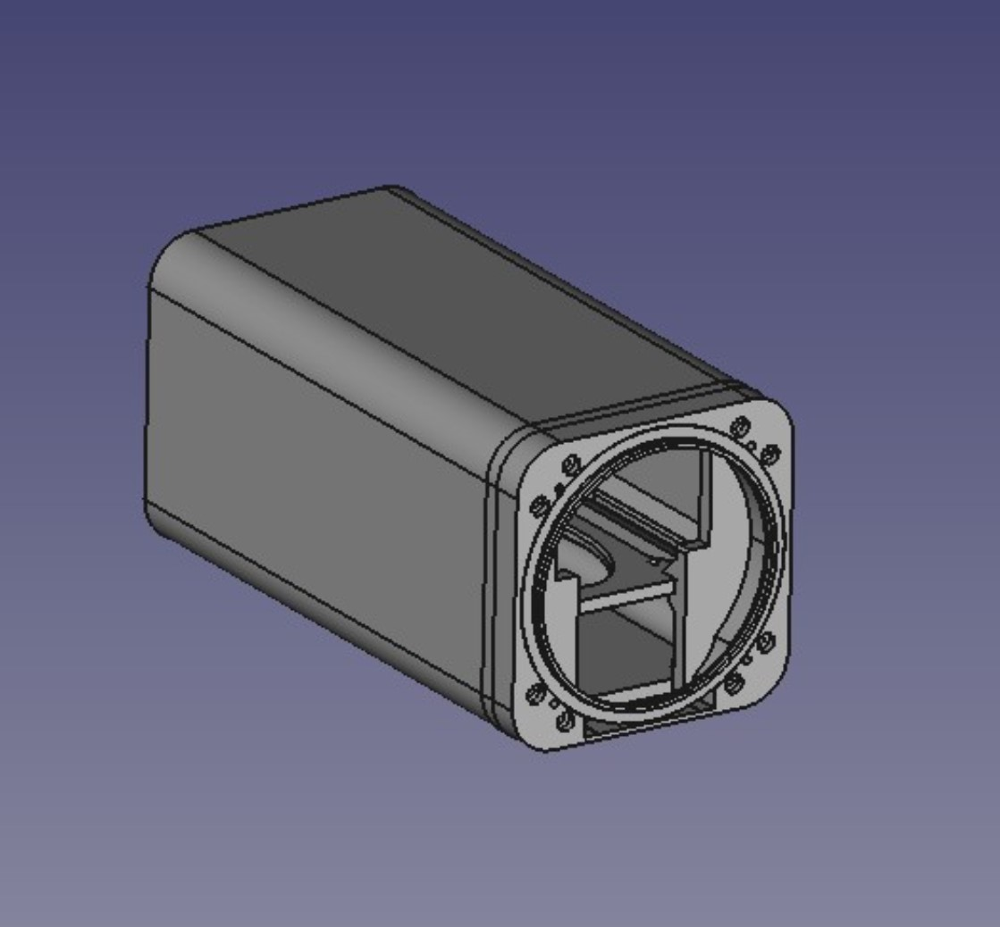

| | |
|---|---|
| Thingiverse | [thing:7162277](https://www.thingiverse.com/thing:7162277) |
| Author | XIAPROJECTS |
| License | Free for personal use; commercial use requires an agreement, see [LICENSE.md](../../LICENSE.md) |

> **Printing for an aircraft:** the parts must withstand 100 °C in cruise on long flights. Read [PRINTING.md](../../PRINTING.md) for the materials and the test before printing.

## Description

Disclaimer: this is a printable case for open-source avionics, non-commercial, if you want to modify it, you shall send to me, on discord channel, the new design and I will be happy to publish it.

Demo links:

1. <https://youtu.be/zinpUHJbRKo>
2. <https://youtube.com/shorts/LmnfKN0EMDE>
3. <https://youtu.be/UYfrsjpX7aM>
4. <https://youtube.com/shorts/NiXh6y5Wfa8>

The RB Avionics project is open-source free for personal use and it is composed by the following:

- RB-01 3D Synth view with autopilot and radio remote
- RB-02 Sixpack
- RB-03 Computer with 3x screens up to 12"
- RB-04 Engine monitoring system
- RB-05 Remote Traffic display for Stratux
- RB-06 Android powered display

Device and software KIT: <https://github.com/xiaprojects/rb-esp/wiki>

Discord Community Channel RB-Avionics: <https://discord.gg/G4u6kjmrUG>

RB-01 & RB-03 Avionics is the latest cutting edge technologies featuring:

1. 3D SynthView Europe
2. Europe and USA VFR Map
3. Traffic ADS-L ADS-B receiver
4. Remote Radio
5. EFIS with MFD
6. Autopilot with Airfields DB
7. Integration with other Avionics

- RB-01 Round display 80 mm
- RB-03 Rectangular display 3" 6.25" 7" 8" 10.1"

RB-02 features: GPS Speed, Attitude Indicator, Altimeter, Turn & Slip, Gyro and GPS Track, GPS Map, Variometer, G-Meter, Timers, Checklist.

RB-04 EMS: 4 CHT, 4 EGT, RPM, MAP, 2 TEMP, OIL PRES, OIL TEMP, Audio and Light Warnings.

RB-05 Stratux remote display: List of nearby traffic, Traffic, Wired and Wireless.

RB-06 Android Display 3" 6.25" 7" 8" 10.1": Remote display EMS, EFIS, MFD, Android Navigator App such as EasyVFR4.

Everything is free for personal use, commercial agreement available.

Important note: maps charge is up to the pilot.

Technical description:

- Drain 1A / 12V with 12V-5V DC-DC Converter
- Weight 300 gr with Aluminium box
- Display size: 6.25" compatible with 2x avionics horizontal mount (radio or transponder)
- Configurable brightness
- USB-GPS VK-162 or NMEA $GPRMC compatible
- CPU 2.4Ghz with 8GB RAM
- Touch screen with zoom and pan
- Android AOSP-15
- Navigation software: Easy VFR 4 with PRO license

GitHub RB-01 Repository: <https://github.com/xiaprojects/roastbeef/wiki/Build-example-7:-Round-display>

## Part names

The file names are in Italian:

| File name | English |
|---|---|
| Base A, Base A rev 2, Base B | Base (rev 2 is a later revision of Base A) |
| Distanziali base | Base spacers |
| Fissaggio power | Power bracket |
| Flangia | Flange |
| Foratura | Drilling template |
| Frontalino | Front panel |
| Ghiera | Bezel ring |
| Ogiva | Ogive (dome cover) |
| Sfiato | Vent |
| Supporto antenna ADSB | ADS-B antenna mount |

<!-- BEGIN parts: generated by tools/import-thing.sh, do not edit by hand -->
## Parts

| File | Size | Preview |
|---|---:|---|
| [RB01.05_-_Base_A_Meshed.stl](files/RB01.05_-_Base_A_Meshed.stl) | 246 KB | 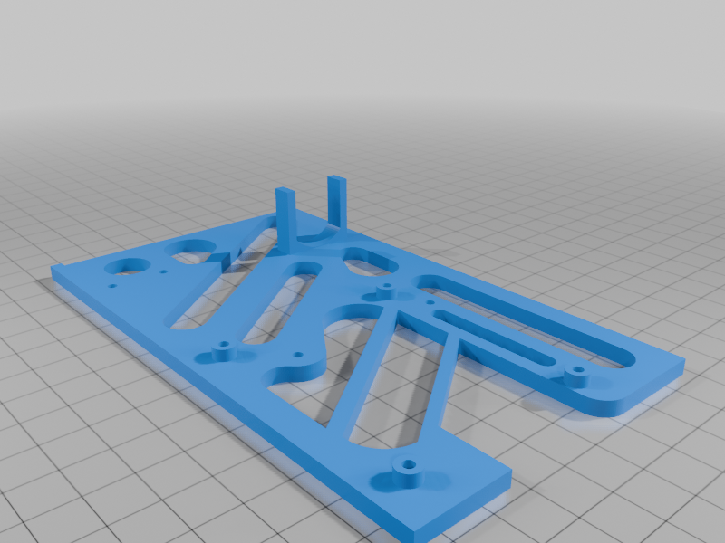 |
| [RB01.05_-_Base_A.rev_2_Meshed.stl](files/RB01.05_-_Base_A.rev_2_Meshed.stl) | 292 KB | 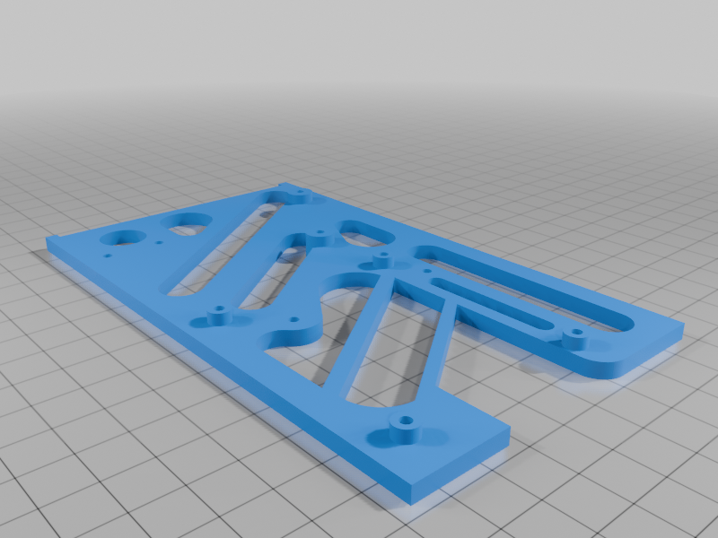 |
| [RB01.05_-_Base_B_Meshed.stl](files/RB01.05_-_Base_B_Meshed.stl) | 130 KB | 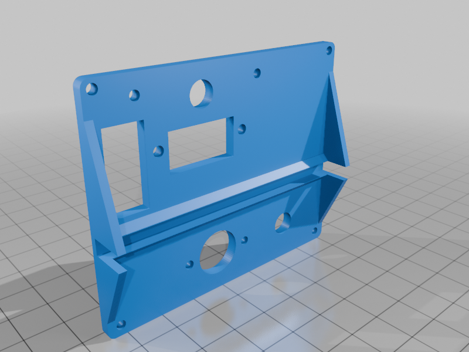 |
| [RB01.05_-_Distanziali_Base_Meshed.stl](files/RB01.05_-_Distanziali_Base_Meshed.stl) | 119 KB | 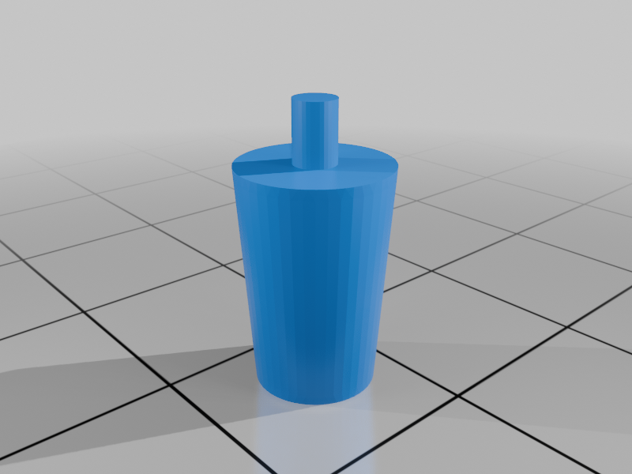 |
| [RB01.05_-_Fissaggio_power_Meshed.stl](files/RB01.05_-_Fissaggio_power_Meshed.stl) | 2 KB | 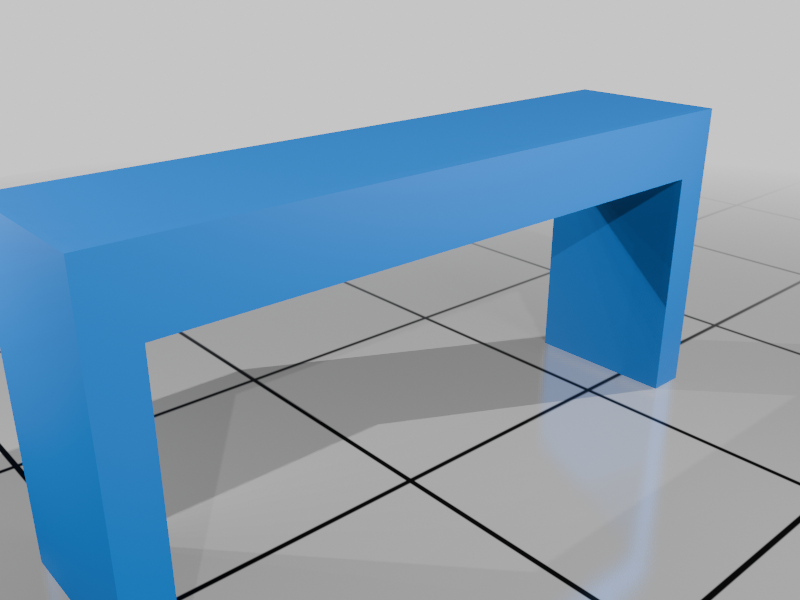 |
| [RB01.05_-_Flangia_Meshed.stl](files/RB01.05_-_Flangia_Meshed.stl) | 120 KB | 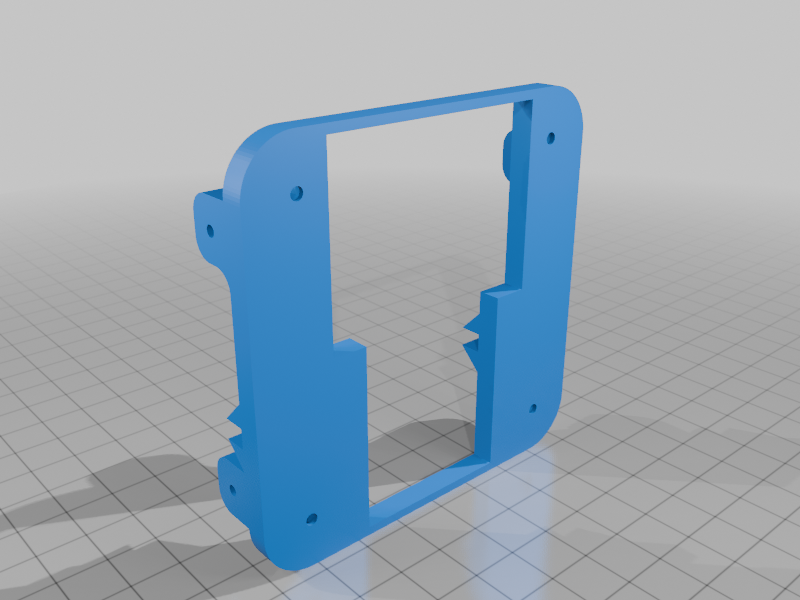 |
| [RB01.05_-_Foratura_Meshed.stl](files/RB01.05_-_Foratura_Meshed.stl) | 80 KB | 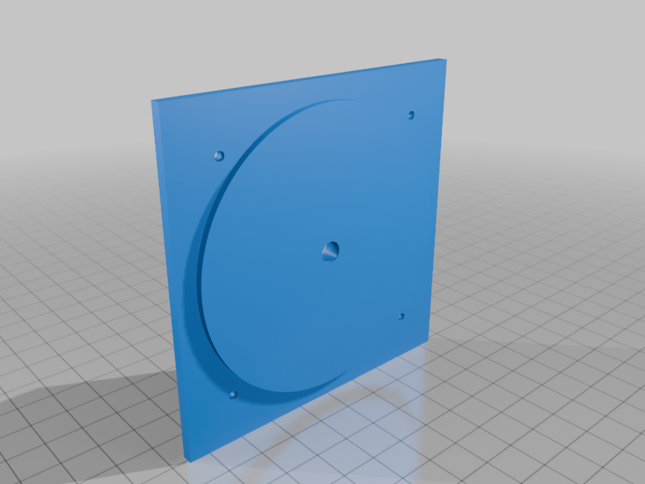 |
| [RB01.05_-_Frontalino_Meshed.stl](files/RB01.05_-_Frontalino_Meshed.stl) | 289 KB | 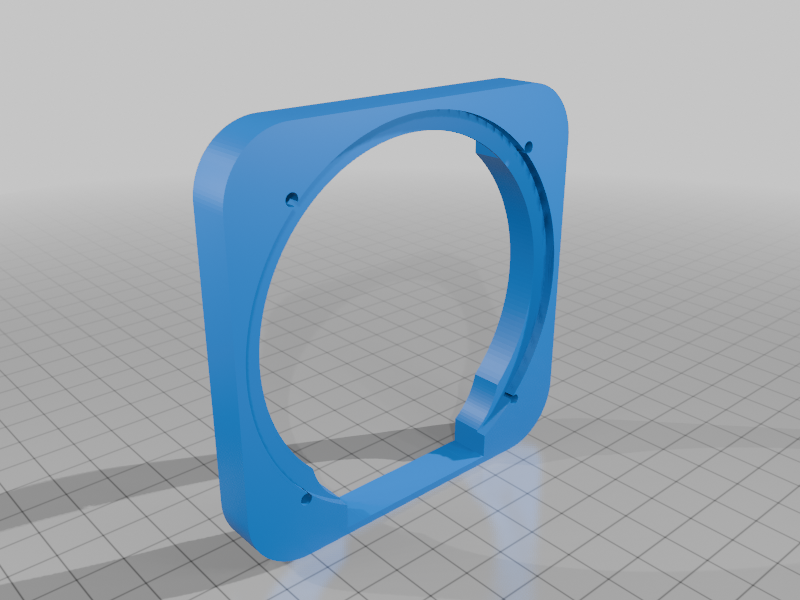 |
| [RB01.05_-_Ghiera_Meshed.stl](files/RB01.05_-_Ghiera_Meshed.stl) | 1.7 MB | 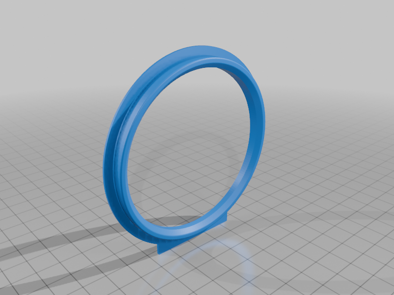 |
| [RB01.05_-_Ogiva_Meshed.stl](files/RB01.05_-_Ogiva_Meshed.stl) | 556 KB | 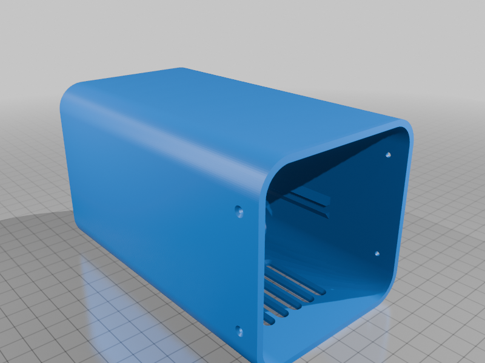 |
| [RB01.05_-_Sfiato_Meshed.stl](files/RB01.05_-_Sfiato_Meshed.stl) | 15 KB | 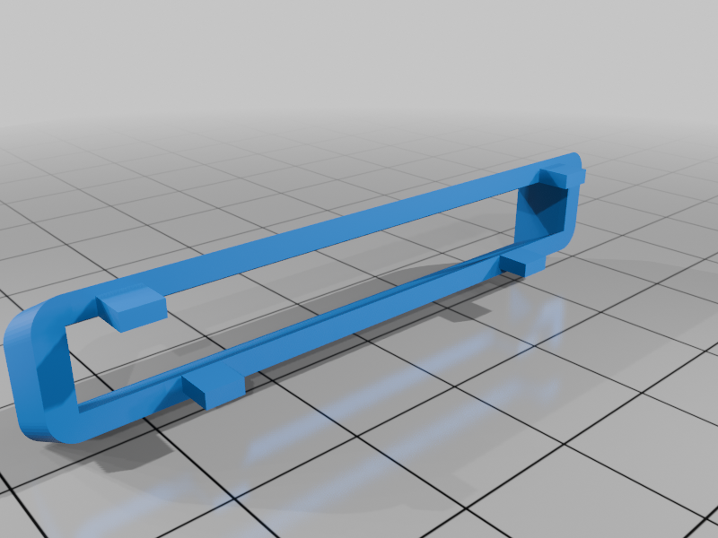 |
| [RB01_supporto_antenna_ADSB_Meshed.stl](files/RB01_supporto_antenna_ADSB_Meshed.stl) | 418 KB | 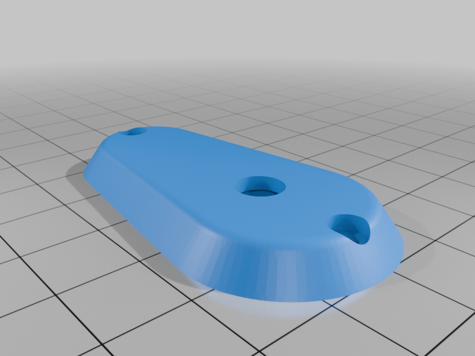 |

## Photos

<!-- END parts -->

<!-- BEGIN kicad: generated by tools/kicad_templates.py, do not edit by hand -->
## KiCad board template

A KiCad project as the starting point for your own electronics.

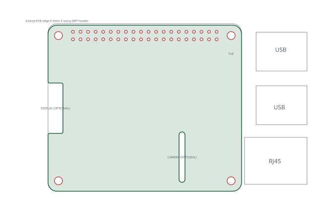

[kicad/rb01-pi-hat/rb01-pi-hat.kicad_pro](kicad/rb01-pi-hat/rb01-pi-hat.kicad_pro): A Raspberry Pi HAT for the RB-01: the Pi 5 sits on the 58 x 49 mm bosses of the RB01.05 Base A sled inside the 84 mm tube of the Ogiva.

- Based on KiCad's RaspberryPi-HAT template: HAT outline, M2.5 holes, the 40-pin socket and the ID EEPROM schematic.
- In the RB-01 the Pi 5 stands on the 58 x 49 mm bosses of the Base A sled (2.5 mm pilots).
- The Ogiva is an 84 mm tube: a board up to about 74 mm wide clears it at HAT height; the standard HAT is 56.5 mm.
- Other sled bosses carry the power converter and the radios: keep the HAT within the Pi footprint.

<!-- END kicad -->
