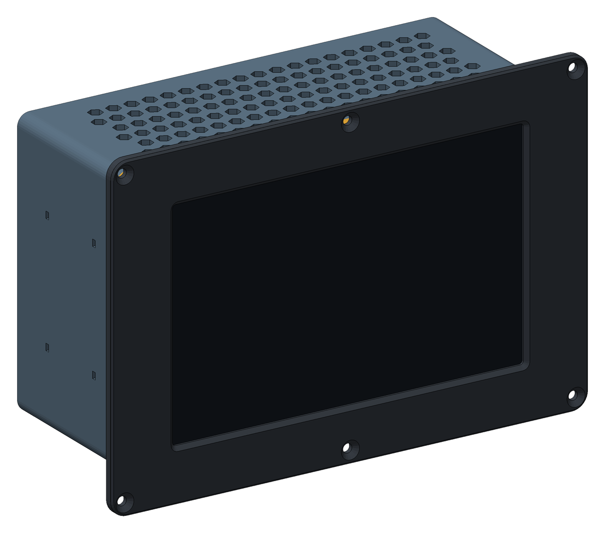
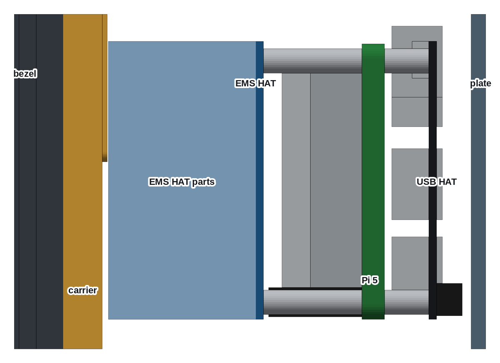
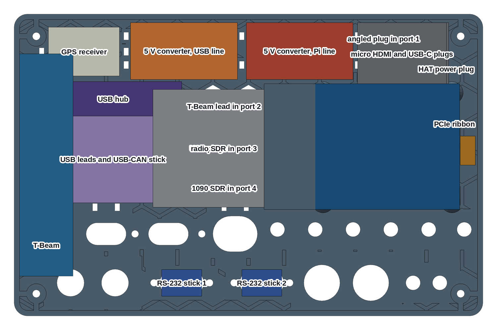
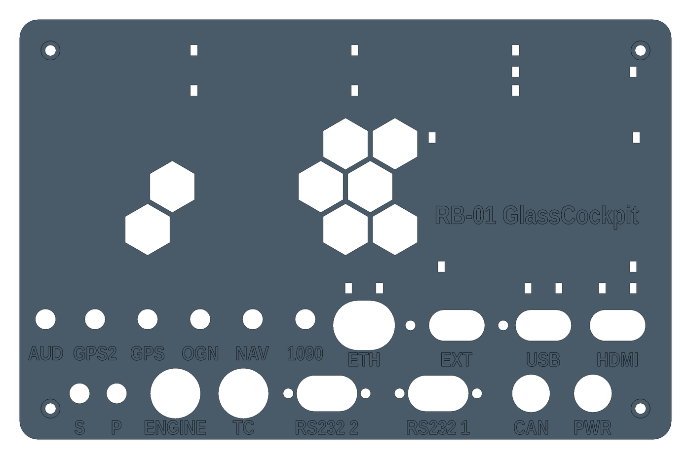
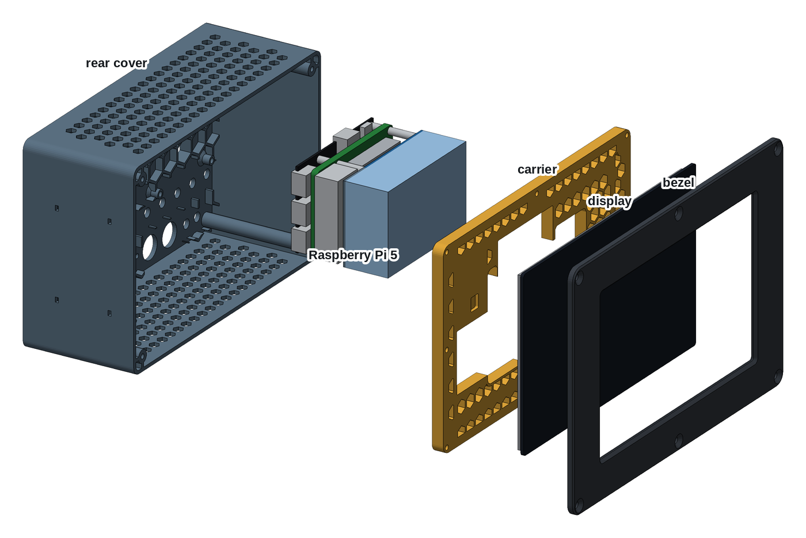
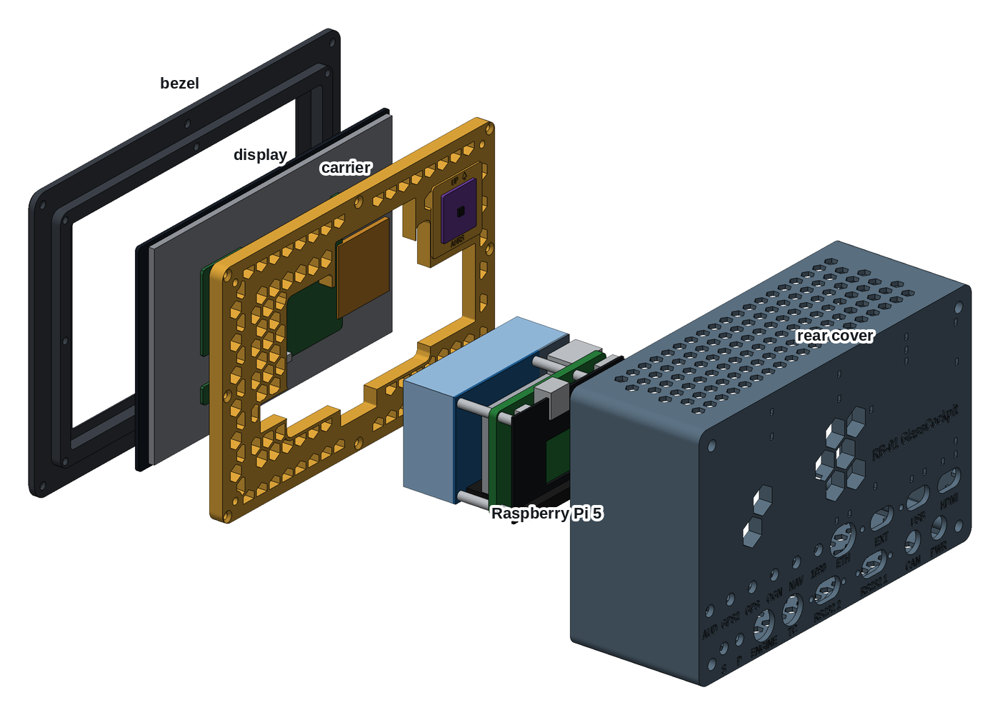
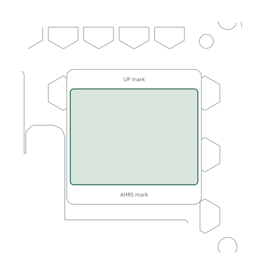

# RB-01 GlassCockpit, 8" unit



The most complete RB-01 in one box. A single Raspberry Pi 5 drives two displays: the
Waveshare 8" in this case on its first HDMI output, and the 80 mm round display of the
[GlassCockpit remote](../glasscockpit-round/) on its second. Everything the round RB-01
carries in its 170 mm tube moves in here, with the EMS, the radios and the antenna
connectors. The unit slides into the panel from the front and is held by six screws
through the bezel. It is three parts, all printed without supports:

- **Bezel:** holds the glass and screws to the panel.
- **Carrier:** a honeycomb plate that clamps the display from behind and carries the
  AHRS plane.
- **Rear cover:** the chassis, 78 mm deep. Everything except the display rides on it.

| | |
|---|---|
| Author | RB-Avionics |
| License | Free for personal use; commercial use requires an agreement, see [LICENSE.md](../../LICENSE.md) |
| Display | [Waveshare 8DP-CAPLCD](https://www.waveshare.com/wiki/8DP-CAPLCD): 194 × 119 mm glass, HDMI, USB-C touch |
| Computer | Raspberry Pi 5 with the Active Cooler |
| Expansion | [Waveshare PCIe TO USB 3.2 Gen1 HAT+](https://www.waveshare.com/wiki/PCIe_TO_USB_3.2_Gen1_HAT+), RB01HAT EMS HAT |
| Depth | 96 mm from the bezel front, 91.5 mm behind the front face of the panel |
| Material | PC or PA-CF for an aircraft, see [PRINTING.md](../../PRINTING.md) |
| Units | millimetres |

> **Printing for an aircraft:** the case must withstand 100 °C in cruise on
> long flights. Print it in PC or PA-CF, never PLA, PETG, ABS or ASA, and run
> the oven test first: read [PRINTING.md](../../PRINTING.md).

> **Status: designed and checked in CAD, not yet printed or built.** Read
> [Check before you print](#check-before-you-print).

## Design

- **The stack, back to front: USB HAT, Pi 5, EMS HAT.** The USB HAT's 40-pin socket is
  blind: it is mounted on the underside and nothing passes through to the top, so no HAT
  can stack above it. The EMS HAT needs the GPIO, so it takes the Pi's header, and the USB
  HAT goes under the Pi. It needs only its PCIe ribbon and its own USB-C power, which is
  what the second 5 V line is for.
- **Two 5 V lines.** One feeds the Pi. The other feeds the USB HAT, and through it the
  remote display, the T-Beam and the two SDRs, so a USB fault or a transmit burst does not
  brown out the Pi.
- **A chassis, not a lid.** The stack stands on four short standoffs in the rear cover
  and the devices are strapped round it. Open the unit and everything comes away with the
  rear cover except the display. Leave the display cables long enough to open it like a book.
- **Every antenna has its bulkhead.** Five SMA holes in a row on the back, each with its label.
- **Same bezel and carrier as the RB-06 8".** The carrier adds one pocket: the touch panel
  has a chip block that stands 1.7 mm proud of the LCD back, under the AHRS plane.
- **Room is checked.** The generator stops if a part touches the display, the stack or a
  device, or if two devices, plugs or boards need the same room. The display and the USB
  HAT have also been checked against Waveshare's own 3D models.



## What goes where

Directions are as seen from the front, with the rear cover in place.

| Item | Where |
|---|---|
| Stack | right of centre, USB end left, HDMI edge up, component faces towards the display |
| 5 V converters | top of the plate, side by side: room for 48 × 25.5 × 16 mm each. The one on the right feeds the Pi |
| USB hub | left of the stack on the plate, room for 62 × 15.5 × 10 mm, sockets down |
| USB-CAN | flat on the plate below the hub, on a short lead, room for 62 × 15 mm with the plugs |
| T-Beam | flat on the left wall, room for 100 × 33 × 24 mm, strapped through the wall |
| GPS receiver | top left of the plate, room for 32 × 22 × 14 mm |
| Nano SDRs | in USB ports 3 and 4 of the HAT, their ends by the vents |
| Sound card, storage | in the Pi's two USB 2 ports |
| RS-232 sticks | standing on the plate behind their DE-9 holes, 50 mm tall, on leads from the hub |
| AHRS plane | back of the carrier, upper left, as on the RB-06 8". The EMS HAT has its own IMU: use one or the other |



## USB ports

The list comes to eleven devices for the eight ports of the Pi and the HAT, so a hub is
required, and a three-port hub is one short: with four ports the count is exact, with no
spare. Devices that need real current go on the HAT, on the second 5 V line.

| Port | Device | Power from |
|---|---|---|
| Pi USB 3, upper | USB hub: USB-CAN, RS-232 1, RS-232 2, EXT | Pi line |
| Pi USB 3, lower | Touch of the 8", to its right-hand USB-C | Pi line |
| Pi USB 2 | Storage stick | Pi line |
| Pi USB 2 | Sound card | Pi line |
| HAT port 1, HDMI edge | Remote round display, through the USB hole. Angled plug: 26 mm to the wall | USB line |
| HAT port 2 | T-Beam | USB line |
| HAT port 3 | Nano SDR, radio and VOR | USB line |
| HAT port 4 | Nano SDR, 1090 MHz | USB line |

## Back of the case

Seen from behind, the labels are engraved under each hole. Bulkheads and sockets hold
themselves; HDMI, USB and ETH are plain slots with a tie-wrap pair above them.



| Label | Hole | For |
|---|---:|---|
| 1090 | 6.5 mm | ADS-B antenna, SMA bulkhead, MCX pigtail to the SDR |
| NAV | 6.5 mm | Radio and VOR antenna, SMA bulkhead, MCX pigtail to the SDR |
| OGN | 6.5 mm | FLARM and OGN antenna, SMA bulkhead, pigtail to the T-Beam |
| GPS | 6.5 mm | GPS antenna of the receiver on the Pi's UART |
| GPS2 | 6.5 mm | GPS antenna of the T-Beam |
| PWR | 12.2 mm | 12 V in, GX12 |
| CAN | 12.2 mm | USB-CAN, GX12 |
| RS232 1, RS232 2 | 19.6 × 11.6 mm, 25 mm screws | The DE-9 ends of the USB-RS232 sticks, from inside |
| TC | 16.2 mm | Thermocouples, M16 gland. No connector: the cold junction is at the MAX31856, so the thermocouple wire runs unbroken to the HAT |
| ENGINE | 16.2 mm | Oil, fuel, battery, RPM and gear, M16 gland or GX16 |
| P, S | 6.5 mm | Pitot and static to the airspeed sensor, M6 bulkhead fittings |
| HDMI, USB | 18 × 10 mm | The two cables to the remote display. A micro HDMI plug and a USB-A plug pass |
| EXT | 18 × 10 mm, 30 mm screws | USB for external devices such as an RB-02 remote: a panel socket, or the cable through the slot |
| ETH | 20 × 16 mm | RJ45 to RB-06 |
| AUD | 6.5 mm | Audio, 3.5 mm panel jack |

## Power

12 V comes in at PWR. Fuse each converter's input on its own.

| Line | Feeds | Estimated current at 5 V |
|---|---|---|
| Pi line, 5 A | Pi 5 by USB-C, EMS HAT, 8" display by its Power USB-C, Pi USB ports | up to 5 A |
| USB line | USB HAT by its USB-C, remote display, T-Beam, two SDRs | about 2 A, more on a transmit burst |

The USB HAT is not on the GPIO, so the USB line is its only supply: the HAT has no power
without it. Do not run both lines from one output without checking the total.

## Cables

- **HDMI to the 8":** HDMI0, the micro HDMI next to the USB-C, to HDMI on the display.
  The plug room is 28 mm above the Pi: an angled plug is safest.
- **HDMI to the round:** HDMI1, out through the HDMI hole, up to 50 cm.
- **USB to the round:** HAT port 1, out through the USB hole, up to 50 cm.
- **Touch:** the 8"'s Touch socket is the USB-C on the right of its board. The stack leaves
  it 9 mm below its lower edge: take the cable out of the carrier opening downwards, with an
  angled plug.
- **PCIe:** the HAT's 40 mm ribbon, round the end of the Pi, into the same sockets the
  same way up as with the HAT on top.
- **EMS:** see the wiring list of the [RB01HAT](https://github.com/xiaprojects/rb-pcb/tree/main/RB-01/rb01hat).

## Software

Add to `/boot/firmware/config.txt`:

```
dtparam=pciex1
usb_max_current_enable=1
```

The first is needed because the HAT is off the GPIO and PCIe is off by default. The second
lets the Pi give its USB ports full current from a converter that has no USB-PD. The two
displays are the RB software's dual HDMI setup.

## Assembly

1. Print the three parts. Before going on, check that the display drops into the bezel pocket.
2. Press in the heat-set inserts:
   - 8 × M3 in the back face of the bezel skirt;
   - 4 × M3 in the back of the carrier corners;
   - 4 × M2.5 in the rear cover standoffs.
3. Stick foam tape on the bezel lip and on the carrier's flat strips, put the display in,
   lay the carrier on it and drive the 8 × M3 × 12 flat head screws crosswise.
4. Fit the bulkheads, sockets and glands on the rear cover. Pass the cables that go
   through the slots and tie them. Fit the pigtails now: the SMA nuts are hard to reach later.
5. Strap down the converters, the hub and the GPS receiver with foam under them. Strap the
   T-Beam to the left wall. Stand the RS-232 sticks in their DE-9 holes.
6. Lay the rear cover inside up. Screw the four 12 mm spacers through the USB HAT into the
   standoffs, USB ports towards the T-Beam side.
7. Fit the PCIe ribbon to the Pi and the HAT with the Pi held beside it, then fold the Pi
   over onto the spacers. Fix it with the four 20 mm spacers through its holes.
8. Fit the stacking header and the EMS HAT, and screw it to the spacers.
9. Plug in the USB devices, the antenna pigtails and the power leads. Connect the
   thermocouples and the pressure tubes.
10. Connect HDMI and touch to the display, close the rear cover on the carrier and drive its
    4 × M3 × 10 socket head screws down the columns. They are 73 mm deep: use a 2.5 mm hex
    key at least 100 mm long.
11. Cut the panel from the DXF below, slide the unit in from the front, and fix the bezel
    with 6 × M4 flat head screws and nylon-insert lock nuts.

## Check before you print

Measured from a 3D model or a drawing: the display, the USB HAT, the Pi. The rest needs
checking on your own parts.

| What | Why |
|---|---|
| 8" revision | Waveshare's model dates from April 2024. The wiki also shows a V2 board: check the socket positions against [8DP-CAPLCD](https://www.waveshare.com/wiki/8DP-CAPLCD) if yours is a V2 |
| PCIe ribbon reach | About 37 mm of the 40 mm is used going round the end of the Pi. Dry-fit it before anything else, with the Pi on its 12 mm spacers. If it is short, buy a longer 16-way ribbon |
| USB HAT's USB-C | Missing from Waveshare's model: placed from the product photo, ±1 mm |
| EMS HAT height | 30 mm of room is allowed for the DIY build's vertical cards, the top of the 25 to 30 mm in its documents |
| Devices | The rooms come from the website model of the RB-01 and from seller data. Check your converters, hub and T-Beam against the sizes above |
| Heat | Not tested. The stack, the converters and the radios put perhaps 20 W in the box. It has 228 hexagonal vents in the top and bottom walls for a chimney flow, and 8 open cells in the back. Check the Pi's temperature in a warm cabin before relying on it |
| Radio | Wi-Fi and Bluetooth are inside the case and carbon fibre blocks them: use PC, not PA-CF, for the rear cover if you rely on them. Keep the SDR leads away from the converters and try the receivers with the engine running |

## Changing the case

The case is generated with FreeCAD by [tools/display_cases.py](../../tools/display_cases.py).
The dimensions are in [tools/display_case_layouts.py](../../tools/display_case_layouts.py).
Rebuild from the repo root with `RB_ONLY=RB-01/glasscockpit-8 freecad.cmd tools/display_cases.py`,
then the AHRS board template with `RB_ONLY=RB-01/glasscockpit-8 python3 tools/kicad_templates.py`.
The FreeCAD model in `files/` is the assembled case for viewing and measuring; edit the
scripts, not the model.

<!-- BEGIN parts: generated by tools/display_cases.py, do not edit by hand -->
## Parts

| Part | On the bed | Size on the bed (mm) | Mass in PC | File |
|---|---|---|---:|---|
| Bezel | front face down | 237 × 162 × 10 | 127 g | [rb01-glass-8-bezel.stl](files/rb01-glass-8-bezel.stl) (380 KB) |
| Carrier | front face down | 211 × 136 × 9 | 125 g | [rb01-glass-8-carrier.stl](files/rb01-glass-8-carrier.stl) (655 KB) |
| Rear cover | back face down | 211 × 136 × 78 | 258 g | [rb01-glass-8-rear-cover.stl](files/rb01-glass-8-rear-cover.stl) (3.0 MB) |

The parts print without supports, placed as exported. The bezel needs a bed of at least 240 × 165 mm. Masses are for solid polycarbonate; the honeycomb is already thin solid walls (1.6 mm, four 0.4 mm lines): 90 cells in the carrier, 8 open vent cells in the rear cover and 228 vents in its top and bottom walls.






## Hardware

| Item | Qty | Where |
|---|---:|---|
| M3 heat-set insert, 5.7 mm long, for a 4 mm hole | 12 | bezel skirt (8), carrier corners (4) |
| M2.5 heat-set insert, 4 mm long, for a 3.6 mm hole | 4 | rear cover standoffs |
| M3 × 12 flat head, ISO 10642 | 8 | carrier to bezel |
| M3 × 10 socket head, ISO 4762 | 4 | rear cover to carrier, inside the columns (2.5 mm hex key) |
| M2.5 hex spacer, male to female, 12 mm + 6 mm thread | 4 | through the USB HAT into the standoffs, carry the Pi |
| M2.5 hex spacer, male to female, 20 mm + 6 mm thread | 4 | through the Pi, carry the EMS HAT (stack S1) |
| M2.5 × 5 pan or socket head | 4 | EMS HAT to the spacers |
| 2 × 20 stacking header | 1 | Pi GPIO to the EMS HAT, not through the USB HAT |
| SMA bulkhead, 6.5 mm, with nut | 5 | 1090, NAV, OGN, GPS, GPS2 |
| MCX to SMA pigtail, 15 cm | 2 | the two Nano SDRs |
| U.FL to SMA pigtail, 20 cm | 3 | T-Beam LoRa and GNSS, GPS receiver |
| GX12 aviation socket, 12 mm | 2 | PWR, CAN |
| M16 cable gland | 2 | TC, ENGINE |
| M6 bulkhead fitting for the pressure tube | 2 | P, S |
| 3.5 mm panel jack and a short lead | 1 | AUD |
| USB-A panel socket on a short lead, 30 mm screw spacing, or the cable itself | 1 | EXT |
| M4 × 12 flat head, ISO 10642 (or #8), with nylon-insert lock nuts | 6 | bezel to the panel, up to 3 mm of panel |
| Closed-cell foam tape, 1 mm, silicone or EPDM rated above 100 °C | 0.6 m × 3 mm, 0.6 m × 5 mm | on the bezel lip round the window; on the carrier's flat strips behind the display |
| Epoxy rated above 100 °C | a few grams | AHRS board on the AHRS plane |
| Tie-wraps, 2.5 mm, heat-stabilised, rated 105 °C | 16 to 24 | cables at the back holes, converters, hub, GPS and T-Beam |

## Panel cut-out

211.8 × 136.8 mm with 6.5 mm corners, and 6 holes of 4.4 mm at x = ±111.9 and 0, z = ±74.4 mm from the centre of the cut-out. The case slides in from the front and the bezel (236.8 × 161.8 mm) covers the edge. Drawing 1:1, layers CUT and BEZEL: [rb01-glass-8-panel-cutout.dxf](files/rb01-glass-8-panel-cutout.dxf)

## Load check, -3 to +6 G

Static loads for the whole unit, 1712 g: display 406 g, Pi 5 with cooler 70 g, USB HAT 17 g, EMS HAT 60 g, printed parts 509 g in PC, 650 g for converters, T-Beam, GPS, hub, USB options, AHRS and cables. Every load is taken as if it acted in the worst direction for that part.

| | +6 G | -3 G |
|---|---:|---:|
| Unit weight × G | 101 N | 50 N |
| Shear on each M4 panel screw | 16.8 N | 8.4 N |
| Pull on each screw of the top or bottom row, from the overhang behind the panel | 8.2 N | 4.1 N |
| Display on the bezel pocket wall | 24 N | 12 N |
| Pull on each carrier insert, display pushed back | 3.9 N | 2.0 N |
| Bending at the root of each standoff, the whole stack on four | 2.1 MPa | 1.1 MPa |
| Pull on each rear cover screw, from the weight the cover carries | 10.5 N | 5.2 N |

Each load is a few newtons, against the hundreds of newtons an M3 heat-set insert holds and the tens of MPa printed PC or PA-CF takes across its layers at 100 °C. Shock and vibration are what remain: the display is clamped on foam and backed by the honeycomb, every screw goes into brass, and the cables are tied at the back holes so their plugs carry no load.

FreeCAD model, assembled, with reference blocks for the display, the Pi and an AHRS board, the stack and the room for each device: [rb01-glass-8-case.FCStd](files/rb01-glass-8-case.FCStd)
<!-- END parts -->

<!-- BEGIN kicad: generated by tools/kicad_templates.py, do not edit by hand -->
## KiCad board template

A KiCad project as the starting point for your own electronics.



[kicad/rb01-glass-8-ahrs-board/rb01-glass-8-ahrs-board.kicad_pro](kicad/rb01-glass-8-ahrs-board/rb01-glass-8-ahrs-board.kicad_pro): A 36 x 27 mm IMU board for the AHRS plane of the carrier, glued flat.

- Seen from behind, the component side; up is up on the instrument, as the arrow on the plane.
- Outline = the AHRS plane between its engraved marks, 1 mm inside its sides: a 25.4 mm breakout fits too.
- No mounting holes: glue the board flat with an epoxy rated above 100 °C, edges square to the arrow.
- Parts up to 53 mm tall clear the rear cover and the 5 V converter above the plane.
- Wire it to the Pi GPIO, I2C bus 1: 3.3 V pin 1, SDA pin 3, SCL pin 5, GND pin 6. The RB software finds ICM-20948 and MPU-9250 family IMUs at 0x68 and BMP280/388/390 baros at 0x76 or 0x77.
- The plane is parallel to the panel; set the sensor orientation in the AHRS calibration of the RB software.
- Dwgs.User shows the carrier cut 0.5 mm in front of its back face, round the AHRS plane.

<!-- END kicad -->
