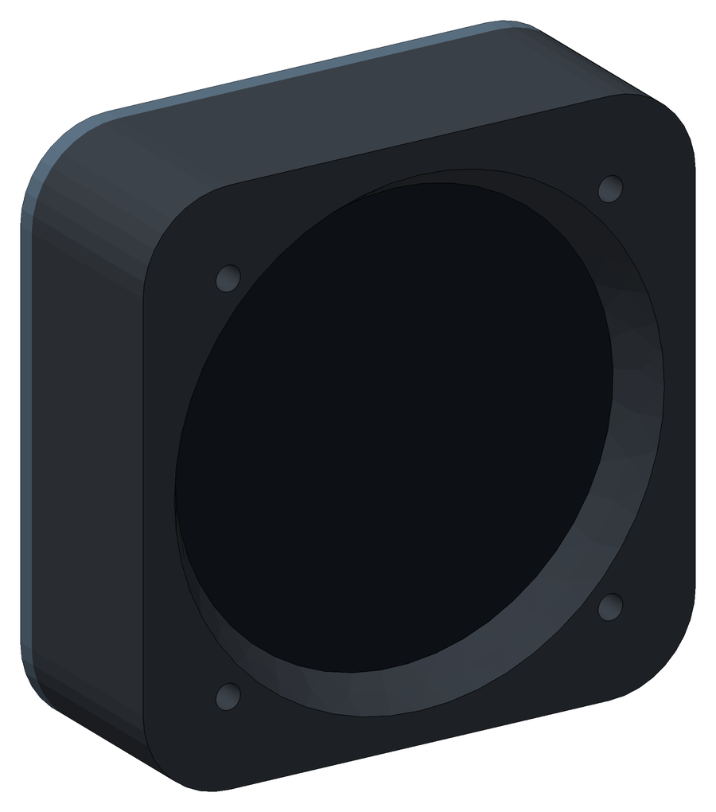
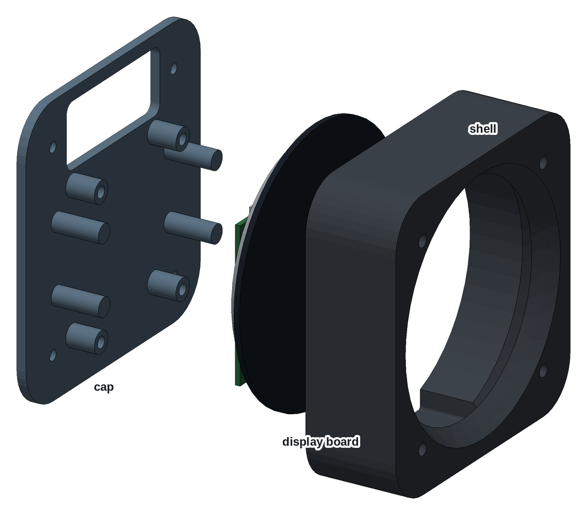
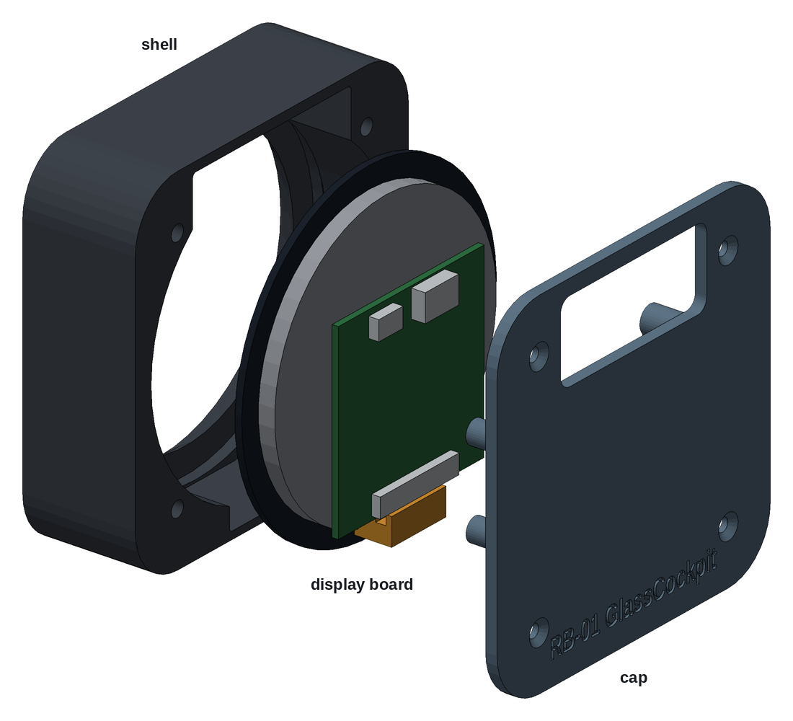

# RB-01 GlassCockpit, remote round display

The second screen of the [GlassCockpit 8" unit](../glasscockpit-8/): an 80 mm round
display with nothing behind it but its driver board. It has no computer of its own. Two
cables, HDMI and USB, up to 50 cm long, run back to the 8" unit, whose Raspberry Pi 5
drives it from its second HDMI output. At 32 mm behind the panel it is less than a fifth of
the depth of the [round RB-01](../3d-synthview-7162277/). It is two parts, both printed
without supports:

- **Shell:** holds the glass and screws to the back of the panel.
- **Cap:** carries the driver board and has the opening for the cables.

| | |
|---|---|
| Author | RB-Avionics |
| License | Free for personal use; commercial use requires an agreement, see [LICENSE.md](../../LICENSE.md) |
| Display | Wisecoco 2.8" round, 480 × 480, touch, with its HDMI driver board, as in the round RB-01 |
| Size | 90 × 90 mm behind the panel, 32 mm deep; allow about 45 mm for the cables to bend |
| Panel | 80 mm instrument hole: fits the RB-01 and RB-02 drilling templates and the RB-Cockpits panels |
| Material | PC or PA-CF for an aircraft, see [PRINTING.md](../../PRINTING.md) |
| Units | millimetres |

> **Printing for an aircraft:** the case must withstand 100 °C in cruise on
> long flights. Print it in PC or PA-CF, never PLA, PETG, ABS or ASA, and run
> the oven test first: read [PRINTING.md](../../PRINTING.md).

> **Status: designed and checked in CAD, not yet printed or built.** Read
> [Check before you print](#check-before-you-print).

## Design

- **The driver board stands parallel to the display, right behind it**, component side
  back, with the HDMI and USB sockets at the top and the 40-pin LCD socket at the bottom.
  The flex folds round the bottom edge of the board and reaches the socket with the same
  face to the contacts as in the round RB-01. Standing the board edge-on instead would
  twist the flex through 90 degrees.
- **The plugs go in a bay above the board.** There are 24 mm from the sockets to the
  top wall: 90 degree plugs or adapters turn the cables back, and they leave through the
  opening in the cap. You can unplug them from behind without opening the case.
- **Behind the panel, glass behind the screws.** The shell sits on the back of the
  panel like the RB-02 Compact Edition, and the panel itself is the bezel. The window
  widens at 33 degrees towards the panel hole. The screw square is hardly wider than the
  glass, so the glass sits behind the panel inserts.

## Cables

| Cable | Display end | Other end |
|---|---|---|
| HDMI, up to 50 cm | HDMI socket of the driver board, with a 90 degree plug or adapter | HDMI1 of the Pi, in the 8" unit, through its HDMI hole |
| USB, up to 50 cm | USB socket of the driver board, marked 5V, with a 90 degree plug or adapter: power and touch | Port 1 of the USB HAT, in the 8" unit, through its USB hole |

The USB cable also powers the display, from the second 5 V line of the 8" unit.

## Assembly

1. Print the two parts. Before going on, check that the glass drops into the shell pocket.
2. Press in the heat-set inserts: 4 × M3 in the front face of the shell, 4 × M3 in its
   back face, 4 × M2.5 in the cap posts.
3. Stick the foam tape on the lip, 2 mm outside the window, and put the display in, glass down.
4. Stick the foam dots on the four cap fingers.
5. Screw the driver board on the cap posts, components towards the cap, HDMI and USB
   towards the opening.
6. Plug the flex into the LCD socket with the cap beside the shell, then close the cap like
   a book, hinged on the flex, and drive the 4 × M3 × 8 flat head screws.
7. Drill the panel with the DXF below or an RB-01 template. Offer the unit up from behind
   and fix it with the four screws from the front.
8. Plug in the two cables through the opening in the cap, and tie them to something solid
   within 10 cm.

## Check before you print

| What | Why |
|---|---|
| Driver board | 48 × 48 mm, from the website model of the RB-01. Its holes, 42 × 44.9 mm, are measured on the RB01.05 sled and spacers, but only three of them: the fourth is assumed by symmetry. The socket positions are as the website draws them, ±2 mm |
| Glass | Ø83.88 mm from Wisecoco's listing, 73.03 × 76.48 mm for the LCD from a seller. The RB01.05 Frontalino has an 85.9 mm recess, which agrees, but there is no drawing. Measure yours |
| LCD depth | 6 mm from the glass front, from the website model |
| Flex | About 23 mm is assumed, from the website model. If it does not reach, the board needs moving down |
| Plugs | The bay is 24 mm tall: choose the 90 degree plugs against it, as a rigid adapter can be longer than that |

## Changing the case

The case is generated with FreeCAD by [tools/display_cases.py](../../tools/display_cases.py).
The dimensions are in [tools/display_case_layouts.py](../../tools/display_case_layouts.py).
Rebuild from the repo root with `RB_ONLY=RB-01/glasscockpit-round freecad.cmd tools/display_cases.py`.
The FreeCAD model in `files/` is the assembled case for viewing and measuring; edit the
scripts, not the model.

<!-- BEGIN parts: generated by tools/display_cases.py, do not edit by hand -->
## Parts

| Part | On the bed | Size on the bed (mm) | Mass in PC | File |
|---|---|---|---:|---|
| Shell | front face down | 90 × 90 × 29 | 94 g | [rb01-glass-round-shell.stl](files/rb01-glass-round-shell.stl) (204 KB) |
| Cap | back face down | 90 × 90 × 18 | 28 g | [rb01-glass-round-cap.stl](files/rb01-glass-round-cap.stl) (809 KB) |

The parts print without supports, placed as exported. Masses are for solid polycarbonate.

## Hardware

| Item | Qty | Where |
|---|---:|---|
| M3 heat-set insert, 5.7 mm long, for a 4 mm hole | 8 | front face of the shell (4), back face of the shell (4) |
| M3 pan or flat head, black, 5 mm long plus the panel thickness | 4 | through the panel into the shell: longer ones bottom out behind the insert |
| M3 × 8 flat head, ISO 10642 | 4 | cap to shell |
| M2.5 heat-set insert, 4 mm long, for a 3.6 mm hole | 4 | cap posts |
| M2.5 × 5 pan head | 4 | driver board to the cap posts |
| Closed-cell foam, 1 mm, rated above 100 °C | 4 dots of 8 mm | on the cap fingers, against the back of the LCD |
| Closed-cell foam tape, 1 mm, silicone or EPDM rated above 100 °C | 0.25 m × 2 mm | on the lip round the window |

## Panel cut-out

An 80.5 mm hole and 4 holes of 3.6 mm on a 62.25 mm square. The shell, with the glass in it, goes on the back of the panel and the screws go in from the front. Drawing 1:1, layers CUT and BODY (the shell outline behind the panel): [rb01-glass-round-panel-cutout.dxf](files/rb01-glass-round-panel-cutout.dxf)

## Load check, -3 to +6 G

Static loads for the whole unit, 232 g: display board 50 g, printed parts 122 g in PC, 60 g for cable ends, adapters and foam.

| | +6 G | -3 G |
|---|---:|---:|
| Unit weight × G | 13.7 N | 6.8 N |
| Shear on each M3 panel screw | 3.41 N | 1.71 N |
| Pull on each panel insert, from the overhang behind the panel | 2.23 N | 1.11 N |

Every load is a newton or two per screw, against the hundreds of newtons an M3 heat-set insert holds. The glass is clamped on foam between the lip and the cap fingers, and the driver board hangs from the cap on four posts.

FreeCAD model, assembled, with reference blocks for the display board and its plugs: [rb01-glass-round-case.FCStd](files/rb01-glass-round-case.FCStd)
<!-- END parts -->
