# RB-02 Front Install Avionics SixPack Box 80mm

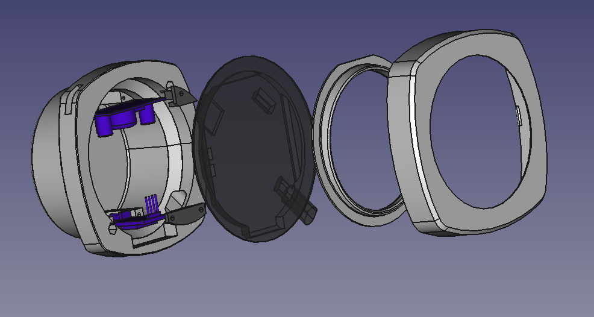

| | |
|---|---|
| Thingiverse | [thing:7103368](https://www.thingiverse.com/thing:7103368) |
| Author | XIAPROJECTS |
| License | Free for personal use; commercial use requires an agreement, see [LICENSE.md](../../LICENSE.md) |

> **Printing for an aircraft:** the parts must withstand 100 °C in cruise on long flights. Read [PRINTING.md](../../PRINTING.md) for the materials and the test before printing.

## Description

RB-02 is the new Touch Screen Avionics for Experimental and Ultralight aircraft.

This mount install is from FRONTAL installation, this will simplify the building process of the instrument.

You can follow the build tutorial here: <https://github.com/xiaprojects/rb-esp/wiki>

To have commercial license send a private message.

<!-- BEGIN parts: generated by tools/import-thing.sh, do not edit by hand -->
## Parts

| File | Size | Preview |
|---|---:|---|
| [RB02C_-_front_ring_Meshed.stl](files/RB02C_-_front_ring_Meshed.stl) | 1.0 MB | 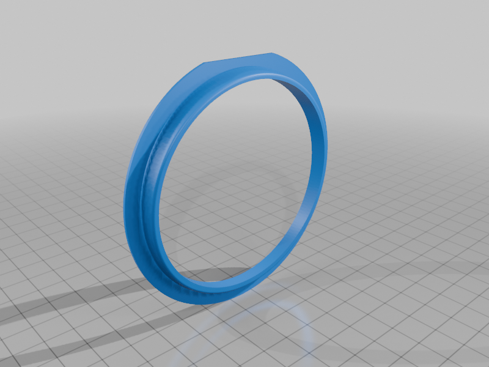 |
| [RB02C_-_GPS_lock_Meshed.stl](files/RB02C_-_GPS_lock_Meshed.stl) | 21 KB | 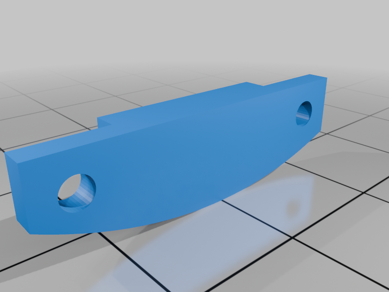 |
| [RB02C_-_power_lock_Meshed.stl](files/RB02C_-_power_lock_Meshed.stl) | 13 KB | 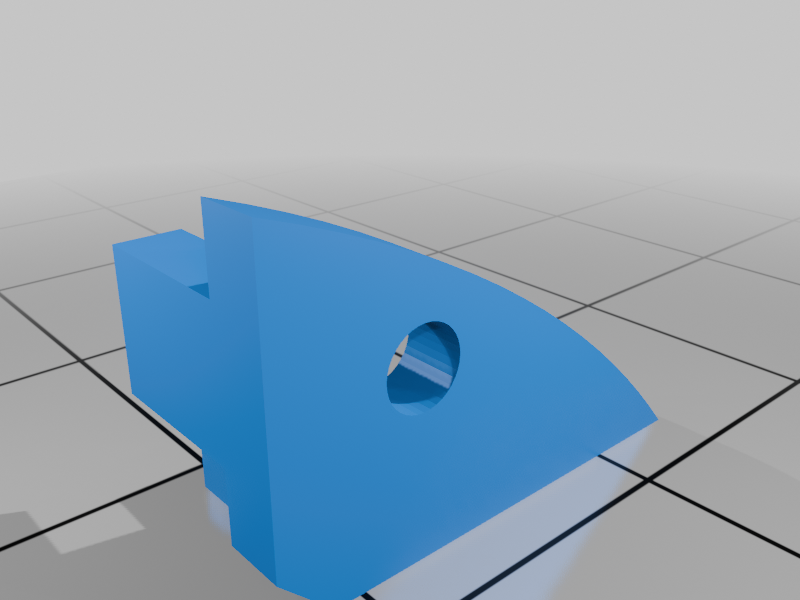 |
| [RB02D_-_case_Meshed.stl](files/RB02D_-_case_Meshed.stl) | 1.1 MB | 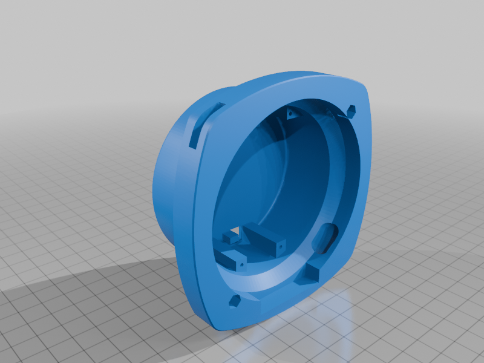 |
| [RB02D_-_front_panel_Meshed.stl](files/RB02D_-_front_panel_Meshed.stl) | 452 KB | 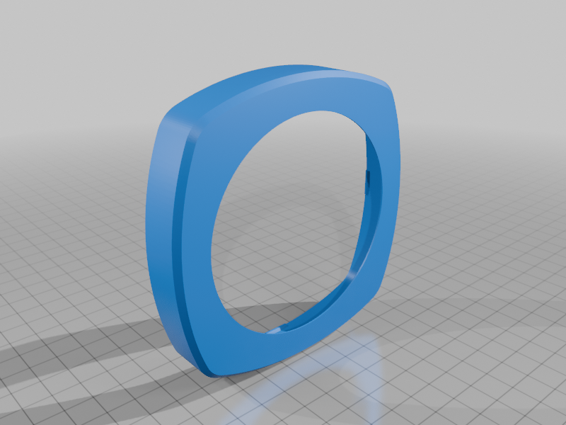 |
| [RB02D_-_template_ESP_Meshed.stl](files/RB02D_-_template_ESP_Meshed.stl) | 156 KB | 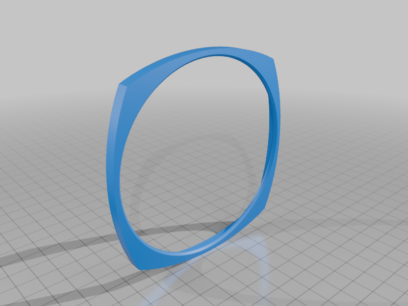 |

## Photos

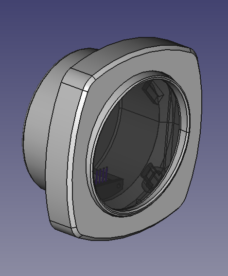
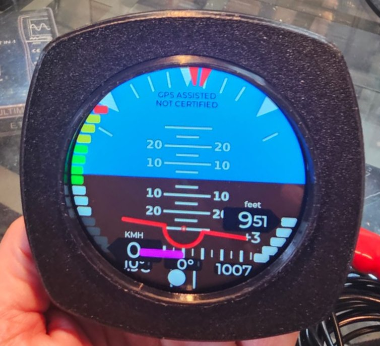
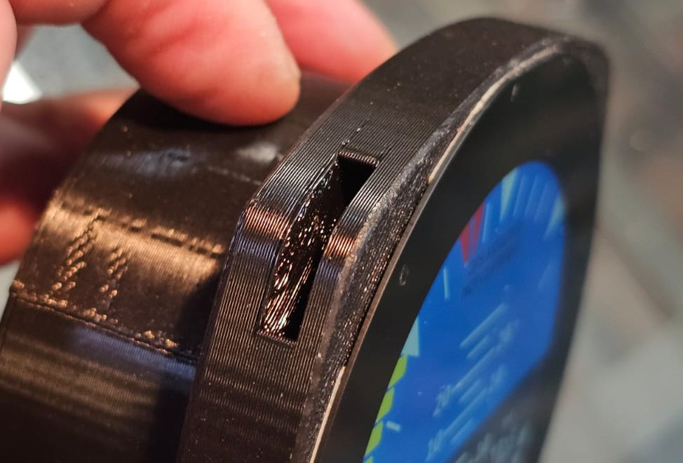
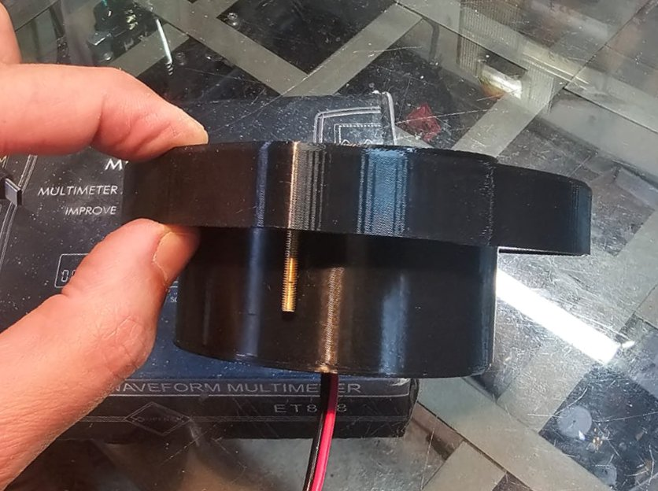
<!-- END parts -->

<!-- BEGIN kicad: generated by tools/kicad_templates.py, do not edit by hand -->
## KiCad board template

A KiCad project as the starting point for your own electronics.

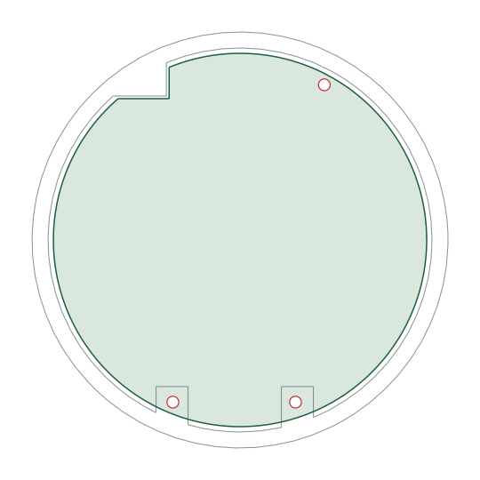

[kicad/rb02-front-install-board/rb02-front-install-board.kicad_pro](kicad/rb02-front-install-board/rb02-front-install-board.kicad_pro): A round 70 mm board inside the front-install case, on its three M2 bosses.

- Seen from the front (display side); the F side faces the display.
- The board sits on the boss faces 17 mm behind the front of RB02D_-_case, inside its 72 mm tube; the notch at the top left clears a block that stands 0.7 mm proud of them.
- The top right boss is 2 mm deeper: put a 2 mm spacer under the board there.
- 3 x M2 screws thread into the printed 1.8 mm pilots.
- Dwgs.User shows the case cut at the board plane.

<!-- END kicad -->
