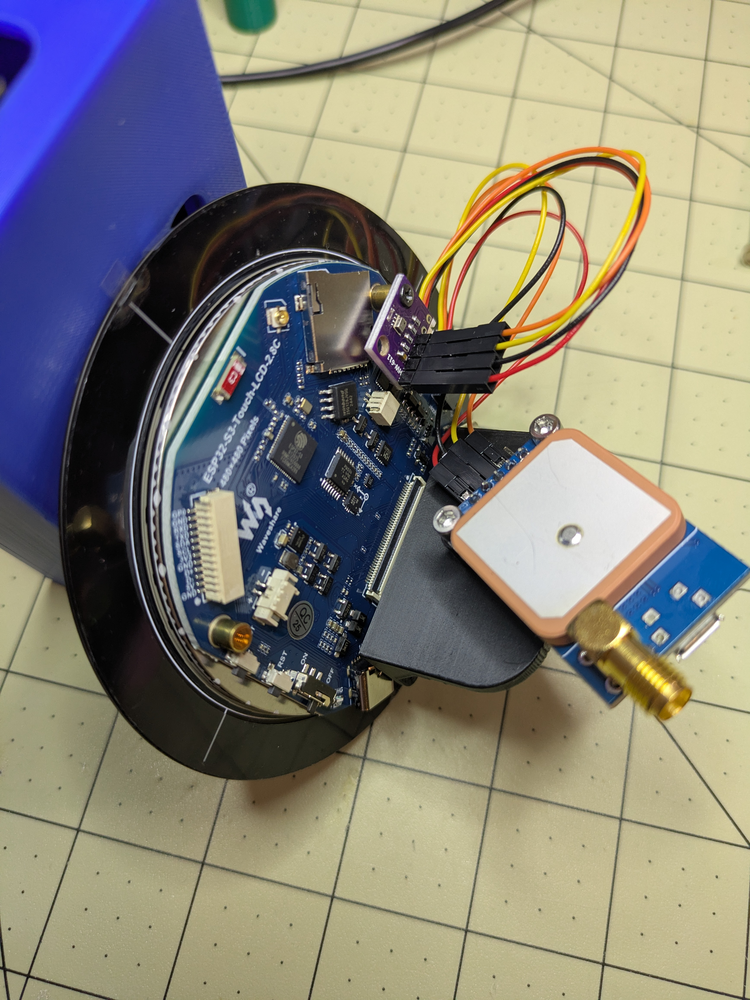
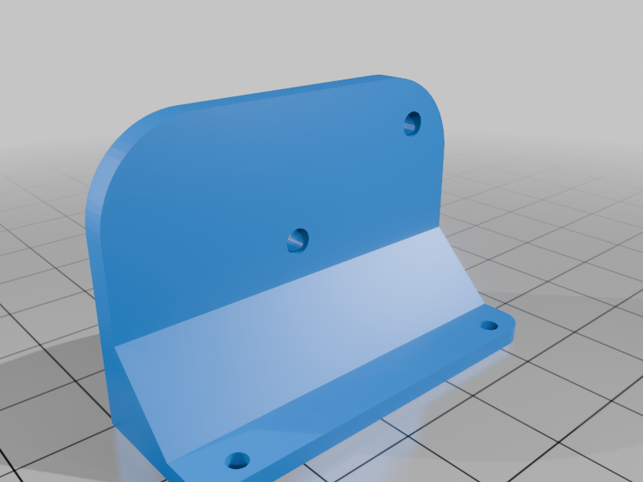
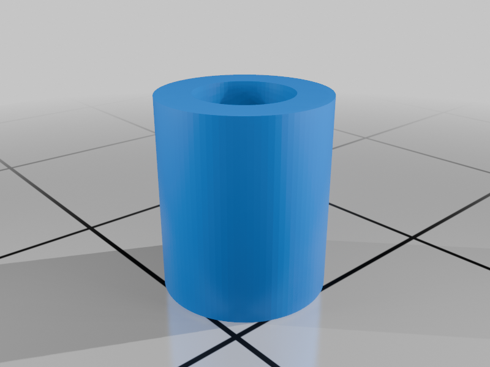
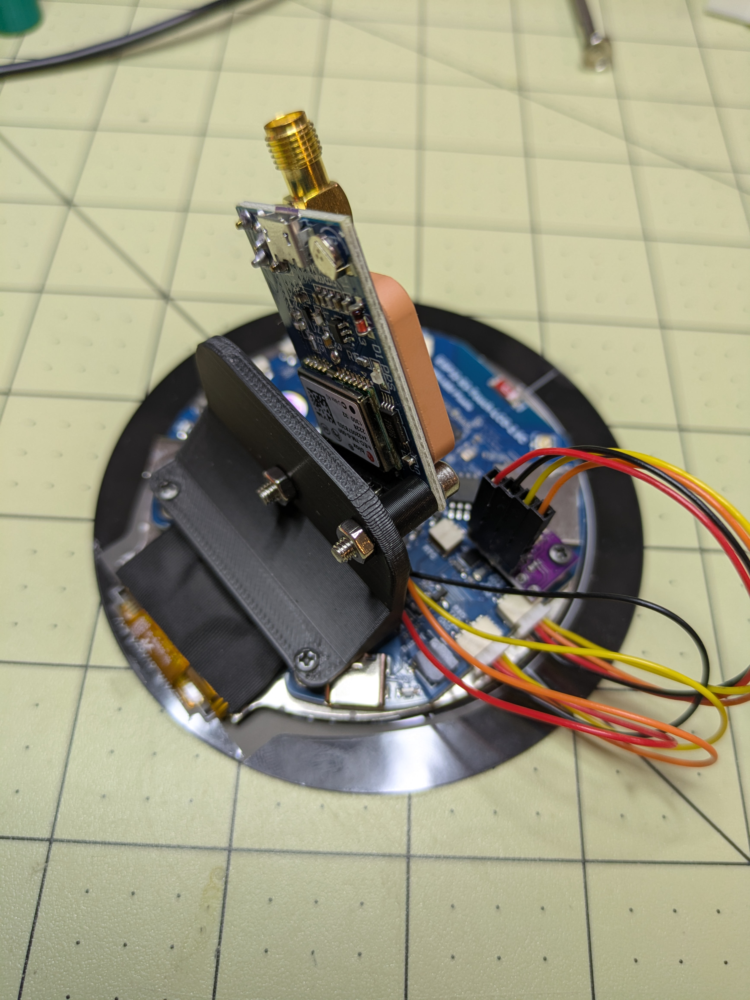
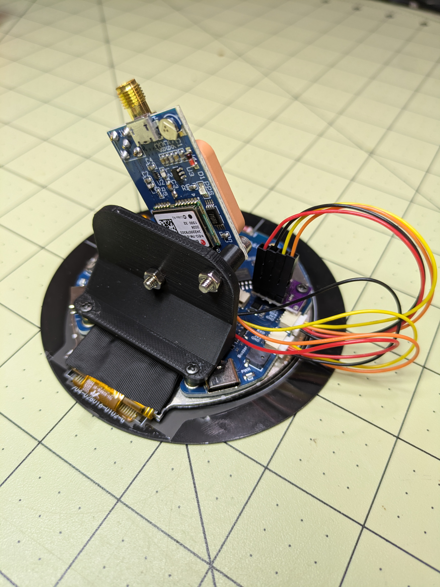
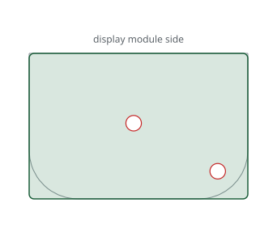

# RB-02 Avionics GPS mount V2.

| | |
|---|---|
| Thingiverse | [thing:7169108](https://www.thingiverse.com/thing:7169108) |
| Author | SeeCoryRun |
| License | Creative Commons - Attribution - Share Alike (CC BY-SA), see [LICENSE.txt](LICENSE.txt) |

> **Printing for an aircraft:** the parts must withstand 100 °C in cruise on long flights. Read [PRINTING.md](../../PRINTING.md) for the materials and the test before printing.

## Description

Small shelf for the ESP32-S3 2.8 inch touch panel running the RB-02 avionics flash. This provides a space to mount the GPS NEO-7M module.

Hardware:

- 2× M3x16 bolts, used with the printed standoffs
- 2× M2x4 screws, to attach the mount to the display module

You can find the full project via: <https://github.com/xiaprojects/rb-esp/wiki#welcome>

<!-- BEGIN parts: generated by tools/import-thing.sh, do not edit by hand -->
## Parts

| File | Size | Preview |
|---|---:|---|
| [GPSmountN7v1.stl](files/GPSmountN7v1.stl) | 183 KB |  |
| [GPSstandoffV2.stl](files/GPSstandoffV2.stl) | 289 KB |  |

## Photos

<!-- END parts -->

<!-- BEGIN kicad: generated by tools/kicad_templates.py, do not edit by hand -->
## KiCad board template

A KiCad project as the starting point for your own electronics.

[kicad/rb02-gps-shelf-board/rb02-gps-shelf-board.kicad_pro](kicad/rb02-gps-shelf-board/rb02-gps-shelf-board.kicad_pro): A 45 x 30 mm board in place of the NEO-7M module on SeeCoryRun's GPS shelf, two M3 bolts.

- Seen from above the shelf; the display module is along the top edge.
- The board stands 7 mm above the shelf on the printed standoffs, held by two M3x16 bolts.
- Outline = the shelf plate; the board may overhang it where the case allows.
- Derived from the GPS mount V2 by SeeCoryRun: CC BY-SA, keep the credit.

<!-- END kicad -->
