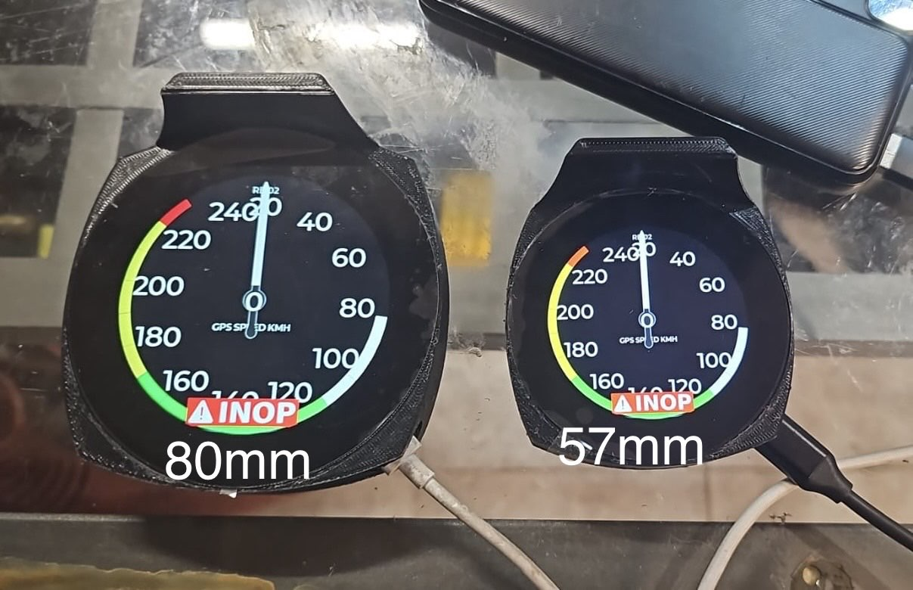
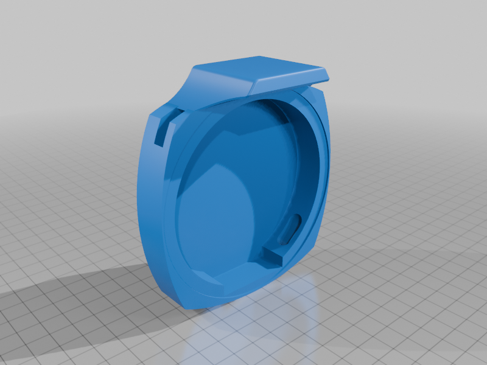
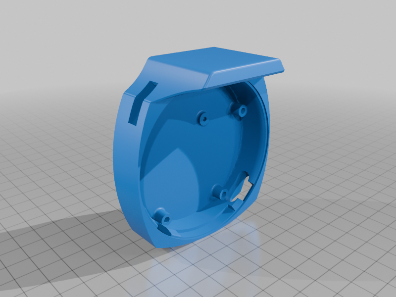
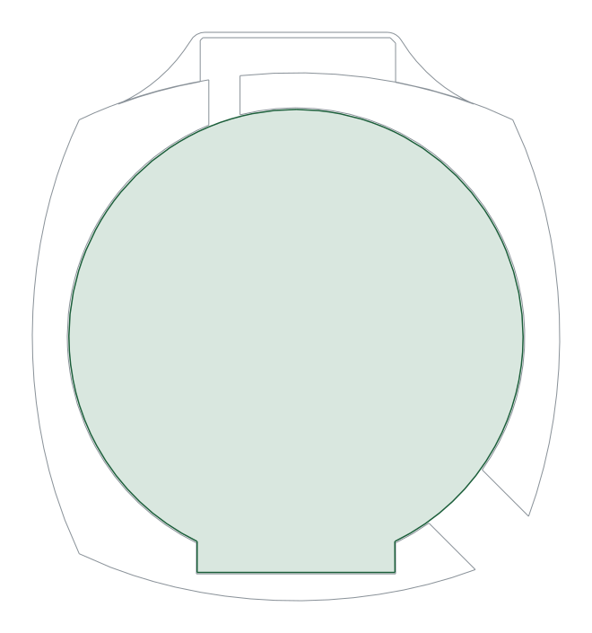
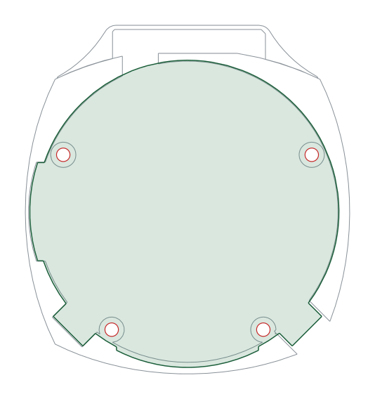

# RB-02 Parrot GPS Avionics SixPack Box 80mm

| | |
|---|---|
| Thingiverse | [thing:7208654](https://www.thingiverse.com/thing:7208654) |
| Author | XIAPROJECTS |
| License | Free for personal use; commercial use requires an agreement, see [LICENSE.md](../../LICENSE.md) |

> **Printing for an aircraft:** the parts must withstand 100 °C in cruise on long flights. Read [PRINTING.md](../../PRINTING.md) for the materials and the test before printing.

## Description

Parrot version of the RB-02 with front install and GPS holder.

RB-02 is the new Touch Screen Avionics for Experimental and Ultralight aircraft.

You can follow the build tutorial here: <https://github.com/xiaprojects/rb-esp/wiki>

To have commercial license send a private message.

<!-- BEGIN parts: generated by tools/import-thing.sh, do not edit by hand -->
## Parts

| File | Size | Preview |
|---|---:|---|
| [RB02B_-_1.02_-_80mm.stl](files/RB02B_-_1.02_-_80mm.stl) | 3.6 MB |  |
| [RB02B_-_2.1_-_57mm.stl](files/RB02B_-_2.1_-_57mm.stl) | 9.5 MB |  |

## Photos

<!-- END parts -->

<!-- BEGIN kicad: generated by tools/kicad_templates.py, do not edit by hand -->
## KiCad board templates

One KiCad project per board, each a starting point for your own electronics.

### RB-02 Parrot GPS 80 mm: display board

[kicad/rb02-parrot-80mm/rb02-parrot-80mm.kicad_pro](kicad/rb02-parrot-80mm/rb02-parrot-80mm.kicad_pro): A board in place of the display module PCB inside the 80 mm shell; the shell has no screw bosses.

- Seen from the front; the F side faces the display glass.
- Outline = the shell wall measured near its rim, 0.3 mm inside it.
- The display module PCB sits here: a custom board of this outline replaces it or stacks behind it.
- No screw bosses: hold the board like the display module, or glue in standoffs.
- Dwgs.User shows the shell cut 0.5 mm behind the plane where the display PCB sits; the GPS hood is above the top edge.

### RB-02 Parrot GPS 57 mm: display board

[kicad/rb02-parrot-57mm/rb02-parrot-57mm.kicad_pro](kicad/rb02-parrot-57mm/rb02-parrot-57mm.kicad_pro): A board in place of the display module PCB inside the 57 mm shell, on the four M3 bosses.

- Seen from the front; the F side faces the display glass.
- Outline = the shell wall measured near its rim, 0.3 mm inside it.
- The display module PCB sits here: a custom board of this outline replaces it or stacks behind it.
- The four bosses take M3 screws (2.8-3 mm printed pilots).
- Dwgs.User shows the shell cut 0.5 mm behind the plane where the display PCB sits; the GPS hood is above the top edge.

<!-- END kicad -->
