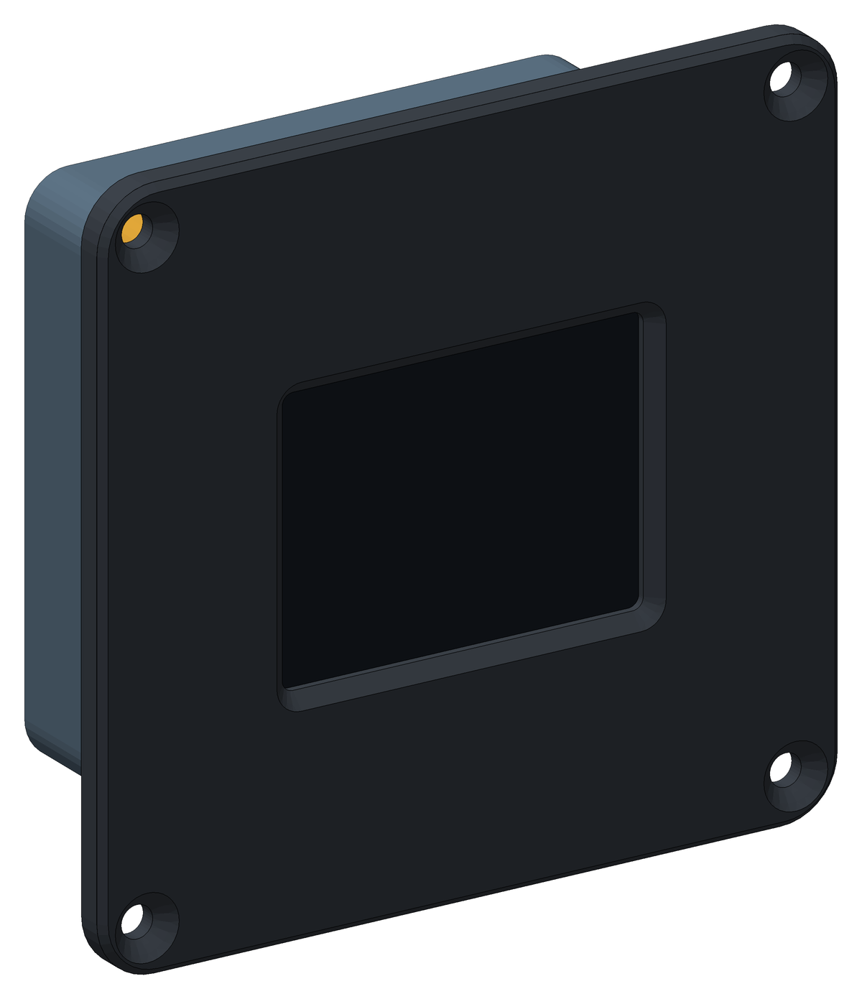
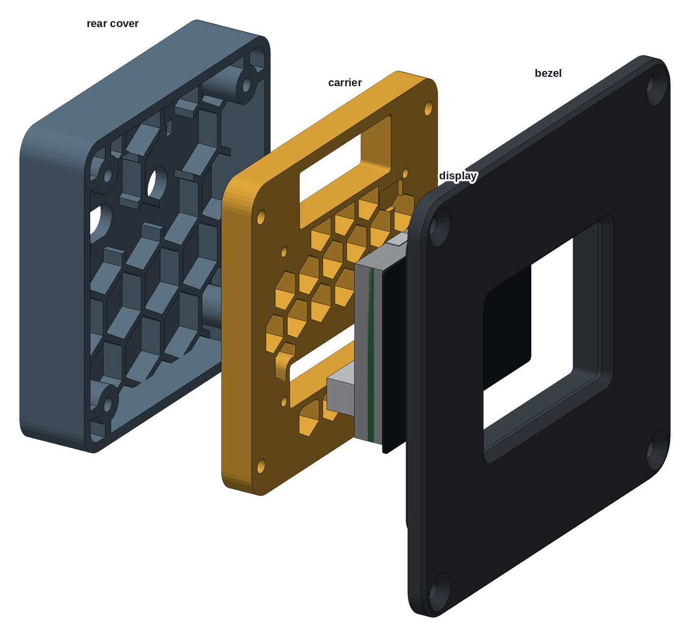
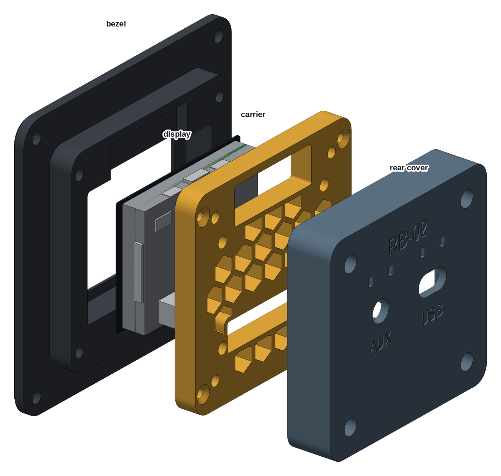
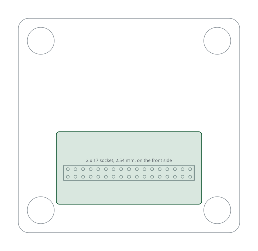

# Printed case, Waveshare ESP32-S3 AMOLED 2.41"

A 3D-printed case for the Waveshare ESP32-S3-Touch-AMOLED-2.41, a 600 × 450
AMOLED touch display with its own ESP32-S3, mounted in landscape. It is the
RB-06 [8" printed case](../../RB-06/printed-case-waveshare-8/) cut to this
small board, without a Raspberry Pi: the case slides into the instrument
panel from the front and is held by four screws through the bezel. Three
parts, printed without supports:

- **Bezel:** holds the lens and screws to the panel, with a plug bay above
  the display.
- **Carrier:** a honeycomb plate screwed to the four standoffs of the
  display board, so the board hangs from it.
- **Rear cover:** closes the case and carries the cable holes.

| | |
|---|---|
| Author | RB-Avionics |
| License | Free for personal use; commercial use requires an agreement, see [LICENSE.md](../../LICENSE.md) |
| Display | [Waveshare ESP32-S3-Touch-AMOLED-2.41](https://docs.waveshare.com/ESP32-S3-Touch-AMOLED-2.41): 61.6 × 44.7 mm lens, USB-C, onboard QMI8658 IMU |
| Computer | the ESP32-S3 on the display board |
| Depth | 38.1 mm from the bezel front, 33.6 mm behind the front face of the panel |
| Material | PC or PA-CF for an aircraft, see [PRINTING.md](../../PRINTING.md) |
| Units | millimetres |

> **Printing for an aircraft:** the case must withstand 100 °C in cruise on
> long flights. Print it in PC or PA-CF, never PLA, PETG, ABS or ASA, and run
> the oven test first: read [PRINTING.md](../../PRINTING.md).

## Design

- **Measured from Waveshare's drawing** of the board
  (`Dimension_Appearance_Diagram.zip` on its documentation page); there is no
  3D model. The display mass, 30 g, is an estimate.
- **The board hangs from the carrier.** Its four M2 standoffs, 3.5 mm tall,
  take M2 screws through the carrier, and the bezel clamps the lens on foam
  in front. No foam on the back.
- **A plug bay above the display.** The USB-C and the two 4-pin connectors
  face up from the top edge of the board. The bezel skirt and the carrier are
  open above them, with 12 mm of room: use an angled USB-C plug. The 2 × 17
  GPIO header faces back through an opening in the carrier, with room for a
  plug or a board on it.
- **No AHRS plane.** The board has its own 6-axis IMU, and it is screwed to
  the carrier, which is screwed to the bezel.
- A script checks the parts against blocks for the board, its connectors and
  the room their plugs need.

The rb-esp firmware does not list this board yet; its round sibling, the
[1.75" AMOLED](../round-case-amoled-1-75/), is supported.

## What goes where

Directions are as seen from the front.

| Item | Where |
|---|---|
| Display | lens down in the bezel pocket, the USB-C and the 4-pin connectors on the top edge, the GPIO header low on the back |
| Back holes | USB, a 14 × 8 mm slot for the USB-C cable; AUX, 8.2 mm, for an M8 cable gland and the wires of the 4-pin connectors. Each has a tie-wrap pair above it, and the labels are engraved on the back |

## Cables

- **Power and data:** 5 V into the USB-C, with an angled plug, out through
  the USB slot.
- **Sensors and serial:** the two 4-pin connectors on the top edge, out
  through the AUX gland.

## Assembly

1. Print the three parts. Before going on, check that the display drops
   into the bezel pocket.
2. Press in the heat-set inserts listed under Hardware: M3 in the back face
   of the bezel skirt and in the back of the carrier corners.
3. Stick 3 mm foam tape on the bezel lip round the window, 2 mm outside its
   edge.
4. Lay the bezel face down on a soft cloth and put the display in, lens
   down, the USB-C towards the plug bay.
5. Lay the carrier on the board, front face down. Drive the 4 × M2 screws
   into the board's standoffs, then the M3 flat head screws into the bezel
   crosswise.
6. Plug the USB-C and the 4-pin cables in through the carrier opening and
   pass them through the back holes; tie each one at its tie-wrap pair.
7. Close the rear cover on the carrier. Its 4 × M3 × 10 socket head screws
   go down the columns, driven with a 2.5 mm hex key.
8. Cut the panel from the DXF below, slide the case in from the front, and
   fix the bezel with the M4 flat head screws and nylon-insert lock nuts.

## Changing the case

The case is generated with FreeCAD by [tools/display_cases.py](../../tools/display_cases.py)
from the dimensions in [tools/display_case_layouts.py](../../tools/display_case_layouts.py).
Rebuild from the repo root with
`RB_ONLY=RB-02/printed-case-amoled-2-41 freecad.cmd tools/display_cases.py`,
then the GPIO board template with
`RB_ONLY=RB-02/printed-case-amoled-2-41 python3 tools/kicad_templates.py`.
The FreeCAD model in `files/` is the assembled case for viewing and measuring;
edit the scripts, not the model.

<!-- BEGIN parts: generated by tools/display_cases.py, do not edit by hand -->
## Parts

| Part | On the bed | Size on the bed (mm) | Mass in PC | File |
|---|---|---|---:|---|
| Bezel | front face down | 104 × 102 × 13 | 73 g | [rb02-amoled241-bezel.stl](files/rb02-amoled241-bezel.stl) (267 KB) |
| Carrier | front face down | 78 × 76 × 8 | 34 g | [rb02-amoled241-carrier.stl](files/rb02-amoled241-carrier.stl) (376 KB) |
| Rear cover | back face down | 78 × 76 × 17 | 41 g | [rb02-amoled241-rear-cover.stl](files/rb02-amoled241-rear-cover.stl) (545 KB) |

The parts print without supports, placed as exported. The bezel needs a bed of at least 107 × 105 mm. Masses are for solid polycarbonate; the honeycomb is already thin solid walls (1.6 mm, four 0.4 mm lines): 22 cells in the carrier.

## Hardware

| Item | Qty | Where |
|---|---:|---|
| M3 heat-set insert, 5.7 mm long, for a 4 mm hole | 8 | bezel skirt (4), carrier corners (4) |
| M3 × 12 flat head, ISO 10642 | 4 | carrier to bezel |
| M3 × 10 socket head, ISO 4762 | 4 | rear cover to carrier, inside the columns (2.5 mm hex key) |
| M2 × 8 socket or pan head | 4 | carrier to the standoffs of the display board |
| M4 × 12 flat head, ISO 10642 (or #8), with nylon-insert lock nuts | 4 | bezel to the panel, up to 3 mm of panel |
| Closed-cell foam tape, 1 mm, silicone or EPDM rated above 100 °C | 0.2 m × 3 mm | on the bezel lip round the window |
| Tie-wraps, 2.5 mm, heat-stabilised, rated 105 °C | 6 to 10 | cables at the back holes |

## Panel cut-out

79.36 × 77 mm with 6.5 mm corners, and 4 holes of 4.4 mm at x = ±45.7, z = ±44.5 mm from the centre of the cut-out. The case slides in from the front and the bezel (104.36 × 102 mm) covers the edge. Drawing 1:1, layers CUT and BEZEL: [rb02-amoled241-panel-cutout.dxf](files/rb02-amoled241-panel-cutout.dxf)

## Load check, -3 to +6 G

Static loads for the whole unit, 198 g: display 30 g, printed parts 148 g in PC, 20 g for cables. Every load is taken as if it acted in the worst direction for that part.

| | +6 G | -3 G |
|---|---:|---:|
| Unit weight × G | 12 N | 6 N |
| Shear on each M4 panel screw | 2.9 N | 1.5 N |
| Pull on each screw of the top or bottom row, from the overhang behind the panel | 0.7 N | 0.4 N |
| Display on the bezel pocket wall | 2 N | 1 N |
| Pull on each carrier insert, display pushed back | 0.9 N | 0.5 N |

Each load is a few newtons, against the hundreds of newtons an M3 heat-set insert holds and the tens of MPa printed PC or PA-CF takes across its layers at 100 °C. Shock and vibration are what remain: the display is clamped on foam by the bezel and screwed to the carrier by its own standoffs, every screw goes into brass or into the board's own standoffs, and the cables are tied at the back holes so their plugs carry no load.

FreeCAD model, assembled, with reference blocks for the display: [rb02-amoled241-case.FCStd](files/rb02-amoled241-case.FCStd)
<!-- END parts -->

<!-- BEGIN kicad: generated by tools/kicad_templates.py, do not edit by hand -->
## KiCad board template

A KiCad project as the starting point for your own electronics.

[kicad/rb02-amoled241-gpio-board/rb02-amoled241-gpio-board.kicad_pro](kicad/rb02-amoled241-gpio-board/rb02-amoled241-gpio-board.kicad_pro): A 48 x 24 mm board on the 2 x 17 GPIO header, inside the rear cover.

- Seen from behind, the component side; up is up on the instrument.
- Put a 2 x 17, 2.54 mm socket on the front side, on the pins drawn on Dwgs.User: the board plugs onto the display's GPIO header through the carrier.
- With an 8.5 mm socket, parts up to 8 mm tall clear the rear cover ribs.
- Outline = the room inside the rear cover below its back holes, clear of the screw columns (drawn on Dwgs.User with the inside of the cover).
- No mounting holes: the socket holds the board, and the rear cover keeps it from backing off.

<!-- END kicad -->
