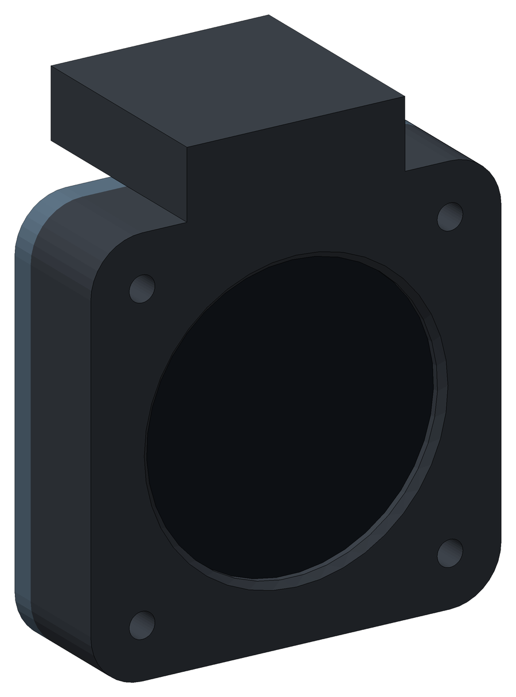
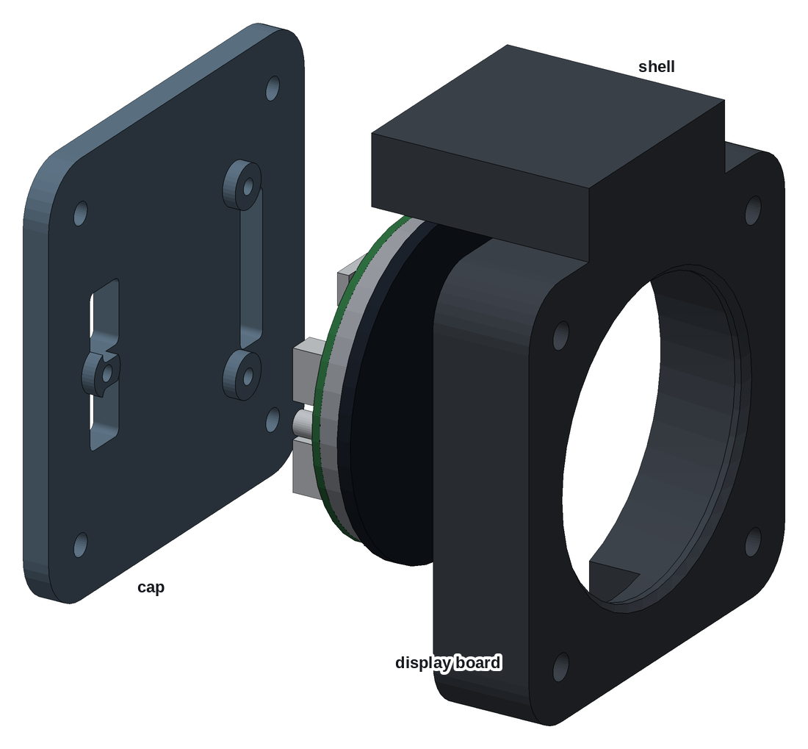
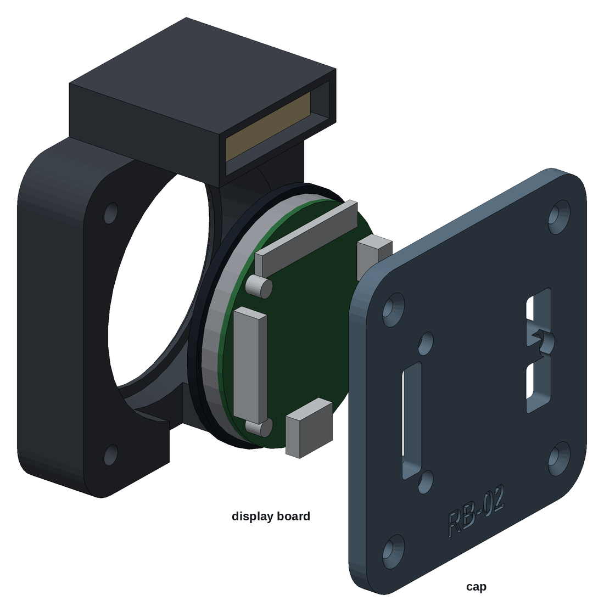

# Round case 57 mm, Waveshare ESP32-S3 AMOLED 1.75"

A 3D-printed RB-02 instrument for the standard 57 mm (2¼") panel hole, with
the Waveshare ESP32-S3-Touch-AMOLED-1.75, a round 466 × 466 AMOLED touch
display with its own ESP32-S3. Like the
[SixPack Box Compact Edition](../sixpack-box-57mm-80mm-compact-edition-7228713/),
it sits behind the panel, held by four screws through the panel, with a GPS
hood on top. Two parts, printed without supports:

- **Shell:** holds the glass behind its lip, takes the panel screws, and
  carries the GPS hood.
- **Cap:** closes the back and holds the display board on its own standoffs.

| | |
|---|---|
| Author | RB-Avionics |
| License | Free for personal use; commercial use requires an agreement, see [LICENSE.md](../../LICENSE.md) |
| Display | [Waveshare ESP32-S3-Touch-AMOLED-1.75](https://docs.waveshare.com/ESP32-S3-Touch-AMOLED-1.75): Ø49 mm glass, USB-C, onboard QMI8658 IMU; the -G version adds a GPS module and a ceramic antenna |
| Computer | the ESP32-S3 on the display board, rb-esp firmware |
| Depth | 19 mm behind the panel, 34 mm at the GPS hood |
| Material | PC or PA-CF for an aircraft, see [PRINTING.md](../../PRINTING.md) |
| Units | millimetres |

> **Printing for an aircraft:** the case must withstand 100 °C in cruise on
> long flights. Print it in PC or PA-CF, never PLA, PETG, ABS or ASA, and run
> the oven test first: read [PRINTING.md](../../PRINTING.md).

## Design

- **Measured from Waveshare's 3D model** and drawing of the board (both in
  `ESP32-S3-Touch-AMOLED-1.75-3D.zip` on its documentation page). The display
  mass, 25 g, is an estimate.
- **Behind the panel.** The 64 × 64 mm shell sits on the back of the panel,
  its front face against it. Four M3 screws go through the panel into
  heat-set inserts in the shell, on the 48 mm square that the RB-Cockpits
  panels use for 57 mm instruments; that square comes from a render, so check
  it against your other instruments. The glass shows through the panel hole,
  behind the shell's lip.
- **The board hangs from the cap.** Its three M2 standoffs take M2 screws
  through the cap, and the lip clamps the glass on foam in front.
- **GPS hood.** The -G version comes with a 25 mm ceramic patch on a 28 mm
  board, on an IPEX cable. It lies face up in the hood on top of the shell,
  above the metal of the board, and its cable goes down into the shell
  through a slot. Without the GPS the hood stays empty.
- **Cables.** The USB-C at the bottom of the board plugs in through a slot in
  the bottom of the shell. The 8-pin header and the speaker and battery
  connectors face back, through openings in the cap.
- **No AHRS plane.** The board has its own 6-axis IMU, and it is screwed to
  the cap, which is screwed to the shell.
- A script checks the parts against blocks for the board, its connectors,
  the GPS antenna and the room their plugs need, and the parts were checked
  against Waveshare's model of the board.

## Assembly

1. Print the two parts. Before going on, check that the display drops into
   the shell from the back.
2. Press in the heat-set inserts listed under Hardware: four in the front
   face of the shell, four in its back face.
3. Stick 2 mm foam tape on the lip round the window, inside the shell.
4. GPS version: stick the antenna on the floor of the hood with silicone
   foam tape, patch up, and pass its cable through the slot into the shell.
5. Screw the cap to the board's standoffs with the 3 × M2 screws, the
   header in the cap's long opening.
6. Plug the antenna cable into the board's IPEX connector. Put the display
   into the shell, glass first, the USB-C towards the slot at the bottom.
   Screw the cap to the shell with 4 × M3 × 8 flat head screws.
7. Plug the USB-C, the header and the speaker cables.
8. Cut the panel from the DXF below, put the shell on the back of the panel
   with the hood up, and fix it with 4 × M3 screws from the front.

## Changing the case

The case is generated with FreeCAD by [tools/display_cases.py](../../tools/display_cases.py)
from the dimensions in [tools/display_case_layouts.py](../../tools/display_case_layouts.py).
Rebuild from the repo root with
`RB_ONLY=RB-02/round-case-amoled-1-75 freecad.cmd tools/display_cases.py`.
The FreeCAD model in `files/` is the assembled case for viewing and measuring;
edit the scripts, not the model. The shell has no room for a board of your
own, so this design has no KiCad template.

<!-- BEGIN parts: generated by tools/display_cases.py, do not edit by hand -->
## Parts

| Part | On the bed | Size on the bed (mm) | Mass in PC | File |
|---|---|---|---:|---|
| Shell | front face down | 64 × 75 × 34 | 42 g | [rb02-amoled175-shell.stl](files/rb02-amoled175-shell.stl) (167 KB) |
| Cap | back face down | 64 × 64 × 6 | 18 g | [rb02-amoled175-cap.stl](files/rb02-amoled175-cap.stl) (425 KB) |

The parts print without supports, placed as exported. Masses are for solid polycarbonate.

## Hardware

| Item | Qty | Where |
|---|---:|---|
| M3 heat-set insert, 5.7 mm long, for a 4 mm hole | 8 | front face of the shell (4), back face of the shell (4) |
| M3 × 8 pan or flat head, black | 4 | through the panel into the shell, up to 3 mm of panel |
| M3 × 8 flat head, ISO 10642 | 4 | cap to shell |
| M2 × 6 socket or pan head | 3 | cap to the standoffs of the display board |
| Closed-cell foam tape, 1 mm, silicone or EPDM rated above 100 °C | 0.15 m × 2 mm | on the lip round the window |
| Silicone foam tape, rated above 100 °C | a 28 mm square | GPS antenna to the floor of the hood |

## Panel cut-out

A 57.5 mm hole and 4 holes of 3.4 mm on a 48 mm square. The shell goes on the back of the panel and the screws go in from the front. Drawing 1:1, layers CUT and BODY (the shell outline behind the panel): [rb02-amoled175-panel-cutout.dxf](files/rb02-amoled175-panel-cutout.dxf)

## Load check, -3 to +6 G

Static loads for the whole unit, 105 g: display board 25 g, printed parts 60 g in PC, 20 g for cables and the GPS antenna.

| | +6 G | -3 G |
|---|---:|---:|
| Unit weight × G | 6.2 N | 3.1 N |
| Shear on each M3 panel screw | 1.55 N | 0.77 N |
| Pull on each panel insert, from the overhang behind the panel | 0.77 N | 0.39 N |

Every load is a newton or two per screw, against the hundreds of newtons an M3 heat-set insert holds. The display is clamped on foam between the lip and the cap, which holds the board by its own standoffs.

FreeCAD model, assembled, with reference blocks for the display board, its plugs and the GPS antenna: [rb02-amoled175-case.FCStd](files/rb02-amoled175-case.FCStd)
<!-- END parts -->
