# RB-02 Avionics SixPack Box 80mm

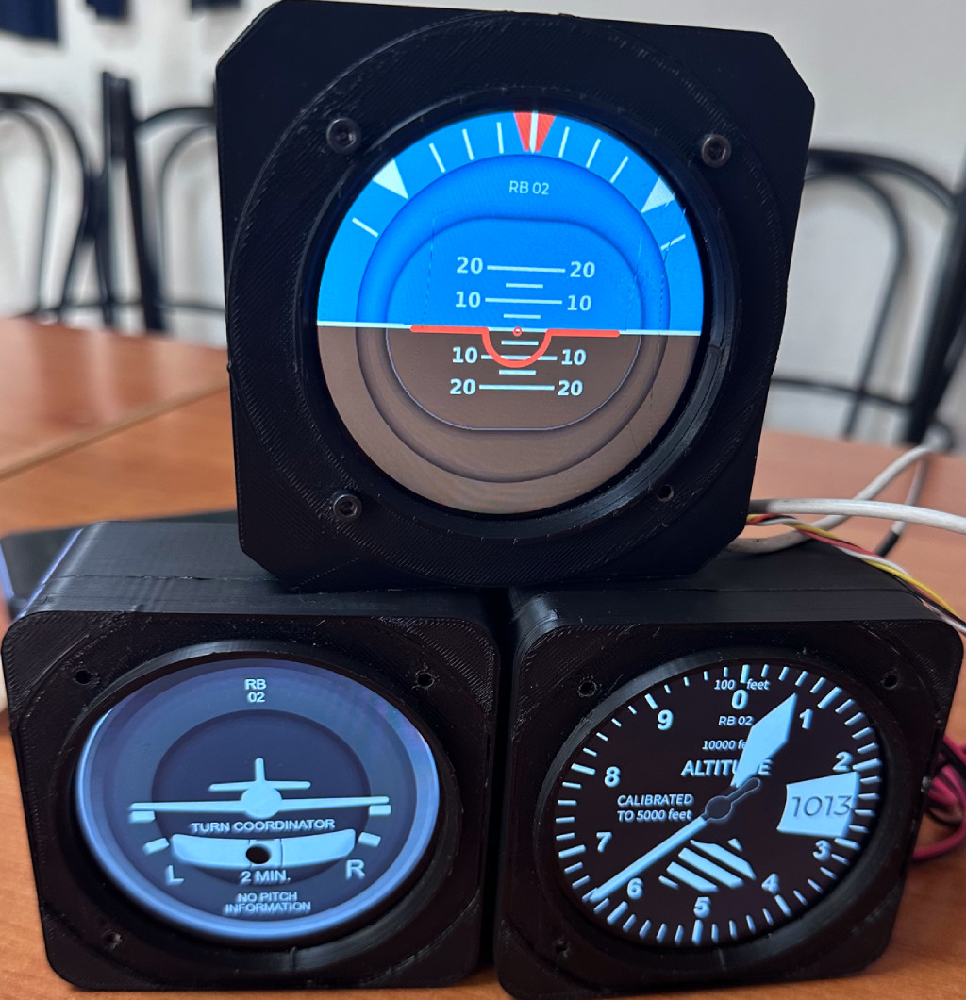

| | |
|---|---|
| Thingiverse | [thing:7088576](https://www.thingiverse.com/thing:7088576) |
| Author | XIAPROJECTS |
| License | Free for personal use; commercial use requires an agreement, see [LICENSE.md](../../LICENSE.md) |

> **Printing for an aircraft:** the parts must withstand 100 °C in cruise on long flights. Read [PRINTING.md](../../PRINTING.md) for the materials and the test before printing.

## Description

RB-02 is the new Touch Screen Avionics for Experimental and Ultralight aircraft.

You can follow the build tutorial here: <https://github.com/xiaprojects/rb-esp/wiki>

To have commercial license send a private message.

<!-- BEGIN parts: generated by tools/import-thing.sh, do not edit by hand -->
## Parts

| File | Size | Preview |
|---|---:|---|
| [RB02.02_Power_Cup_Meshed.stl](files/RB02.02_Power_Cup_Meshed.stl) | 129 KB | 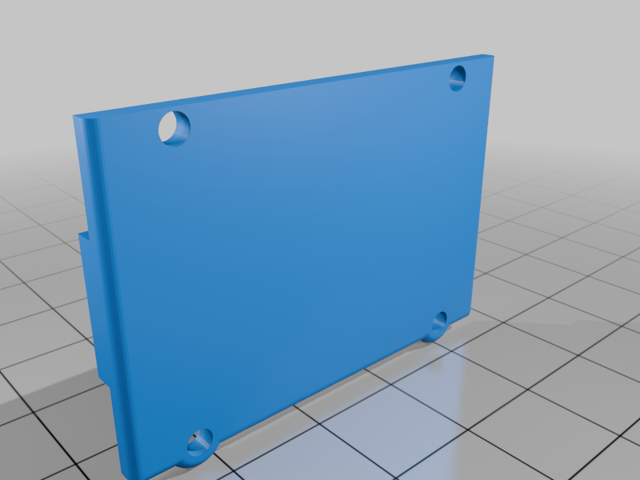 |
| [RB02B_Front_Meshed.stl](files/RB02B_Front_Meshed.stl) | 150 KB | 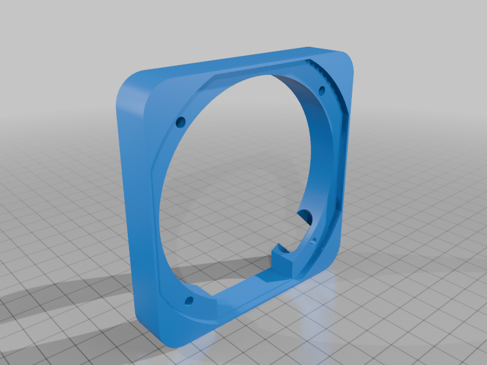 |
| [RB02B_Rear_GPS_-_2_Meshed.stl](files/RB02B_Rear_GPS_-_2_Meshed.stl) | 86 KB | 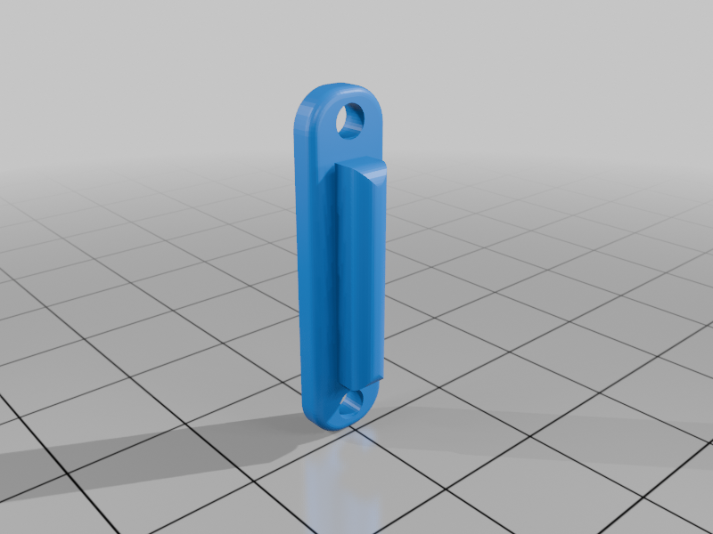 |
| [RB02B_Rear_GPS_Meshed.stl](files/RB02B_Rear_GPS_Meshed.stl) | 328 KB | 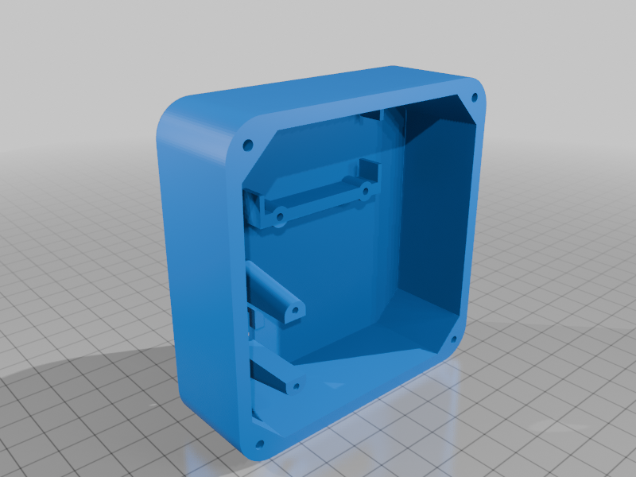 |
| [RB02B_Rear_Meshed.stl](files/RB02B_Rear_Meshed.stl) | 311 KB | 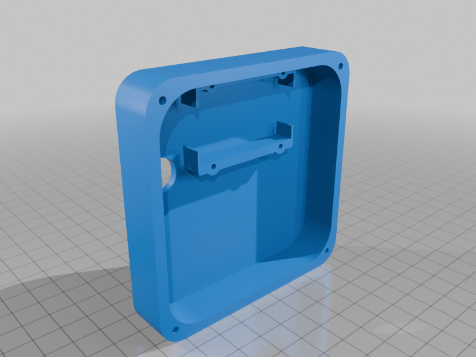 |
| [RB2B_Monitor_Template_Meshed.stl](files/RB2B_Monitor_Template_Meshed.stl) | 63 KB | 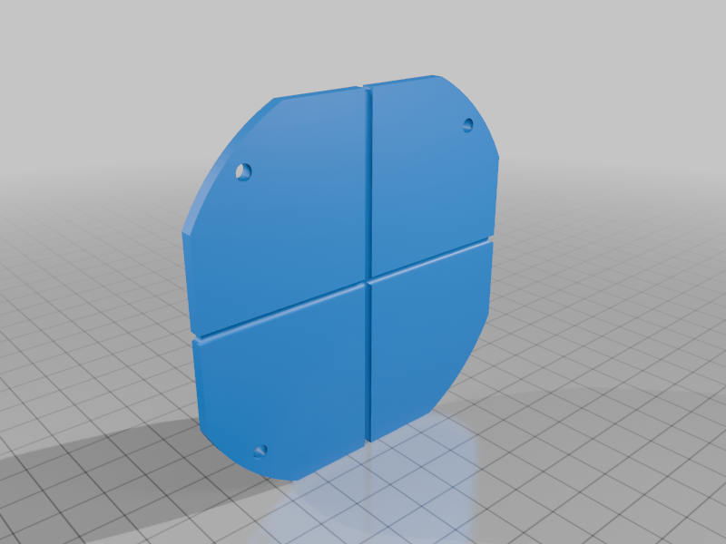 |
| [RB2B_Ring_Meshed.stl](files/RB2B_Ring_Meshed.stl) | 190 KB | 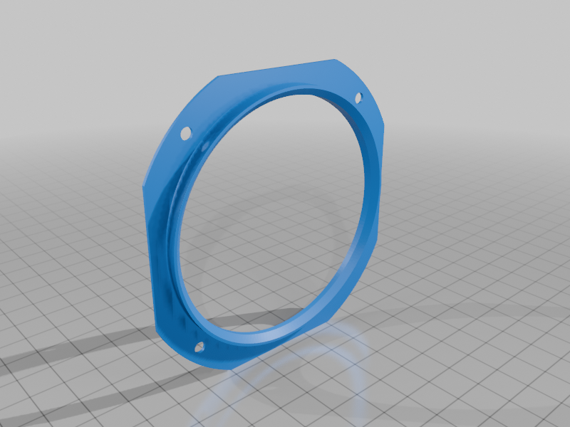 |

## Photos

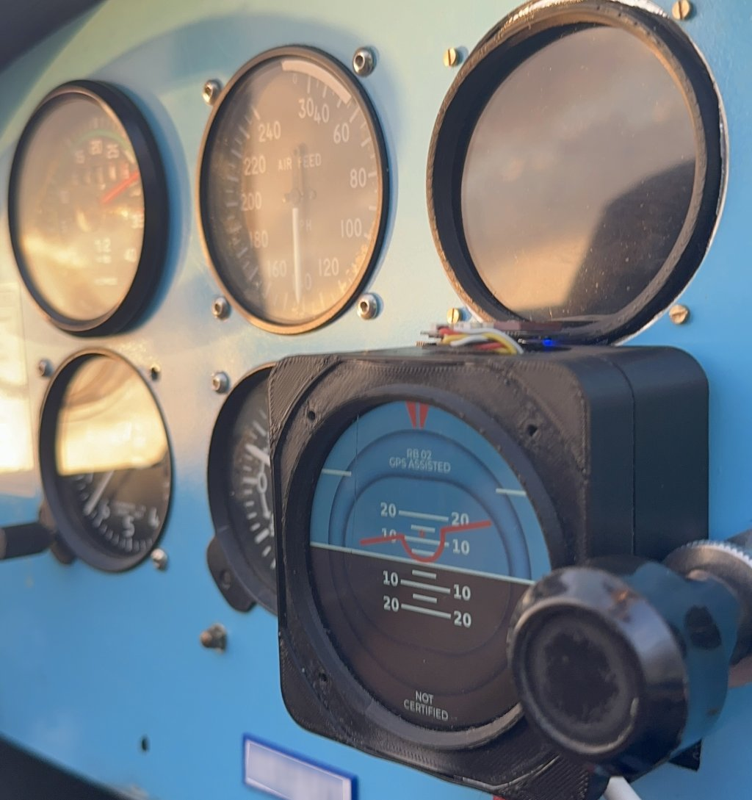
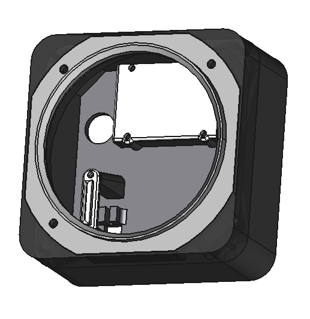
<!-- END parts -->

<!-- BEGIN kicad: generated by tools/kicad_templates.py, do not edit by hand -->
## KiCad board template

A KiCad project as the starting point for your own electronics.

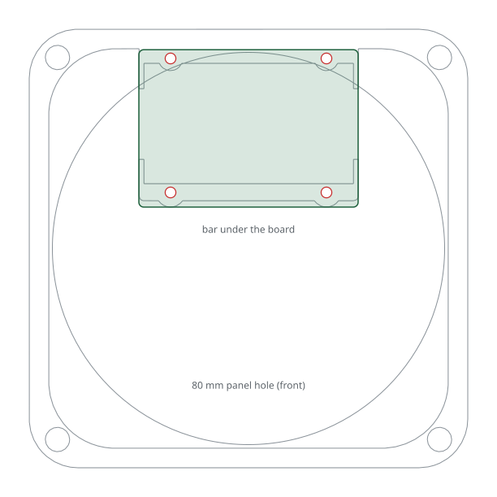

[kicad/rb02-sixpack-module/rb02-sixpack-module.kicad_pro](kicad/rb02-sixpack-module/rb02-sixpack-module.kicad_pro): The module board of the SixPack Box rear: 45 x 32.3 mm on the bar and the top bosses, M2 screws.

- Seen from the front (display side); the F side faces the display.
- The board rests on the bar and the two top bosses of RB02B_Rear, 7 mm below its rim and 8 mm above the back wall; in RB02B_Rear_GPS the same holes are 19 mm below the rim.
- 4 x M2 screws thread into the printed 2 mm pilots.
- The top edge touches the case wall: keep copper 0.5 mm from it.
- Dwgs.User shows the case cut at the board plane.

<!-- END kicad -->
