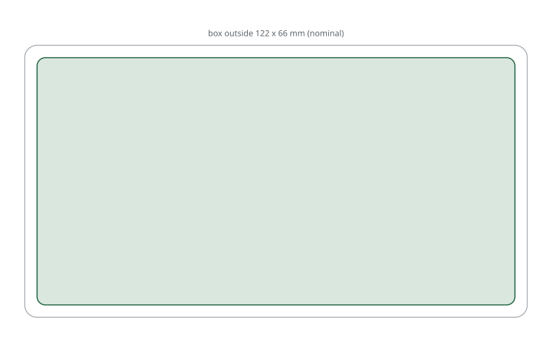

# Aluminium Amazon box

An off-the-shelf aluminium box, 122 × 66 × 39.5 mm. Nothing to print or cut:
buy the box and drill it.

Where to buy: [Amazon.it B0827V5V7N](https://www.amazon.it/dp/B0827V5V7N)

Drill holes for airflow and for the Wi-Fi chip.

## What fits inside

- Raspberry Pi Zero 2W
- USB ↔ RS232 adapter
- 12 V → 5 V converter
- USB GPS VK162
- Nano V2 or V3 RTL-SDR
- 1090 MHz antenna connector

## Build example

[roastbeef wiki, Build example 4: Basic](https://github.com/xiaprojects/roastbeef/wiki/Build-example-4:-Basic)

<!-- BEGIN kicad: generated by tools/kicad_templates.py, do not edit by hand -->
## KiCad board template

A KiCad project as the starting point for your own electronics.

[kicad/rb03-box-board/rb03-box-board.kicad_pro](kicad/rb03-box-board/rb03-box-board.kicad_pro): A 116 x 60 mm carrier board for the 122 x 66 x 39.5 mm aluminium box.

- Seen from above.
- Sized from the nominal outside of the box, not measured: check the wall thickness, the end caps and any PCB slots of your box before ordering.
- No mounting holes: add them where your box has slots or standoffs.
- Contents in the RB-03 build: Pi Zero 2W, USB-RS232, 12 V to 5 V, USB GPS, RTL-SDR, 1090 MHz connector.

<!-- END kicad -->
