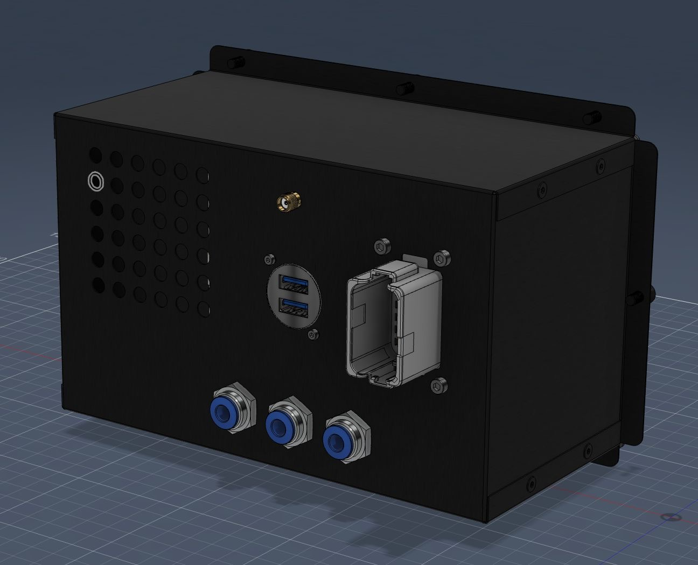
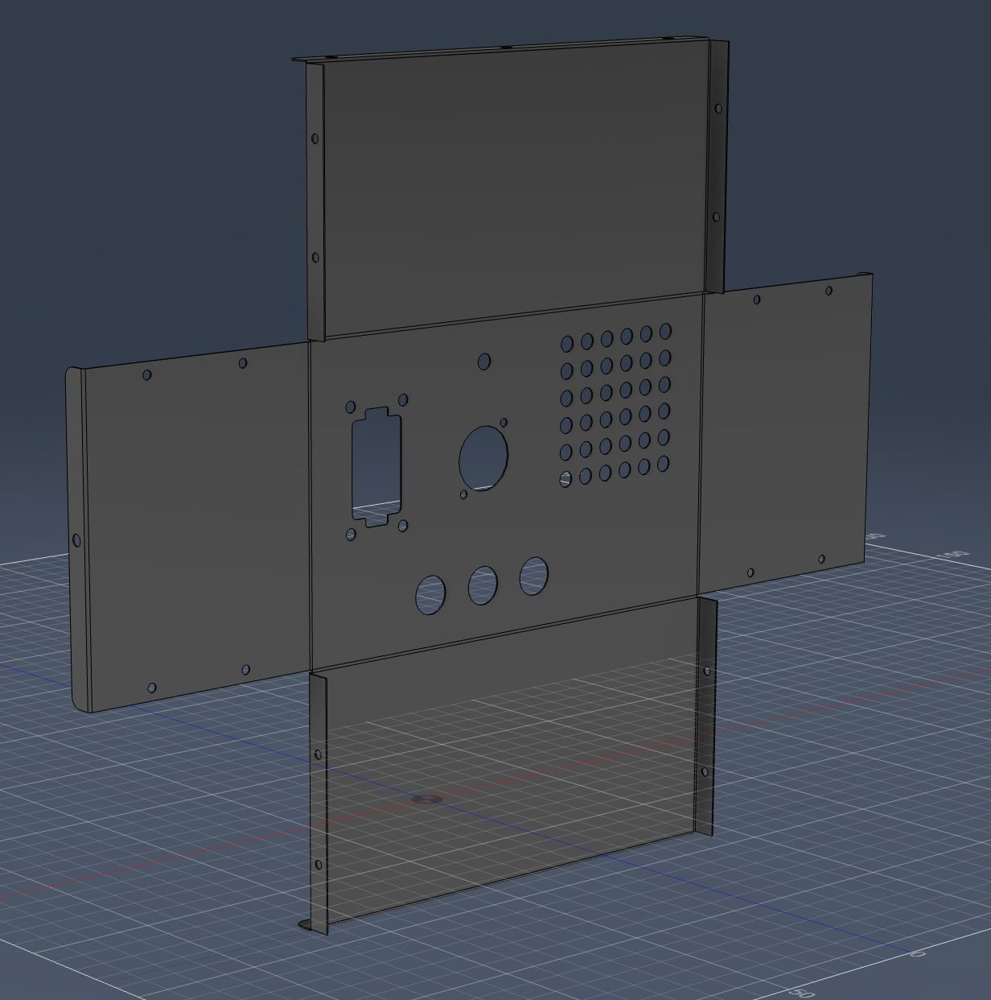
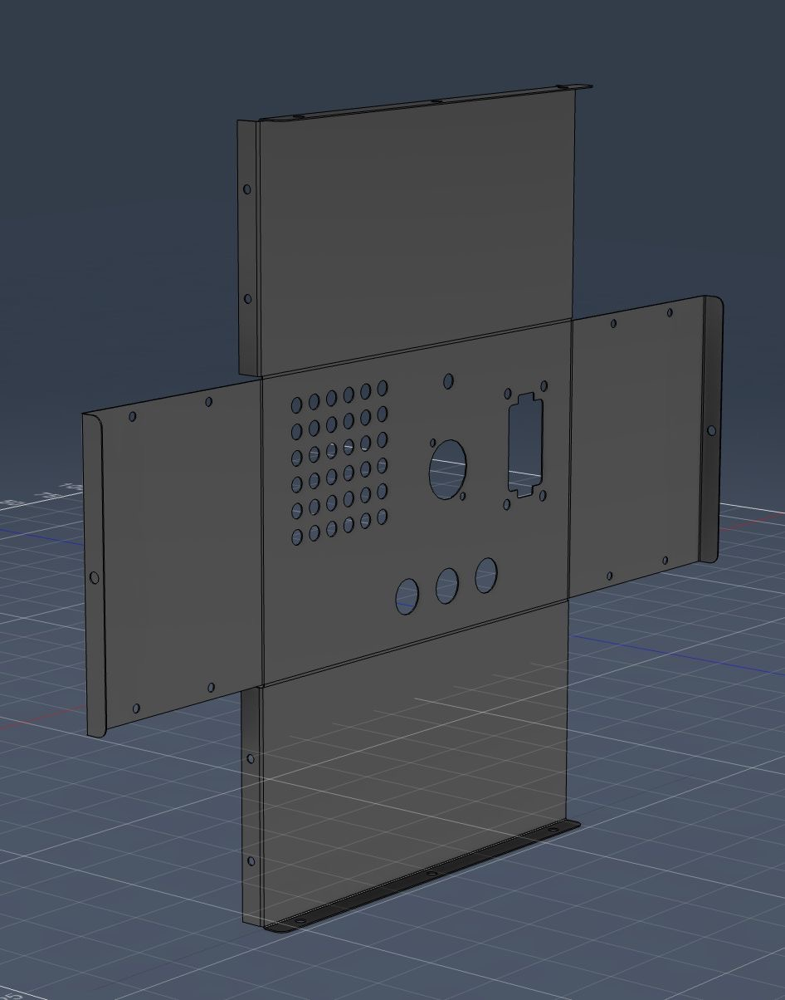
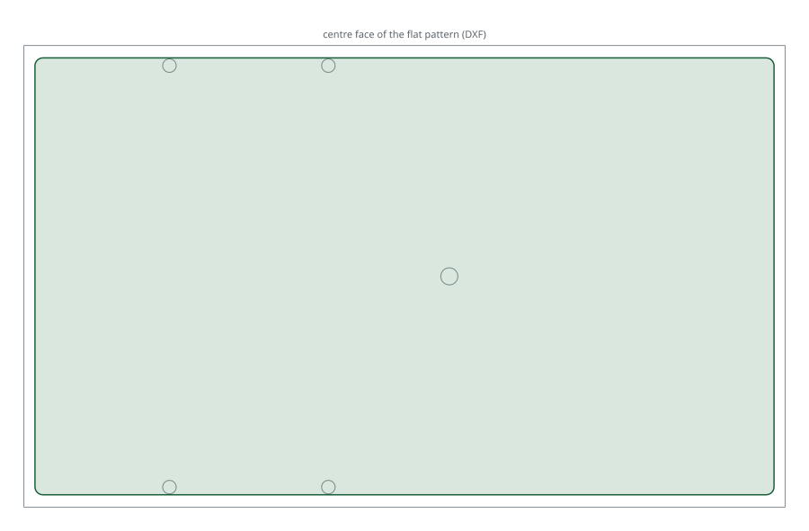

# Aluminium box for Waveshare 8"

Sheet-aluminium enclosure for the RB-06 with an 8" Waveshare display. The DXF
is the flat pattern: cut it from one sheet, then fold it into a box with screw
flanges.

| | |
|---|---|
| Author | Sandro, RB-Avionics team |
| License | Free for personal use; commercial use requires an agreement, see [LICENSE.md](../../LICENSE.md) |
| Sheet thickness | not stated |

## Files

| File | Use |
|---|---|
| [RB_Box_WS8inch_v3.dxf](files/RB_Box_WS8inch_v3.dxf) | Flat pattern for cutting, version 3, millimetres (DXF R14) |

Rear panel cut-outs, as shown in the renders: ventilation grid, SMA antenna
connector, round dual USB socket, rectangular multi-pin connector, three
push-in tube fittings.

## Renders

<!-- BEGIN kicad: generated by tools/kicad_templates.py, do not edit by hand -->
## KiCad board template

A KiCad project as the starting point for your own electronics.

[kicad/rb06-box-board/rb06-box-board.kicad_pro](kicad/rb06-box-board/rb06-box-board.kicad_pro): A 186 x 110 mm board inside the RB-06 box for the 8" Waveshare display, parallel to its back.

- Drawn as the centre face of RB_Box_WS8inch_v3.dxf, 191.6 x 116.3 mm between the bend lines.
- The board keeps 2.8 mm from each side for the sheet thickness, which the DXF does not state.
- No mounting holes: the box has no bosses. Mount the board on the display's standoffs or add rivet nuts.
- The connector cut-outs are not drawn: in the v3 DXF the vent grid and a fitting fall outside the sheet outline, so their positions need checking with the designer first.

<!-- END kicad -->
