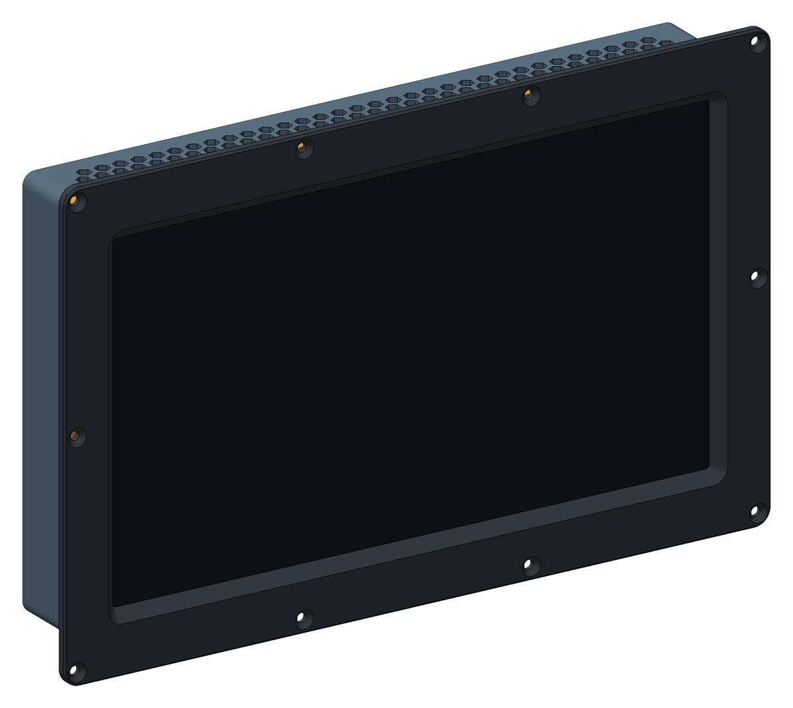
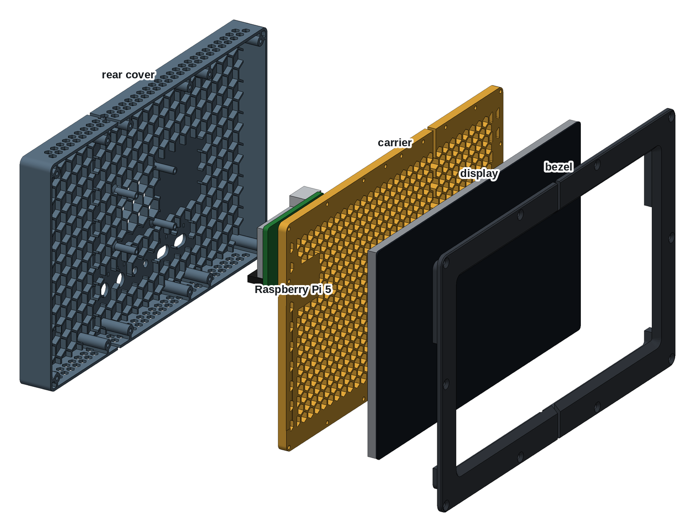
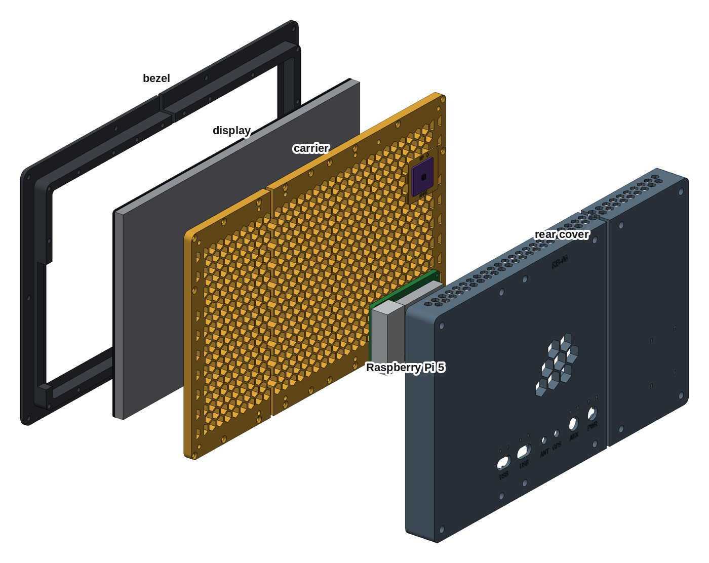
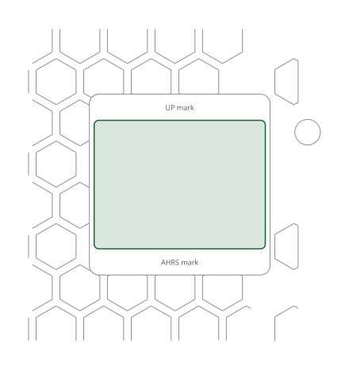

# Printed case, Waveshare 13.3" AMOLED

A 3D-printed case for the RB-06 with the Waveshare 13.3inch FHD AMOLED, a
1920 × 1080 portable touch monitor in its own metal case. It holds the
monitor together with a Raspberry Pi 5 and an AHRS sensor. The case slides
into the instrument panel from the front and is held by ten screws through
the bezel. It is the [8" printed case](../printed-case-waveshare-8/) cut to
this monitor, three parts, each printed in two pieces without supports:

- **Bezel:** holds the glass and screws to the panel.
- **Carrier:** a honeycomb plate that clamps the monitor from behind and
  carries the AHRS plane.
- **Rear cover:** carries the Pi, the cable holes and the vents.

| | |
|---|---|
| Author | RB-Avionics |
| License | Free for personal use; commercial use requires an agreement, see [LICENSE.md](../../LICENSE.md) |
| Display | [Waveshare 13.3inch FHD AMOLED](https://www.waveshare.com/wiki/13.3inch_FHD_AMOLED): 307 × 183 × 10 mm, mini HDMI, two USB-C, on the sides |
| Computer | Raspberry Pi 5 with the Active Cooler |
| Depth | 54.0 mm from the bezel front, 49.5 mm behind the front face of the panel |
| Material | PC or PA-CF for an aircraft, see [PRINTING.md](../../PRINTING.md) |
| Units | millimetres |

> **Printing for an aircraft:** the case must withstand 100 °C in cruise on
> long flights. Print it in PC or PA-CF, never PLA, PETG, ABS or ASA, and run
> the oven test first: read [PRINTING.md](../../PRINTING.md).

> **Check against your monitor first.** Waveshare publishes no 3D model of
> this monitor, only its outline and photos. The case follows the 307 × 183 ×
> 10 mm outline and the visible area of the size drawing; the ports and
> buttons are placed from the photos only. Print the left bezel piece first
> and check the monitor, its ports and its buttons against it.

## Design

The honeycomb, the screws into brass and the shock design are those of the
[8" printed case](../printed-case-waveshare-8/#design). What changes here:

- **The monitor sits deeper.** Its ports are on its 10 mm sides. The glass
  is 6.3 mm behind the bezel face, so the sides of the monitor are behind a
  panel up to 3 mm thick, and the window is bevelled at 45° all the way to
  the glass so the deep lip does not shade the picture.
- **Open sides.** The bezel skirt is open along both sides from 80 mm below
  to 30 mm above the centre, behind the panel: the USB-C ports and the mini
  HDMI on one side and the buttons and the audio jack on the other plug in
  through it. Use 90° adapters, so the cables turn back along the case. The
  speakers, near the top of the sides, stay covered.
- **Six pieces, staggered seams.** No part fits a 256 mm bed in one piece.
  The bezel is cut at the centre, the carrier 60 mm right of it and the rear
  cover 60 mm left of it. Each seam is bridged by the next part with screws
  on both sides: the carrier holds the two bezel halves, the bezel and the
  rear cover hold the two carrier pieces, and the carrier holds the two rear
  cover pieces. The bezel seam shows as a line across the top and bottom of
  the frame.
- **The carrier is a full honeycomb plate** on the flat metal back of the
  monitor. The monitor's VESA holes are not used.
- The display mass, 650 g, is an estimate for a monitor of this size.

## What goes where

Directions are as seen from the front.

| Item | Where |
|---|---|
| Monitor | glass down in the bezel pocket |
| Raspberry Pi 5 | on the rear cover standoffs, component side back so the Active Cooler draws air through the open cells; USB to the right, micro HDMI up |
| AHRS plane | back of the carrier, upper left: a flat pad 1 mm proud of the honeycomb, parallel to the panel, with an UP arrow |
| 5 V converter | lower left on the rear cover ribs, room for 42 × 55 × 18 mm, two tie-wrap pairs to strap it |
| Back holes | PWR and AUX, 12.2 mm, for a GX12 socket or an M12 cable gland; GPS and ANT, 6.5 mm, for SMA bulkheads; two 18 × 10 mm USB slots that pass a USB-A plug. Each cable hole has a tie-wrap pair above it, and the labels are engraved on the back |

## Cables

- **HDMI:** micro HDMI on the Pi (HDMI0, next to the USB-C) to the monitor's
  mini HDMI, with a 90° adapter at the monitor. The cable leaves the case at
  the side, behind the panel, and comes back in through a USB slot.
- **Touch:** USB-A on the Pi to one of the monitor's USB-C, with a 90°
  plug.
- **Monitor power:** 5 V, 3 A to the other USB-C, from the 5 V converter.
- **AHRS:** four wires to the GPIO header, I2C bus 1: 3.3 V pin 1, SDA pin 3,
  SCL pin 5, GND pin 6.
- **Power:** 12 or 24 V in through PWR to a 5 V, 5 A converter, then to the
  Pi's USB-C and the monitor.

## Assembly

1. Print the six pieces. Before going on, check that the monitor drops into
   the bezel pocket and that its ports line up with the side openings.
2. Press in the heat-set inserts listed under Hardware: M3 in the back face
   of the bezel skirt, M3 in the back of the carrier, M2.5 in the rear cover
   standoffs.
3. Lay the two bezel halves face down on a flat table, seam to seam. Stick
   3 mm foam tape on the lip round the window, 2 mm outside its edge, across
   the seam. Stick 5 mm tape on the flat strips round the edge of the
   carrier pieces.
4. Put the monitor in, glass down.
5. Lay the two carrier pieces on the monitor, front face down. Drive the M3
   flat head screws into the bezel crosswise, those next to the bezel seam
   first, until the carrier sits on the skirt.
6. Glue the AHRS board between the marks of the AHRS plane, edges square to
   the arrow, with an epoxy rated above 100 °C.
7. Lay the two rear cover pieces inside up, seam to seam, back holes towards
   you. Put the Pi on the standoffs, component side down, USB ports to the
   right and the micro HDMI edge away from you. Fix it with 4 × M2.5 × 6
   screws from the back of the board.
8. Fit the SMA bulkheads and the GX12 sockets or glands. Strap the 5 V
   converter to its tie-wrap pairs. Pass the outside cables through the back
   holes and tie each one at its tie-wrap pair.
9. Close the rear cover on the carrier with its M3 × 10 socket head screws,
   down the columns, driven with a 2.5 mm hex key.
10. Cut the panel from the DXF below, slide the case in from the front, and
    fix the bezel with the M4 flat head screws and nylon-insert lock nuts.
11. From behind the panel, plug the HDMI and USB-C cables into the side of
    the monitor, then connect them to the Pi through the USB slots.

## AHRS

The AHRS plane is tied to the panel through the carrier and the bezel, and it
stays put when the rear cover comes off. The plane is parallel to the panel,
so the sensor's Z axis points fore and aft. Run the AHRS orientation and
calibration of the RB software with the panel installed. The monitor's metal
case is right in front of the plane: calibrate the magnetometer in place, or
do not rely on magnetic heading.

## Changing the case

The case is generated with FreeCAD by [tools/display_cases.py](../../tools/display_cases.py)
from the dimensions in [tools/display_case_layouts.py](../../tools/display_case_layouts.py).
Rebuild from the repo root with
`RB_ONLY=RB-06/printed-case-waveshare-13-3-amoled freecad.cmd tools/display_cases.py`,
then the AHRS board template with
`RB_ONLY=RB-06/printed-case-waveshare-13-3-amoled python3 tools/kicad_templates.py`.
The FreeCAD model in `files/` is the assembled case for viewing and measuring;
edit the scripts, not the model.

<!-- BEGIN parts: generated by tools/display_cases.py, do not edit by hand -->
## Parts

| Part | On the bed | Size on the bed (mm) | Mass in PC | File |
|---|---|---|---:|---|
| Bezel, left | front face down | 175 × 226 × 17 | 125 g | [rb06-133amoled-bezel-left.stl](files/rb06-133amoled-bezel-left.stl) (320 KB) |
| Bezel, right | front face down | 175 × 226 × 17 | 125 g | [rb06-133amoled-bezel-right.stl](files/rb06-133amoled-bezel-right.stl) (348 KB) |
| Carrier, left | front face down | 222 × 200 × 9 | 201 g | [rb06-133amoled-carrier-left.stl](files/rb06-133amoled-carrier-left.stl) (1.1 MB) |
| Carrier, right | front face down | 102 × 200 × 8 | 95 g | [rb06-133amoled-carrier-right.stl](files/rb06-133amoled-carrier-right.stl) (508 KB) |
| Rear cover, left | back face down | 102 × 200 × 29 | 127 g | [rb06-133amoled-rear-cover-left.stl](files/rb06-133amoled-rear-cover-left.stl) (360 KB) |
| Rear cover, right | back face down | 222 × 200 × 29 | 246 g | [rb06-133amoled-rear-cover-right.stl](files/rb06-133amoled-rear-cover-right.stl) (1.5 MB) |

The parts print without supports, placed as exported. Each part is cut in two to fit the bed; the largest piece needs a bed of at least 225 × 203 mm. Masses are for solid polycarbonate; the honeycomb is already thin solid walls (1.6 mm, four 0.4 mm lines): 564 cells in the carrier, 8 open vent cells in the rear cover over the Pi fan and 130 vents in its top and bottom walls.

## Hardware

| Item | Qty | Where |
|---|---:|---|
| M3 heat-set insert, 5.7 mm long, for a 4 mm hole | 32 | bezel skirt (20), carrier corners (12) |
| M2.5 heat-set insert, 4 mm long, for a 3.6 mm hole | 4 | rear cover standoffs |
| M3 × 12 flat head, ISO 10642 | 20 | carrier to bezel |
| M3 × 10 socket head, ISO 4762 | 12 | rear cover to carrier, inside the columns (2.5 mm hex key) |
| M2.5 × 6 pan or socket head | 4 | Raspberry Pi to the standoffs |
| M4 × 12 flat head, ISO 10642 (or #8), with nylon-insert lock nuts | 10 | bezel to the panel, up to 3 mm of panel |
| Closed-cell foam tape, 1 mm, silicone or EPDM rated above 100 °C | 0.9 m × 3 mm, 1.0 m × 5 mm | on the bezel lip round the window; on the carrier's flat strips behind the display |
| Epoxy rated above 100 °C | a few grams | AHRS board on the AHRS plane |
| Tie-wraps, 2.5 mm, heat-stabilised, rated 105 °C | 6 to 10 | cables at the back holes, 5 V converter |

## Panel cut-out

324.8 × 200.8 mm with 6.5 mm corners, and 10 holes of 4.4 mm at x = ±168.4 and ±56.1, z = ±106.4 and 0 mm from the centre of the cut-out. The case slides in from the front and the bezel (349.8 × 225.8 mm) covers the edge. Drawing 1:1, layers CUT and BEZEL: [rb06-133amoled-panel-cutout.dxf](files/rb06-133amoled-panel-cutout.dxf)

## Load check, -3 to +6 G

Static loads for the whole unit, 1741 g: display 650 g, Pi 5 with cooler 70 g, printed parts 921 g in PC, 100 g for cables, AHRS and converter. Every load is taken as if it acted in the worst direction for that part.

| | +6 G | -3 G |
|---|---:|---:|
| Unit weight × G | 102 N | 51 N |
| Shear on each M4 panel screw | 10.2 N | 5.1 N |
| Pull on each screw of the top or bottom row, from the overhang behind the panel | 2.2 N | 1.1 N |
| Display on the bezel pocket wall | 38 N | 19 N |
| Pull on each carrier insert, display pushed back | 2.8 N | 1.4 N |
| Bending at the root of each Pi standoff | 1.0 MPa | 0.5 MPa |

Each load is a few newtons, against the hundreds of newtons an M3 heat-set insert holds and the tens of MPa printed PC or PA-CF takes across its layers at 100 °C. Shock and vibration are what remain: the display is clamped on foam and backed by the honeycomb, every screw goes into brass, and the cables are tied at the back holes so their plugs carry no load.

FreeCAD model, assembled, with reference blocks for the display, the Pi and an AHRS board: [rb06-133amoled-case.FCStd](files/rb06-133amoled-case.FCStd)
<!-- END parts -->

<!-- BEGIN kicad: generated by tools/kicad_templates.py, do not edit by hand -->
## KiCad board template

A KiCad project as the starting point for your own electronics.

[kicad/rb06-133amoled-ahrs-board/rb06-133amoled-ahrs-board.kicad_pro](kicad/rb06-133amoled-ahrs-board/rb06-133amoled-ahrs-board.kicad_pro): A 36 x 27 mm IMU board for the AHRS plane of the carrier, glued flat.

- Seen from behind, the component side; up is up on the instrument, as the arrow on the plane.
- Outline = the AHRS plane between its engraved marks, 1 mm inside its sides: a 25.4 mm breakout fits too.
- No mounting holes: glue the board flat with an epoxy rated above 100 °C, edges square to the arrow.
- Parts up to 18 mm tall clear the rear cover.
- Wire it to the Pi GPIO, I2C bus 1: 3.3 V pin 1, SDA pin 3, SCL pin 5, GND pin 6. The RB software finds ICM-20948 and MPU-9250 family IMUs at 0x68 and BMP280/388/390 baros at 0x76 or 0x77.
- The plane is parallel to the panel; set the sensor orientation in the AHRS calibration of the RB software.
- Dwgs.User shows the carrier cut 0.5 mm in front of its back face, round the AHRS plane.

<!-- END kicad -->
