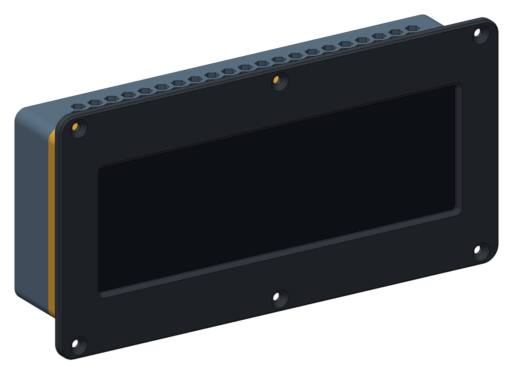
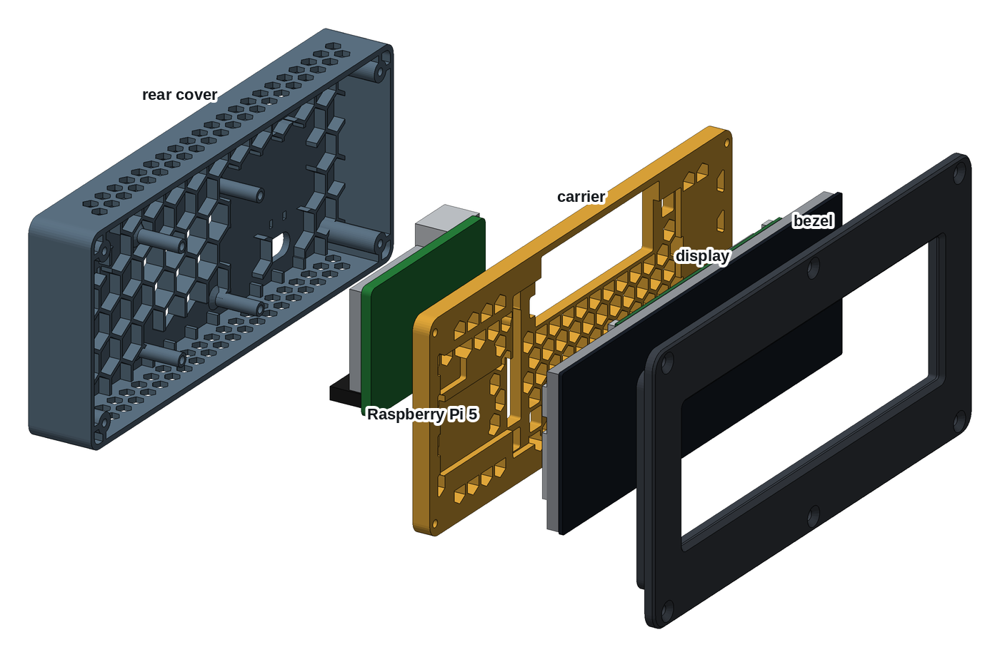
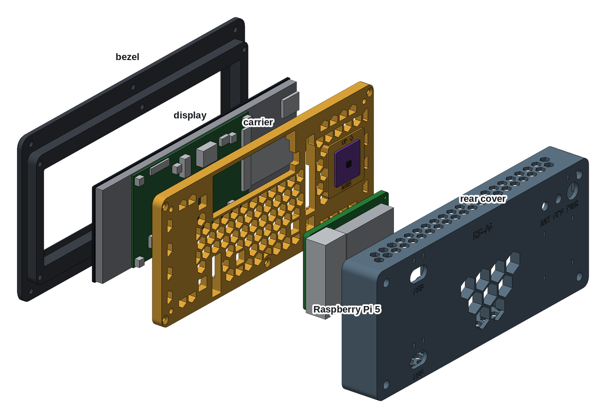
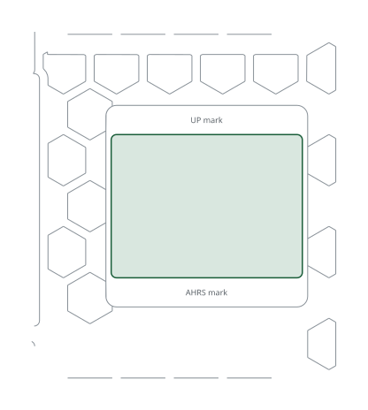

# Printed case, Waveshare 7.9"

A 3D-printed case for the RB-06 with the Waveshare 7.9inch HDMI LCD, a
1280 × 400 HDMI touch display shaped as a long strip. It holds the display
together with a Raspberry Pi 5 and an AHRS sensor. The case slides into the
instrument panel from the front and is held by six screws through the bezel.
It is the [8" printed case](../printed-case-waveshare-8/) cut to this display,
three parts printed without supports:

- **Bezel:** holds the glass and screws to the panel.
- **Carrier:** a honeycomb plate that clamps the display from behind and
  carries the AHRS plane.
- **Rear cover:** carries the Pi, the cable holes and the vents.

| | |
|---|---|
| Author | RB-Avionics |
| License | Free for personal use; commercial use requires an agreement, see [LICENSE.md](../../LICENSE.md) |
| Display | [Waveshare 7.9inch HDMI LCD](https://www.waveshare.com/wiki/7.9inch_HDMI_LCD): 207.8 × 69.8 mm glass, HDMI, micro USB touch and power |
| Computer | Raspberry Pi 5 with the Active Cooler |
| Depth | 49.1 mm from the bezel front, 44.6 mm behind the front face of the panel |
| Material | PC or PA-CF for an aircraft, see [PRINTING.md](../../PRINTING.md) |
| Units | millimetres |

> **Printing for an aircraft:** the case must withstand 100 °C in cruise on
> long flights. Print it in PC or PA-CF, never PLA, PETG, ABS or ASA, and run
> the oven test first: read [PRINTING.md](../../PRINTING.md).

## Design

The honeycomb, the screws into brass and the shock design are those of the
[8" printed case](../printed-case-waveshare-8/#design). What changes here:

- **Measured from Waveshare's 3D model** of the display (one solid, in
  `7.9inch_HDMI_LCD_3D_Drawing.zip` on its wiki) and the size drawing. The
  display mass, 230 g, is estimated from the model.
- **Carrier.** The driver board, right of centre, and a taped flex on the
  left stand 2.2 mm proud of the LCD back. The carrier is recessed over them
  and holds the LCD back beside them; it is open round the connectors and
  the eight standoffs on the board.
- **Narrow side flanges.** The bezel flange is 6 mm at the sides and 13 mm
  at the top and bottom, where all six panel screws are, so the bezel fits a
  250 mm bed.
- **Room for every plug.** The HDMI, the power micro USB and the audio jack
  face up from the top edge of the board, with 15 mm of room: use a 90° HDMI
  adapter and angled plugs. The touch micro USB faces down with 18 mm. The
  case is 24 mm taller than the glass to fit the Pi and its micro HDMI plugs
  above it. The rear cover keeps 40 mm free beyond the Pi's two USB stacks,
  not beyond its Ethernet port, which the case leaves unused.
- A script checks the parts against blocks for the display, the Pi, an AHRS
  board and the room their plugs need, and the parts were checked against
  Waveshare's model of the display.

## What goes where

Directions are as seen from the front.

| Item | Where |
|---|---|
| Display | glass down in the bezel pocket, the driver board right of centre with its HDMI facing up |
| Raspberry Pi 5 | on the rear cover standoffs, component side back so the Active Cooler draws air through the open cells; USB to the right, micro HDMI up |
| AHRS plane | back of the carrier, at the left: a flat pad 1 mm proud of the honeycomb, parallel to the panel, with an UP arrow |
| 5 V converter | left on the rear cover ribs, above the AHRS plane: room for 35 × 45 × 15 mm, two tie-wrap pairs to strap it |
| Back holes | PWR, 12.2 mm, for a GX12 socket or an M12 cable gland; GPS and ANT, 6.5 mm, for SMA bulkheads; two 18 × 10 mm USB slots that pass a USB-A plug. The cable holes have a tie-wrap pair above them, and the labels are engraved on the back |

## Cables

- **HDMI:** micro HDMI on the Pi (HDMI0, next to the USB-C) to HDMI on the
  display, through a 90° adapter. An FPC ribbon HDMI cable fits best.
- **Touch:** USB-A on the Pi to the display's Touch micro USB, with angled
  plugs.
- **Display power:** 5 V to the display's Power micro USB, from the 5 V
  converter.
- **AHRS:** four wires to the GPIO header, I2C bus 1: 3.3 V pin 1, SDA pin 3,
  SCL pin 5, GND pin 6.
- **Power:** 12 or 24 V in through PWR to a 5 V, 5 A converter, then to the
  Pi's USB-C and the display.

Leave the cables between the Pi and the display long enough to open the case
like a book: the Pi comes away with the rear cover.

## Assembly

1. Print the three parts. Before going on, check that the display drops
   into the bezel pocket.
2. Press in the heat-set inserts listed under Hardware: M3 in the back face
   of the bezel skirt, M3 in the back of the carrier corners, M2.5 in the
   rear cover standoffs.
3. Stick 3 mm foam tape on the bezel lip round the window, 2 mm outside its
   edge. Stick 5 mm tape on the flat areas of the carrier's front face that
   are not recessed: the block at the right and the strips at the left.
4. Lay the bezel face down on a soft cloth and put the display in, glass
   down.
5. Lay the carrier on the display, front face down, its openings over the
   board's connectors and standoffs. Drive the M3 flat head screws into the
   bezel crosswise, until the carrier sits on the skirt.
6. Glue the AHRS board between the marks of the AHRS plane, edges square to
   the arrow, with an epoxy rated above 100 °C.
7. Lay the rear cover inside up, its top edge away from you. Put the Pi on
   the standoffs, component side down, USB ports to the right and the micro
   HDMI edge away from you. Fix it with 4 × M2.5 × 6 screws from the back of
   the board.
8. Fit the SMA bulkheads and the GX12 socket or gland. Strap the 5 V
   converter to its tie-wrap pairs. Pass the outside cables through the back
   holes and tie each one at its tie-wrap pair. Then connect HDMI, USB, the
   display power and the AHRS wires.
9. Close the rear cover on the carrier. Its 4 × M3 × 10 socket head screws
   go down the columns, driven with a 2.5 mm hex key.
10. Cut the panel from the DXF below, slide the case in from the front, and
    fix the bezel with the M4 flat head screws and nylon-insert lock nuts.

## AHRS

The AHRS plane is tied to the panel through the carrier and the bezel, and it
stays put when the rear cover comes off. The plane is parallel to the panel,
so the sensor's Z axis points fore and aft. Run the AHRS orientation and
calibration of the RB software with the panel installed. The 5 V converter
sits on the ribs right behind the plane: calibrate the magnetometer in place
with the converter loaded, or do not rely on magnetic heading.

## Changing the case

The case is generated with FreeCAD by [tools/display_cases.py](../../tools/display_cases.py)
from the dimensions in [tools/display_case_layouts.py](../../tools/display_case_layouts.py).
Rebuild from the repo root with
`RB_ONLY=RB-06/printed-case-waveshare-7-9 freecad.cmd tools/display_cases.py`,
then the AHRS board template with
`RB_ONLY=RB-06/printed-case-waveshare-7-9 python3 tools/kicad_templates.py`.
The FreeCAD model in `files/` is the assembled case for viewing and measuring;
edit the scripts, not the model.

<!-- BEGIN parts: generated by tools/display_cases.py, do not edit by hand -->
## Parts

| Part | On the bed | Size on the bed (mm) | Mass in PC | File |
|---|---|---|---:|---|
| Bezel | front face down | 237 × 120 × 12 | 138 g | [rb06-79-bezel.stl](files/rb06-79-bezel.stl) (352 KB) |
| Carrier | front face down | 225 × 94 × 9 | 105 g | [rb06-79-carrier.stl](files/rb06-79-carrier.stl) (659 KB) |
| Rear cover | back face down | 225 × 94 × 29 | 132 g | [rb06-79-rear-cover.stl](files/rb06-79-rear-cover.stl) (1.2 MB) |

The parts print without supports, placed as exported. The bezel needs a bed of at least 240 × 123 mm. Masses are for solid polycarbonate; the honeycomb is already thin solid walls (1.6 mm, four 0.4 mm lines): 88 cells in the carrier, 9 open vent cells in the rear cover over the Pi fan and 84 vents in its top and bottom walls.

## Hardware

| Item | Qty | Where |
|---|---:|---|
| M3 heat-set insert, 5.7 mm long, for a 4 mm hole | 10 | bezel skirt (6), carrier corners (4) |
| M2.5 heat-set insert, 4 mm long, for a 3.6 mm hole | 4 | rear cover standoffs |
| M3 × 12 flat head, ISO 10642 | 6 | carrier to bezel |
| M3 × 10 socket head, ISO 4762 | 4 | rear cover to carrier, inside the columns (2.5 mm hex key) |
| M2.5 × 6 pan or socket head | 4 | Raspberry Pi to the standoffs |
| M4 × 12 flat head, ISO 10642 (or #8), with nylon-insert lock nuts | 6 | bezel to the panel, up to 3 mm of panel |
| Closed-cell foam tape, 1 mm, silicone or EPDM rated above 100 °C | 0.5 m × 3 mm, 0.2 m × 5 mm | on the bezel lip round the window; on the carrier's flat strips behind the display |
| Epoxy rated above 100 °C | a few grams | AHRS board on the AHRS plane |
| Tie-wraps, 2.5 mm, heat-stabilised, rated 105 °C | 6 to 10 | cables at the back holes, 5 V converter |

## Panel cut-out

225.58 × 95 mm with 6.5 mm corners, and 6 holes of 4.4 mm at x = ±108.3 and 0, z = ±53.5 mm from the centre of the cut-out. The case slides in from the front and the bezel (236.58 × 120 mm) covers the edge. Drawing 1:1, layers CUT and BEZEL: [rb06-79-panel-cutout.dxf](files/rb06-79-panel-cutout.dxf)

## Load check, -3 to +6 G

Static loads for the whole unit, 775 g: display 230 g, Pi 5 with cooler 70 g, printed parts 375 g in PC, 100 g for cables, AHRS and converter. Every load is taken as if it acted in the worst direction for that part.

| | +6 G | -3 G |
|---|---:|---:|
| Unit weight × G | 46 N | 23 N |
| Shear on each M4 panel screw | 7.6 N | 3.8 N |
| Pull on each screw of the top or bottom row, from the overhang behind the panel | 2.2 N | 1.1 N |
| Display on the bezel pocket wall | 14 N | 7 N |
| Pull on each carrier insert, display pushed back | 3.3 N | 1.6 N |
| Bending at the root of each Pi standoff | 1.0 MPa | 0.5 MPa |

Each load is a few newtons, against the hundreds of newtons an M3 heat-set insert holds and the tens of MPa printed PC or PA-CF takes across its layers at 100 °C. Shock and vibration are what remain: the display is clamped on foam and backed by the honeycomb, every screw goes into brass, and the cables are tied at the back holes so their plugs carry no load.

FreeCAD model, assembled, with reference blocks for the display, the Pi and an AHRS board: [rb06-79-case.FCStd](files/rb06-79-case.FCStd)
<!-- END parts -->

<!-- BEGIN kicad: generated by tools/kicad_templates.py, do not edit by hand -->
## KiCad board template

A KiCad project as the starting point for your own electronics.

[kicad/rb06-79-ahrs-board/rb06-79-ahrs-board.kicad_pro](kicad/rb06-79-ahrs-board/rb06-79-ahrs-board.kicad_pro): A 36 x 27 mm IMU board for the AHRS plane of the carrier, glued flat.

- Seen from behind, the component side; up is up on the instrument, as the arrow on the plane.
- Outline = the AHRS plane between its engraved marks, 1 mm inside its sides: a 25.4 mm breakout fits too.
- No mounting holes: glue the board flat with an epoxy rated above 100 °C, edges square to the arrow.
- Parts up to 4 mm tall clear the rear cover and the 5 V converter above the plane.
- Wire it to the Pi GPIO, I2C bus 1: 3.3 V pin 1, SDA pin 3, SCL pin 5, GND pin 6. The RB software finds ICM-20948 and MPU-9250 family IMUs at 0x68 and BMP280/388/390 baros at 0x76 or 0x77.
- The plane is parallel to the panel; set the sensor orientation in the AHRS calibration of the RB software.
- Dwgs.User shows the carrier cut 0.5 mm in front of its back face, round the AHRS plane.

<!-- END kicad -->
