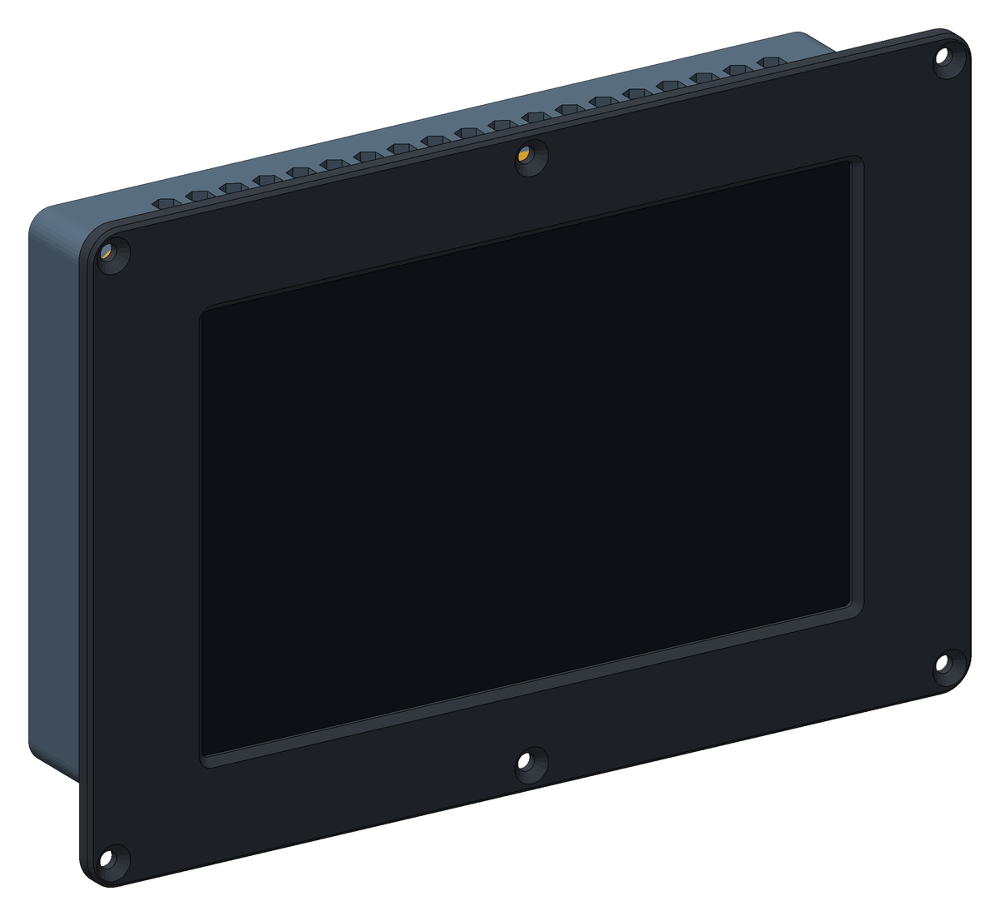
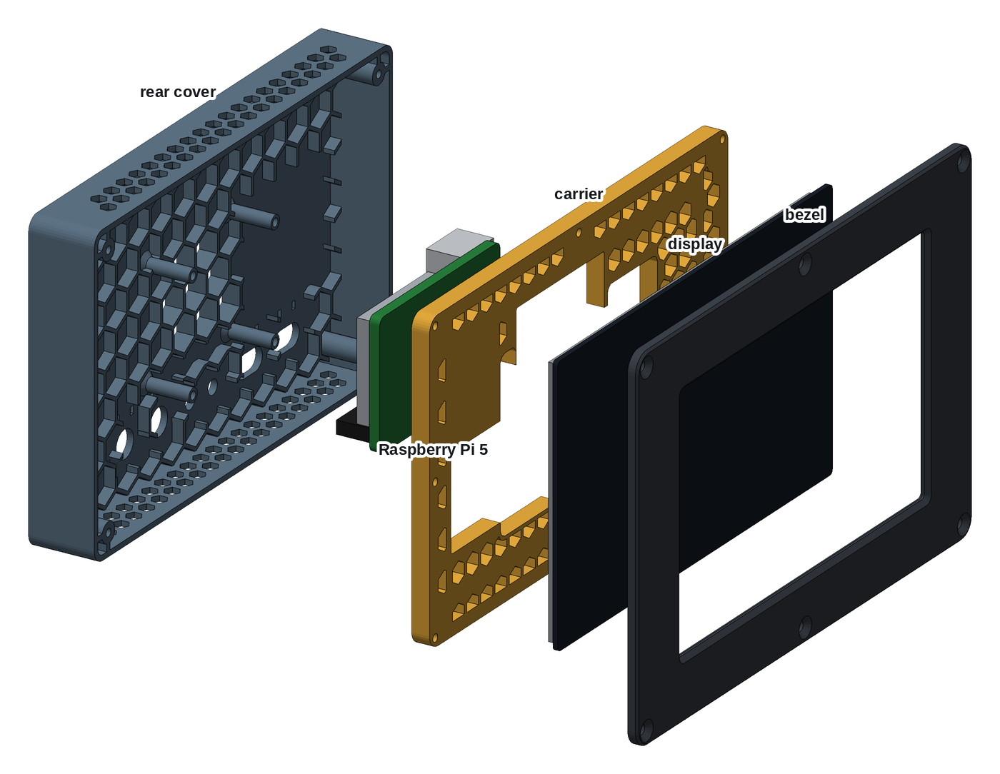
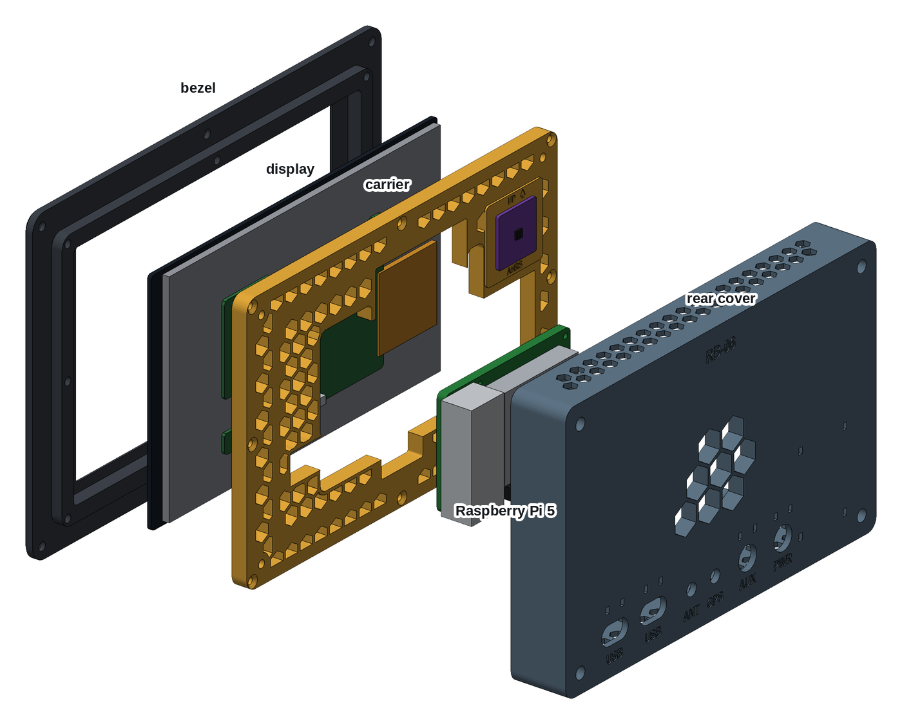
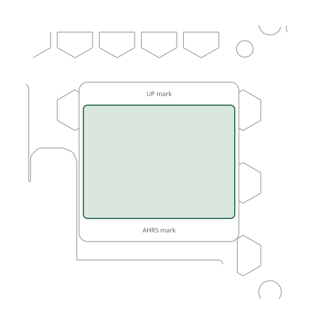

# Printed case, Waveshare 8"

A 3D-printed case for the RB-06. It holds the Waveshare 8DP-CAPLCD, an 8" 1280 × 800
HDMI touch display, together with a Raspberry Pi 5 and an AHRS sensor. The case
slides into the instrument panel from the front and is held by six screws
through the bezel. It is three parts, all printed without supports:

- **Bezel:** holds the glass and screws to the panel.
- **Carrier:** a honeycomb plate that clamps the display from behind and
  carries the AHRS plane.
- **Rear cover:** carries the Pi, the cable holes and the vents.

| | |
|---|---|
| Author | RB-Avionics |
| License | Free for personal use; commercial use requires an agreement, see [LICENSE.md](../../LICENSE.md) |
| Display | [Waveshare 8DP-CAPLCD](https://www.waveshare.com/wiki/8DP-CAPLCD): 194 × 119 mm glass, HDMI, USB-C touch |
| Computer | Raspberry Pi 5 with the Active Cooler |
| Depth | 47 mm from the bezel front, 42.5 mm behind the front face of the panel |
| Material | PC or PA-CF for an aircraft, see [PRINTING.md](../../PRINTING.md) |
| Units | millimetres |

> **Printing for an aircraft:** the case must withstand 100 °C in cruise on
> long flights. Print it in PC or PA-CF, never PLA, PETG, ABS or ASA, and run
> the oven test first: read [PRINTING.md](../../PRINTING.md).

## Design

- **Honeycomb throughout.** The carrier is an open honeycomb, 8 mm deep with
  1.6 mm walls. The rear cover plate has 5 mm honeycomb ribs inside, and the
  cells over the Pi fan are open as its air intake. The top and bottom walls
  have rows of hexagonal vents; their points face front and back, so they print
  without support.
- **Shock, -3 to +6 G.**
  - The display sits in a pocket in the bezel and is clamped on foam tape
    between the bezel lip and the carrier, which backs it across its width.
  - Every screw goes into a brass heat-set insert, none into printed plastic.
  - The Pi stands on four 6 mm standoffs that flare into the honeycomb.
  - Cables are tied at the back holes, so connectors carry no cable weight.
  - The load check below gives the numbers.
- **Room for every plug.** The carrier is open round the display's HDMI,
  USB-C and audio sockets, which face up from the top edge of its driver board,
  and round the second USB-C, which faces right. The rear cover leaves room for
  the Pi's micro HDMI and USB-C plugs above it and the USB plugs to its right.
  A script checks the parts against blocks for the display, the Pi, an AHRS
  board, and the room their plugs need.

## What goes where

Directions are as seen from the front.

| Item | Where |
|---|---|
| Display | glass down in the bezel pocket, the HDMI edge of its driver board up, the LCD flex on the left |
| Raspberry Pi 5 | on the rear cover standoffs, component side back so the Active Cooler draws air through the open cells; USB and Ethernet to the right, micro HDMI up |
| AHRS plane | back of the carrier, upper left: a flat pad 1 mm proud of the honeycomb, parallel to the panel, with an UP arrow |
| 5 V converter | lower left on the rear cover ribs, room for 42 × 55 × 18 mm, two tie-wrap pairs to strap it |
| Back holes | PWR and AUX, 12.2 mm, for a GX12 socket or an M12 cable gland; GPS and ANT, 6.5 mm, for SMA bulkheads; two 18 × 10 mm USB slots that pass a USB-A plug. Each cable hole has a tie-wrap pair above it, and the labels are engraved on the back |

## Cables

- **HDMI:** micro HDMI on the Pi (HDMI0, next to the USB-C) to HDMI on the
  display, about 15 cm. An FPC ribbon HDMI cable with angled adapters fits
  best: the plugs sit side by side in the bay above the driver board.
- **Touch:** USB-A on the Pi to the display's USB-C touch port, with an angled
  USB-C plug. Waveshare: if the display flickers on the Pi's USB power, feed
  5 V to its Power USB-C as well (750 mA or more).
- **AHRS:** four wires to the GPIO header, I2C bus 1: 3.3 V pin 1, SDA pin 3,
  SCL pin 5, GND pin 6.
- **Power:** 12 or 24 V in through PWR to a 5 V, 5 A converter, then to the
  Pi's USB-C.

Leave the cables between the Pi and the display long enough to open the case
like a book: the Pi comes away with the rear cover.

## Assembly

1. Print the three parts. Before going on, check that the display drops
   into the bezel pocket.
2. Press in the heat-set inserts:
   - 8 × M3 in the back face of the bezel skirt;
   - 4 × M3 in the back of the carrier corners;
   - 4 × M2.5 in the rear cover standoffs.
3. Stick 3 mm foam tape on the bezel lip round the window, 2 mm outside its
   edge. Stick 5 mm tape on the flat strips of the carrier's front face; the
   narrow left strip takes 3 mm tape.
4. Lay the bezel face down on a soft cloth and put the display in, glass
   down.
5. Lay the carrier on the display, front face down, with its openings over
   the driver board and the LCD flex. They fit one way only: with the HDMI
   edge of the driver board away from you, the AHRS plane is at the far right.
   Drive the 8 × M3 × 12 flat head screws into the bezel crosswise, until the
   carrier sits on the skirt.
6. Glue the AHRS board between the marks of the AHRS plane, edges square to
   the arrow, with an epoxy rated above 100 °C.
7. Lay the rear cover inside up, back holes towards you. Put the Pi on the
   standoffs, component side down, USB ports to the right and the micro HDMI
   edge away from you. Fix it with 4 × M2.5 × 6 screws from the back of the
   board.
8. Fit the SMA bulkheads and the GX12 sockets or glands. Pass the outside
   cables through the back holes and tie each one at its tie-wrap pair. Then
   connect HDMI, USB and the AHRS wires.
9. Close the rear cover on the carrier. Its 4 × M3 × 10 socket head screws go
   down the columns, driven with a 2.5 mm hex key.
10. Cut the panel from the DXF below, slide the case in from the front, and
    fix the bezel with 6 × M4 flat head screws and nylon-insert lock nuts.

## AHRS

The AHRS plane is the stiffest place in the case. It is tied to the panel
through the carrier and the bezel, and it stays put when the rear cover comes
off. The plane is parallel to the panel, so the sensor's Z axis points fore
and aft. Run the AHRS orientation and calibration of the RB software with the
panel installed: it maps the sensor axes to the aircraft. The display's metal
frame and the Pi are a few centimetres away. Calibrate the magnetometer in
place, or do not rely on magnetic heading.

## Changing the case

The case is generated with FreeCAD by [tools/display_cases.py](../../tools/display_cases.py).
The dimensions of the display, the Pi, the parts and the holes are in
[tools/display_case_layouts.py](../../tools/display_case_layouts.py). Rebuild from the
repo root with `RB_ONLY=RB-06/printed-case-waveshare-8 freecad.cmd tools/display_cases.py`.
Then rebuild the AHRS board template with
`RB_ONLY=RB-06/printed-case-waveshare-8 python3 tools/kicad_templates.py`.
The FreeCAD model in `files/` is the assembled case for viewing and measuring;
edit the scripts, not the model.

<!-- BEGIN parts: generated by tools/display_cases.py, do not edit by hand -->
## Parts

| Part | On the bed | Size on the bed (mm) | Mass in PC | File |
|---|---|---|---:|---|
| Bezel | front face down | 237 × 162 × 10 | 127 g | [rb06-8dp-bezel.stl](files/rb06-8dp-bezel.stl) (380 KB) |
| Carrier | front face down | 211 × 136 × 9 | 125 g | [rb06-8dp-carrier.stl](files/rb06-8dp-carrier.stl) (641 KB) |
| Rear cover | back face down | 211 × 136 × 29 | 173 g | [rb06-8dp-rear-cover.stl](files/rb06-8dp-rear-cover.stl) (1.3 MB) |

The parts print without supports, placed as exported. The bezel needs a bed of at least 240 × 165 mm. Masses are for solid polycarbonate; the honeycomb is already thin solid walls (1.6 mm, four 0.4 mm lines): 90 cells in the carrier, 8 open vent cells in the rear cover over the Pi fan and 76 vents in its top and bottom walls.

## Hardware

| Item | Qty | Where |
|---|---:|---|
| M3 heat-set insert, 5.7 mm long, for a 4 mm hole | 12 | bezel skirt (8), carrier corners (4) |
| M2.5 heat-set insert, 4 mm long, for a 3.6 mm hole | 4 | rear cover standoffs |
| M3 × 12 flat head, ISO 10642 | 8 | carrier to bezel |
| M3 × 10 socket head, ISO 4762 | 4 | rear cover to carrier, inside the columns (2.5 mm hex key) |
| M2.5 × 6 pan or socket head | 4 | Raspberry Pi to the standoffs |
| M4 × 12 flat head, ISO 10642 (or #8), with nylon-insert lock nuts | 6 | bezel to the panel, up to 3 mm of panel |
| Closed-cell foam tape, 1 mm, silicone or EPDM rated above 100 °C | 0.6 m × 3 mm, 0.6 m × 5 mm | on the bezel lip round the window; on the carrier's flat strips behind the display |
| Epoxy rated above 100 °C | a few grams | AHRS board on the AHRS plane |
| Tie-wraps, 2.5 mm, heat-stabilised, rated 105 °C | 6 to 10 | cables at the back holes, 5 V converter |

## Panel cut-out

211.8 × 136.8 mm with 6.5 mm corners, and 6 holes of 4.4 mm at x = ±111.9 and 0, z = ±74.4 mm from the centre of the cut-out. The case slides in from the front and the bezel (236.8 × 161.8 mm) covers the edge. Drawing 1:1, layers CUT and BEZEL: [rb06-8dp-panel-cutout.dxf](files/rb06-8dp-panel-cutout.dxf)

## Load check, -3 to +6 G

Static loads for the whole unit, 1001 g: display 406 g, Pi 5 with cooler 70 g, printed parts 425 g in PC, 100 g for cables, AHRS and converter. Every load is taken as if it acted in the worst direction for that part.

| | +6 G | -3 G |
|---|---:|---:|
| Unit weight × G | 59 N | 29 N |
| Shear on each M4 panel screw | 9.8 N | 4.9 N |
| Pull on each screw of the top or bottom row, from the overhang behind the panel | 1.7 N | 0.9 N |
| Display on the bezel pocket wall | 24 N | 12 N |
| Pull on each carrier insert, display pushed back | 3.9 N | 2.0 N |
| Bending at the root of each Pi standoff | 1.0 MPa | 0.5 MPa |

Each load is a few newtons, against the hundreds of newtons an M3 heat-set insert holds and the tens of MPa printed PC or PA-CF takes across its layers at 100 °C. Shock and vibration are what remain: the display is clamped on foam and backed by the honeycomb, every screw goes into brass, and the cables are tied at the back holes so their plugs carry no load.

FreeCAD model, assembled, with reference blocks for the display, the Pi and an AHRS board: [rb06-8dp-case.FCStd](files/rb06-8dp-case.FCStd)
<!-- END parts -->

<!-- BEGIN kicad: generated by tools/kicad_templates.py, do not edit by hand -->
## KiCad board template

A KiCad project as the starting point for your own electronics.

[kicad/rb06-8dp-ahrs-board/rb06-8dp-ahrs-board.kicad_pro](kicad/rb06-8dp-ahrs-board/rb06-8dp-ahrs-board.kicad_pro): A 36 x 27 mm IMU board for the AHRS plane of the carrier, glued flat.

- Seen from behind, the component side; up is up on the instrument, as the arrow on the plane.
- Outline = the AHRS plane between its engraved marks, 1 mm inside its sides: a 25.4 mm breakout fits too.
- No mounting holes: glue the board flat with an epoxy rated above 100 °C, edges square to the arrow.
- Parts up to 18 mm tall clear the rear cover.
- Wire it to the Pi GPIO, I2C bus 1: 3.3 V pin 1, SDA pin 3, SCL pin 5, GND pin 6. The RB software finds ICM-20948 and MPU-9250 family IMUs at 0x68 and BMP280/388/390 baros at 0x76 or 0x77.
- The plane is parallel to the panel; set the sensor orientation in the AHRS calibration of the RB software.
- Dwgs.User shows the carrier cut 0.5 mm in front of its back face, round the AHRS plane.

<!-- END kicad -->
