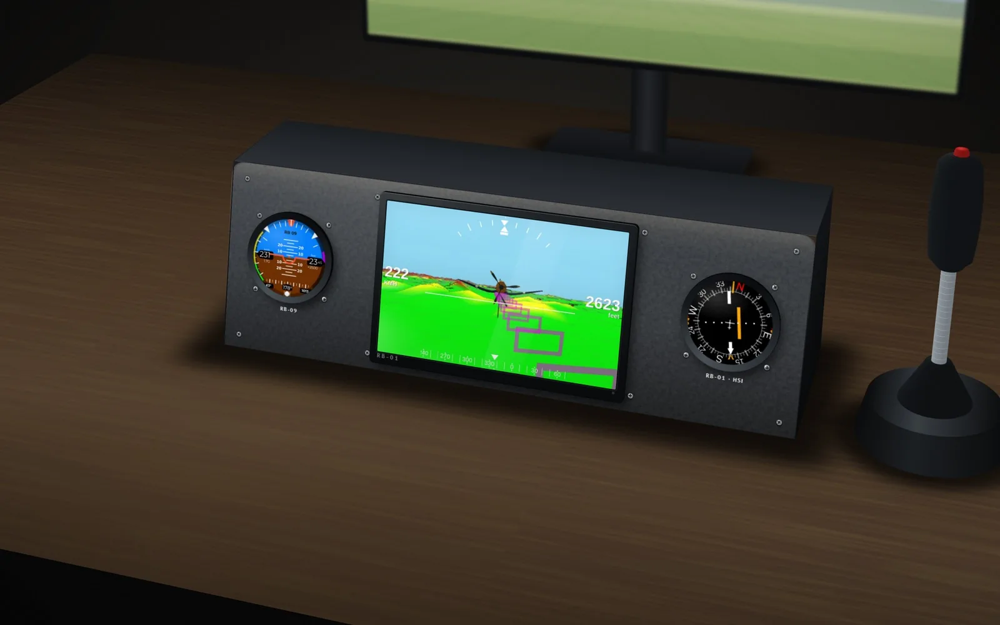
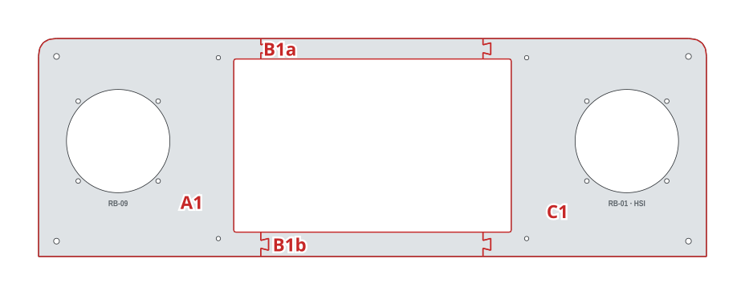
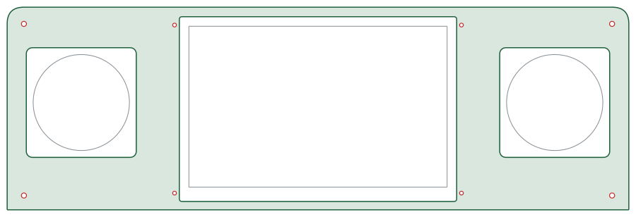

# Desktop pod

An RB-09, an RB-01 synthetic vision and an RB-01 HSI in a pod under the monitor: the smallest RB home cockpit, next to your joystick.

| | |
|---|---|
| Author | RB-Avionics |
| License | Free for personal use; commercial use requires an agreement, see [LICENSE.md](../../LICENSE.md) |
| Concept | [www.rbavionics.com, RB-Simulator](https://www.rbavionics.com/#rb-simulator) |

> **Printing for an aircraft:** these panels are made for simulators, where PLA or PETG is fine. Printed for an aircraft, they must withstand 100 °C in cruise on long flights: read [PRINTING.md](../../PRINTING.md).

A 3D-printable version of the panel in the concept render. Not included: the pod body (top and sides, the face is tilted back 14°) and the joystick.
Print and assembly notes are in the [RB-Cockpits README](../README.md).

<!-- BEGIN parts: generated by tools/cockpit_panels.py, do not edit by hand -->
## Hardware

| Item | Qty | Panel cut-out |
|---|---:|---|
| RB 80 mm round instrument | 2 | Ø80.5 mm, 4 × M3 on a 62.25 mm square |
| RB-01 display, screen 216 × 135 mm (10.0") | 1 | window 216 × 135 mm, 4 × M3 beside the bezel |
| Panel mounting screw M4 | 4 | Ø4.5 mm |

## Panel

520 × 170 mm, 4 mm thick, 4 tiles for a 200 mm bed.

| Tile | Size on the bed (mm) | File |
|---|---|---|
| A1 | 179 × 170 | [desktop-pod-A1.stl](files/desktop-pod-A1.stl) (213 KB) |
| B1a | 179 × 16 | [desktop-pod-B1a.stl](files/desktop-pod-B1a.stl) (3 KB) |
| B1b | 179 × 19 | [desktop-pod-B1b.stl](files/desktop-pod-B1b.stl) (3 KB) |
| C1 | 174 × 170 | [desktop-pod-C1.stl](files/desktop-pod-C1.stl) (218 KB) |

Whole panel for laser or CNC cutting, layers CUT and ENGRAVE, mm: [desktop-pod.dxf](files/desktop-pod.dxf)

FreeCAD model with the whole panels and the tiles: [desktop-pod.FCStd](files/desktop-pod.FCStd)
<!-- END parts -->

<!-- BEGIN kicad: generated by tools/kicad_templates.py, do not edit by hand -->
## KiCad board template

A KiCad project as the starting point for your own electronics.

[kicad/desktop-pod-backplane/desktop-pod-backplane.kicad_pro](kicad/desktop-pod-backplane/desktop-pod-backplane.kicad_pro): A backplane behind the desktop pod: same outline, cut-outs for the instruments and displays, holes on the panel screws.

- Seen from the front; the F side faces the back of the panel. Outline = the panel outline.
- Cut-outs clear the instrument bodies and display modules by 1 mm: 92 mm squares for the 80 mm RB cases, 79 x 85 mm for the 57 mm shells with the GPS hood, display bezel + 2 mm.
- Holes on the panel screws (M4) and the display screws (M3): stand the board off the panel on them.
- Switches, keys, push-pulls and knobs are drawn on Dwgs.User at their panel cut-outs: place PCB-mount parts there, or add cut-outs for panel-mount parts.
- PCB fabs limit the board size (often 500 mm or less): split the board along the print tile seams.

<!-- END kicad -->
