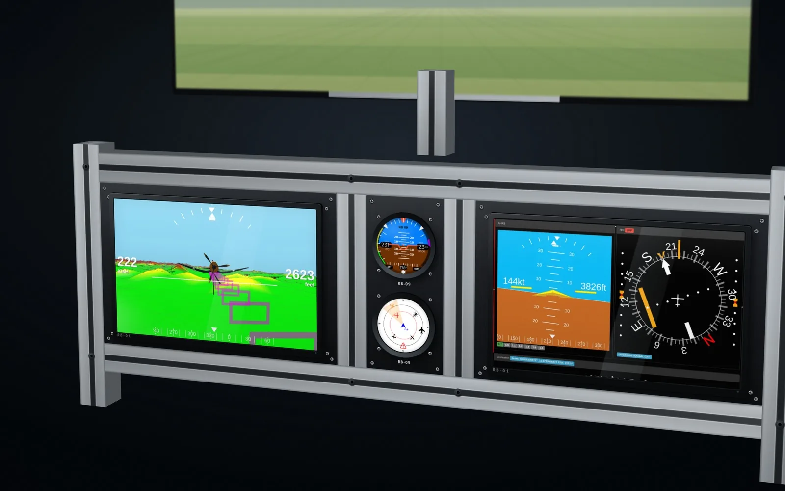
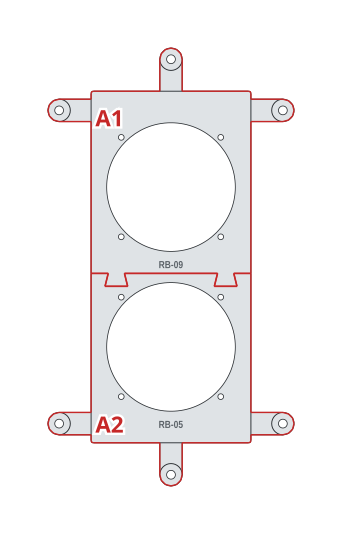
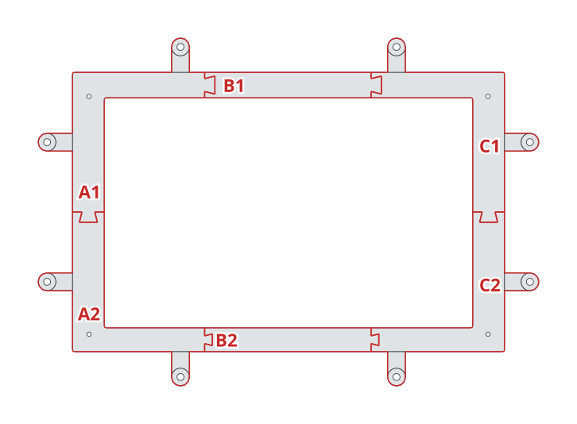
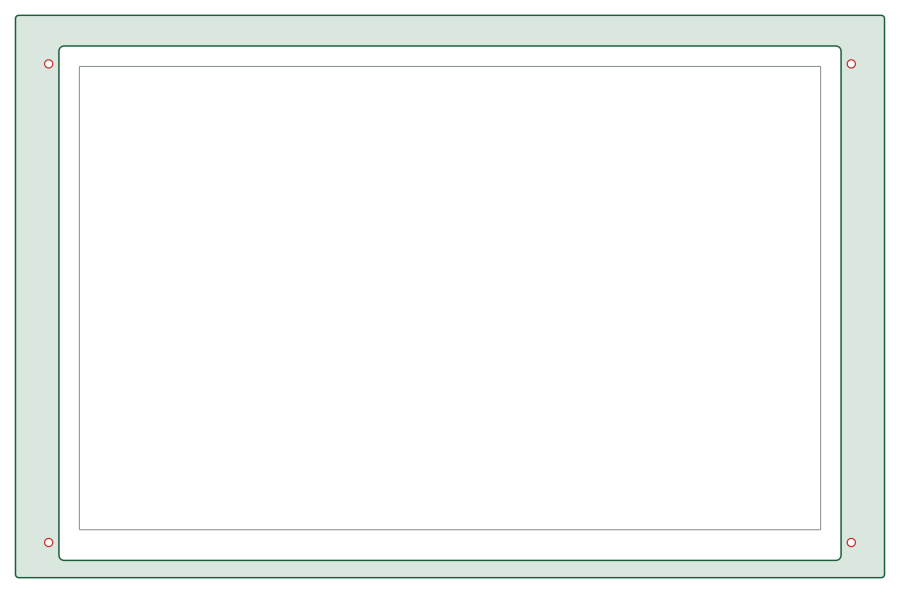
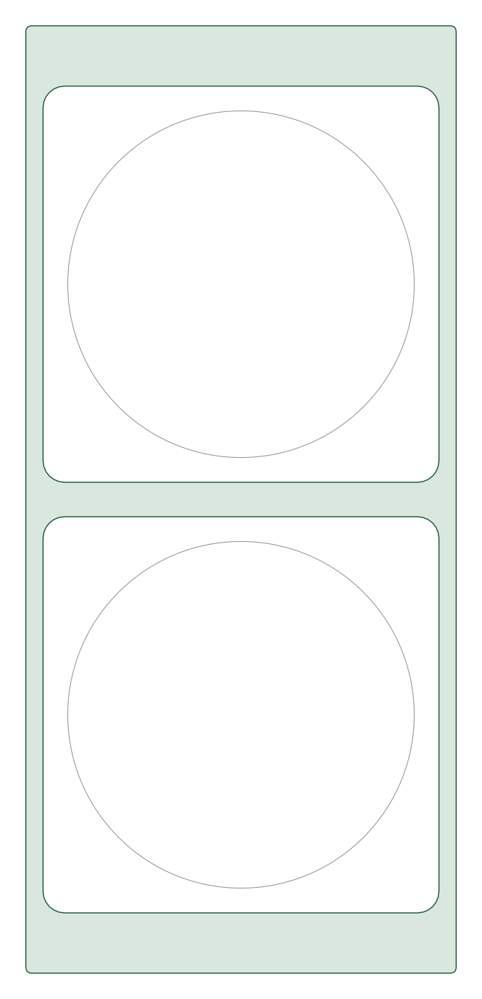

# Glass-cockpit rig

Two RB-01 screens, synthetic vision with the guidance tunnel and the attitude and HSI page, with an RB-09 and an RB-05 between them, on an aluminium-profile frame.

| | |
|---|---|
| Author | RB-Avionics |
| License | Free for personal use; commercial use requires an agreement, see [LICENSE.md](../../LICENSE.md) |
| Concept | [www.rbavionics.com, RB-Simulator](https://www.rbavionics.com/#rb-simulator) |

> **Printing for an aircraft:** these panels are made for simulators, where PLA or PETG is fine. Printed for an aircraft, they must withstand 100 °C in cruise on long flights: read [PRINTING.md](../../PRINTING.md).

A 3D-printable version of the panel in the concept render. Not included: the 40 × 40 mm aluminium-profile frame and the monitor riser.
Print and assembly notes are in the [RB-Cockpits README](../README.md).

<!-- BEGIN parts: generated by tools/cockpit_panels.py, do not edit by hand -->
## Hardware

| Item | Qty | Panel cut-out |
|---|---:|---|
| RB 80 mm round instrument | 2 | Ø80.5 mm, 4 × M3 on a 62.25 mm square |
| RB-01 display, screen 290 × 181.25 mm (13.5") | 2 | window 290 × 181.25 mm, 4 × M3 beside the bezel |
| M5 screw and T-nut for the 40 mm profile slot | 22 | Ø5.5 mm in the ears |

## Left plate

340 × 220 mm, 4 mm thick, 6 tiles for a 200 mm bed.

| Tile | Size on the bed (mm) | File |
|---|---|---|
| A1 | 139 × 145 | [glass-cockpit-rig-left-A1.stl](files/glass-cockpit-rig-left-A1.stl) (50 KB) |
| A2 | 137 × 137 | [glass-cockpit-rig-left-A2.stl](files/glass-cockpit-rig-left-A2.stl) (50 KB) |
| B1 | 139 × 20 | [glass-cockpit-rig-left-B1.stl](files/glass-cockpit-rig-left-B1.stl) (3 KB) |
| B2 | 137 × 19 | [glass-cockpit-rig-left-B2.stl](files/glass-cockpit-rig-left-B2.stl) (3 KB) |
| C1 | 132 × 145 | [glass-cockpit-rig-left-C1.stl](files/glass-cockpit-rig-left-C1.stl) (50 KB) |
| C2 | 132 × 137 | [glass-cockpit-rig-left-C2.stl](files/glass-cockpit-rig-left-C2.stl) (50 KB) |

Whole left plate for laser or CNC cutting, layers CUT and ENGRAVE, mm: [glass-cockpit-rig-left.dxf](files/glass-cockpit-rig-left.dxf)

## Centre plate

100 × 220 mm, 4 mm thick, 2 tiles for a 200 mm bed.

| Tile | Size on the bed (mm) | File |
|---|---|---|
| A1 | 154 × 149 | [glass-cockpit-rig-centre-A1.stl](files/glass-cockpit-rig-centre-A1.stl) (221 KB) |
| A2 | 154 × 133 | [glass-cockpit-rig-centre-A2.stl](files/glass-cockpit-rig-centre-A2.stl) (206 KB) |

Whole centre plate for laser or CNC cutting, layers CUT and ENGRAVE, mm: [glass-cockpit-rig-centre.dxf](files/glass-cockpit-rig-centre.dxf)

## Right plate

340 × 220 mm, 4 mm thick, 6 tiles for a 200 mm bed.

| Tile | Size on the bed (mm) | File |
|---|---|---|
| A1 | 139 × 145 | [glass-cockpit-rig-right-A1.stl](files/glass-cockpit-rig-right-A1.stl) (50 KB) |
| A2 | 137 × 137 | [glass-cockpit-rig-right-A2.stl](files/glass-cockpit-rig-right-A2.stl) (50 KB) |
| B1 | 139 × 20 | [glass-cockpit-rig-right-B1.stl](files/glass-cockpit-rig-right-B1.stl) (3 KB) |
| B2 | 137 × 19 | [glass-cockpit-rig-right-B2.stl](files/glass-cockpit-rig-right-B2.stl) (3 KB) |
| C1 | 132 × 145 | [glass-cockpit-rig-right-C1.stl](files/glass-cockpit-rig-right-C1.stl) (50 KB) |
| C2 | 132 × 137 | [glass-cockpit-rig-right-C2.stl](files/glass-cockpit-rig-right-C2.stl) (50 KB) |

Whole right plate for laser or CNC cutting, layers CUT and ENGRAVE, mm: [glass-cockpit-rig-right.dxf](files/glass-cockpit-rig-right.dxf)

FreeCAD model with the whole panels and the tiles: [glass-cockpit-rig.FCStd](files/glass-cockpit-rig.FCStd)
<!-- END parts -->

<!-- BEGIN kicad: generated by tools/kicad_templates.py, do not edit by hand -->
## KiCad board templates

One KiCad project per board, each a starting point for your own electronics.

### Glass-cockpit rig left plate: backplane

[kicad/glass-cockpit-rig-left-backplane/glass-cockpit-rig-left-backplane.kicad_pro](kicad/glass-cockpit-rig-left-backplane/glass-cockpit-rig-left-backplane.kicad_pro): A backplane behind the glass-cockpit rig left plate: same outline, cut-outs for the instruments and displays, holes on the panel screws.

- Seen from the front; the F side faces the back of the panel. Outline = the panel outline.
- Cut-outs clear the instrument bodies and display modules by 1 mm: 92 mm squares for the 80 mm RB cases, 79 x 85 mm for the 57 mm shells with the GPS hood, display bezel + 2 mm.
- Holes on the panel screws (M4) and the display screws (M3): stand the board off the panel on them.
- Switches, keys, push-pulls and knobs are drawn on Dwgs.User at their panel cut-outs: place PCB-mount parts there, or add cut-outs for panel-mount parts.
- PCB fabs limit the board size (often 500 mm or less): split the board along the print tile seams.

### Glass-cockpit rig centre plate: backplane

[kicad/glass-cockpit-rig-centre-backplane/glass-cockpit-rig-centre-backplane.kicad_pro](kicad/glass-cockpit-rig-centre-backplane/glass-cockpit-rig-centre-backplane.kicad_pro): A backplane behind the glass-cockpit rig centre plate: same outline, cut-outs for the instruments and displays, holes on the panel screws.

- Seen from the front; the F side faces the back of the panel. Outline = the panel outline.
- Cut-outs clear the instrument bodies and display modules by 1 mm: 92 mm squares for the 80 mm RB cases, 79 x 85 mm for the 57 mm shells with the GPS hood, display bezel + 2 mm.
- Holes on the panel screws (M4) and the display screws (M3): stand the board off the panel on them.
- Switches, keys, push-pulls and knobs are drawn on Dwgs.User at their panel cut-outs: place PCB-mount parts there, or add cut-outs for panel-mount parts.
- PCB fabs limit the board size (often 500 mm or less): split the board along the print tile seams.

### Glass-cockpit rig right plate: backplane

[kicad/glass-cockpit-rig-right-backplane/glass-cockpit-rig-right-backplane.kicad_pro](kicad/glass-cockpit-rig-right-backplane/glass-cockpit-rig-right-backplane.kicad_pro): A backplane behind the glass-cockpit rig right plate: same outline, cut-outs for the instruments and displays, holes on the panel screws.

- Seen from the front; the F side faces the back of the panel. Outline = the panel outline.
- Cut-outs clear the instrument bodies and display modules by 1 mm: 92 mm squares for the 80 mm RB cases, 79 x 85 mm for the 57 mm shells with the GPS hood, display bezel + 2 mm.
- Holes on the panel screws (M4) and the display screws (M3): stand the board off the panel on them.
- Switches, keys, push-pulls and knobs are drawn on Dwgs.User at their panel cut-outs: place PCB-mount parts there, or add cut-outs for panel-mount parts.
- PCB fabs limit the board size (often 500 mm or less): split the board along the print tile seams.

<!-- END kicad -->
