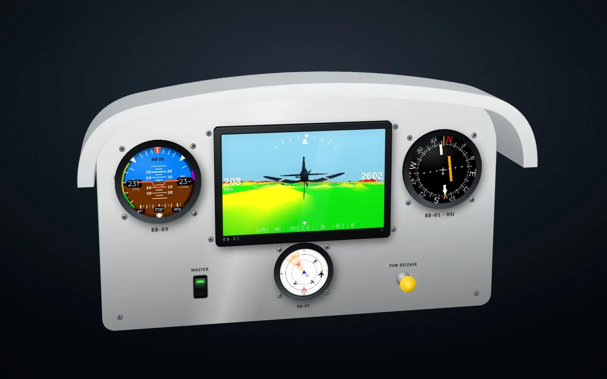
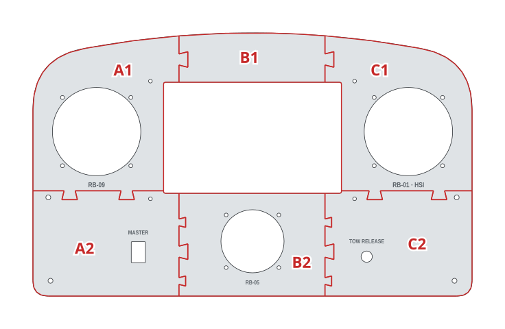
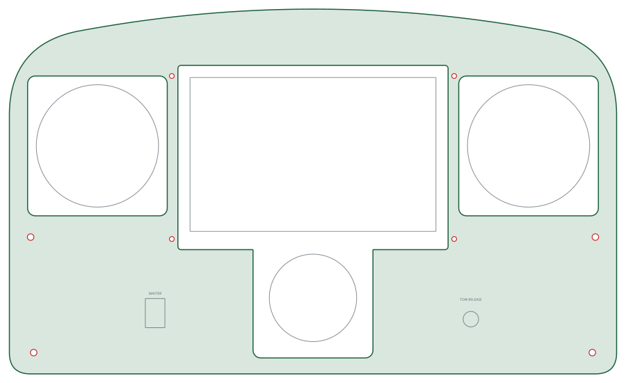

# Glider panel

Glider panels are cut for 80 mm and 57 mm instruments, the RB formats: an RB-09 and an RB-01 HSI at 80 mm and an RB-05 at 57 mm, around an RB-01 synthetic vision.

| | |
|---|---|
| Author | RB-Avionics |
| License | Free for personal use; commercial use requires an agreement, see [LICENSE.md](../../LICENSE.md) |
| Concept | [www.rbavionics.com, RB-Simulator](https://www.rbavionics.com/#rb-simulator) |

> **Printing for an aircraft:** these panels are made for simulators, where PLA or PETG is fine. Printed for an aircraft, they must withstand 100 °C in cruise on long flights: read [PRINTING.md](../../PRINTING.md).

A 3D-printable version of the panel in the concept render. Not included: the instrument hood.
Print and assembly notes are in the [RB-Cockpits README](../README.md).

<!-- BEGIN parts: generated by tools/cockpit_panels.py, do not edit by hand -->
## Hardware

| Item | Qty | Panel cut-out |
|---|---:|---|
| RB 57 mm round instrument | 1 | Ø57.5 mm, 4 × M3 on a 48 mm square |
| RB 80 mm round instrument | 2 | Ø80.5 mm, 4 × M3 on a 62.25 mm square |
| RB-01 display, screen 162 × 101.25 mm (7.5") | 1 | window 162 × 101.25 mm, 4 × M3 beside the bezel |
| Mini rocker switch (KCD1) | 1 | 12.9 × 19.2 mm |
| Panel mounting screw M4 | 4 | Ø4.5 mm |
| Push-pull control | 1 | Ø10.2 mm |

## Panel

400 × 240 mm, 4 mm thick, 6 tiles for a 200 mm bed.

| Tile | Size on the bed (mm) | File |
|---|---|---|
| A1 | 141 × 149 | [glider-panel-A1.stl](files/glider-panel-A1.stl) (184 KB) |
| A2 | 141 × 96 | [glider-panel-A2.stl](files/glider-panel-A2.stl) (121 KB) |
| B1 | 141 × 45 | [glider-panel-B1.stl](files/glider-panel-B1.stl) (4 KB) |
| B2 | 141 × 94 | [glider-panel-B2.stl](files/glider-panel-B2.stl) (152 KB) |
| C1 | 134 × 149 | [glider-panel-C1.stl](files/glider-panel-C1.stl) (189 KB) |
| C2 | 134 × 96 | [glider-panel-C2.stl](files/glider-panel-C2.stl) (154 KB) |

Whole panel for laser or CNC cutting, layers CUT and ENGRAVE, mm: [glider-panel.dxf](files/glider-panel.dxf)

FreeCAD model with the whole panels and the tiles: [glider-panel.FCStd](files/glider-panel.FCStd)
<!-- END parts -->

<!-- BEGIN kicad: generated by tools/kicad_templates.py, do not edit by hand -->
## KiCad board template

A KiCad project as the starting point for your own electronics.

[kicad/glider-panel-backplane/glider-panel-backplane.kicad_pro](kicad/glider-panel-backplane/glider-panel-backplane.kicad_pro): A backplane behind the glider panel: same outline, cut-outs for the instruments and displays, holes on the panel screws.

- Seen from the front; the F side faces the back of the panel. Outline = the panel outline.
- Cut-outs clear the instrument bodies and display modules by 1 mm: 92 mm squares for the 80 mm RB cases, 79 x 85 mm for the 57 mm shells with the GPS hood, display bezel + 2 mm.
- Holes on the panel screws (M4) and the display screws (M3): stand the board off the panel on them.
- Switches, keys, push-pulls and knobs are drawn on Dwgs.User at their panel cut-outs: place PCB-mount parts there, or add cut-outs for panel-mount parts.
- PCB fabs limit the board size (often 500 mm or less): split the board along the print tile seams.
- Warning: display 7.5" and RB-05 body overlap behind the panel: their cut-outs are merged, check that the two parts clear each other before building.

<!-- END kicad -->
