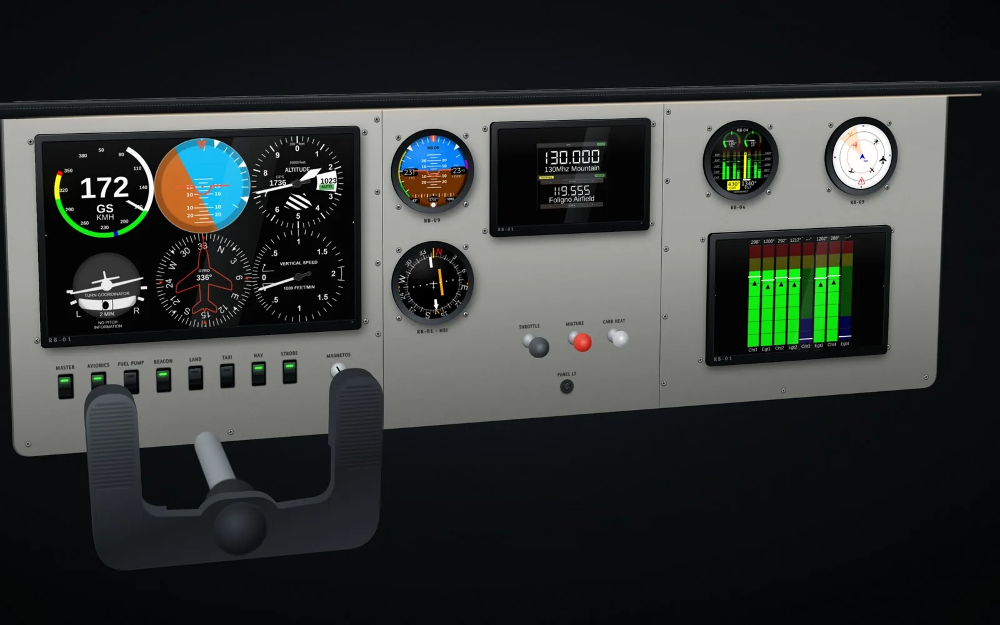
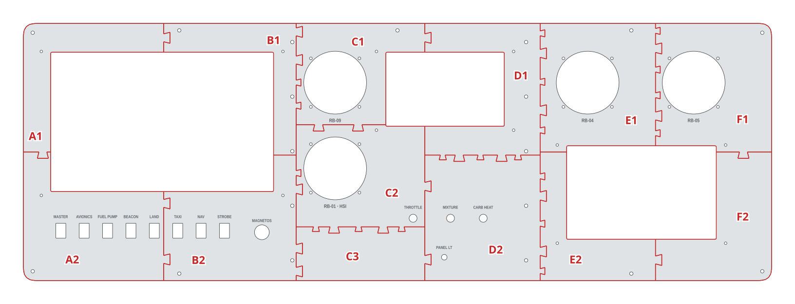
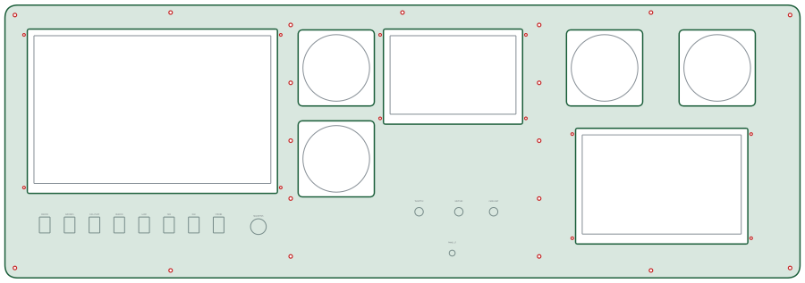

# Six-pack trainer

The RB-01 six-pack in front of the pilot, an RB-09 standby, the RB-01 HSI and radio page, RB-04 engine and RB-05 traffic, on a classic trainer panel with a yoke.

| | |
|---|---|
| Author | RB-Avionics |
| License | Free for personal use; commercial use requires an agreement, see [LICENSE.md](../../LICENSE.md) |
| Concept | [www.rbavionics.com, RB-Simulator](https://www.rbavionics.com/#rb-simulator) |

> **Printing for an aircraft:** these panels are made for simulators, where PLA or PETG is fine. Printed for an aircraft, they must withstand 100 °C in cruise on long flights: read [PRINTING.md](../../PRINTING.md).

A 3D-printable version of the panel in the concept render. Not included: the glare shield and the yoke.
Print and assembly notes are in the [RB-Cockpits README](../README.md).

<!-- BEGIN parts: generated by tools/cockpit_panels.py, do not edit by hand -->
## Hardware

| Item | Qty | Panel cut-out |
|---|---:|---|
| RB 80 mm round instrument | 4 | Ø80.5 mm, 4 × M3 on a 62.25 mm square |
| RB-01 display, screen 152 × 95 mm (7.1") | 1 | window 152 × 95 mm, 4 × M3 beside the bezel |
| RB-01 display, screen 192 × 120 mm (8.9") | 1 | window 192 × 120 mm, 4 × M3 beside the bezel |
| RB-01 display, screen 286 × 178.75 mm (13.3") | 1 | window 286 × 178.75 mm, 4 × M3 beside the bezel |
| Key switch | 1 | Ø19 mm |
| Mini rocker switch (KCD1) | 8 | 12.9 × 19.2 mm |
| Panel mounting screw M4 | 19 | Ø4.5 mm |
| Potentiometer with knob | 1 | Ø7.2 mm |
| Push-pull control | 3 | Ø10.2 mm |

## Panel

960 × 330 mm, 4 mm thick, 13 tiles for a 200 mm bed.

| Tile | Size on the bed (mm) | File |
|---|---|---|
| A1 | 188 × 173 | [six-pack-trainer-A1.stl](files/six-pack-trainer-A1.stl) (28 KB) |
| A2 | 188 × 165 | [six-pack-trainer-A2.stl](files/six-pack-trainer-A2.stl) (449 KB) |
| B1 | 178 × 169 | [six-pack-trainer-B1.stl](files/six-pack-trainer-B1.stl) (56 KB) |
| B2 | 178 × 161 | [six-pack-trainer-B2.stl](files/six-pack-trainer-B2.stl) (337 KB) |
| C1 | 173 × 138 | [six-pack-trainer-C1.stl](files/six-pack-trainer-C1.stl) (192 KB) |
| C2 | 173 × 139 | [six-pack-trainer-C2.stl](files/six-pack-trainer-C2.stl) (253 KB) |
| C3 | 173 × 69 | [six-pack-trainer-C3.stl](files/six-pack-trainer-C3.stl) (7 KB) |
| D1 | 156 × 177 | [six-pack-trainer-D1.stl](files/six-pack-trainer-D1.stl) (63 KB) |
| D2 | 156 × 161 | [six-pack-trainer-D2.stl](files/six-pack-trainer-D2.stl) (217 KB) |
| E1 | 156 × 165 | [six-pack-trainer-E1.stl](files/six-pack-trainer-E1.stl) (160 KB) |
| E2 | 156 × 165 | [six-pack-trainer-E2.stl](files/six-pack-trainer-E2.stl) (28 KB) |
| F1 | 149 × 173 | [six-pack-trainer-F1.stl](files/six-pack-trainer-F1.stl) (180 KB) |
| F2 | 149 × 165 | [six-pack-trainer-F2.stl](files/six-pack-trainer-F2.stl) (28 KB) |

Whole panel for laser or CNC cutting, layers CUT and ENGRAVE, mm: [six-pack-trainer.dxf](files/six-pack-trainer.dxf)

FreeCAD model with the whole panels and the tiles: [six-pack-trainer.FCStd](files/six-pack-trainer.FCStd)
<!-- END parts -->

<!-- BEGIN kicad: generated by tools/kicad_templates.py, do not edit by hand -->
## KiCad board template

A KiCad project as the starting point for your own electronics.

[kicad/six-pack-trainer-backplane/six-pack-trainer-backplane.kicad_pro](kicad/six-pack-trainer-backplane/six-pack-trainer-backplane.kicad_pro): A backplane behind the six-pack trainer: same outline, cut-outs for the instruments and displays, holes on the panel screws.

- Seen from the front; the F side faces the back of the panel. Outline = the panel outline.
- Cut-outs clear the instrument bodies and display modules by 1 mm: 92 mm squares for the 80 mm RB cases, 79 x 85 mm for the 57 mm shells with the GPS hood, display bezel + 2 mm.
- Holes on the panel screws (M4) and the display screws (M3): stand the board off the panel on them.
- Switches, keys, push-pulls and knobs are drawn on Dwgs.User at their panel cut-outs: place PCB-mount parts there, or add cut-outs for panel-mount parts.
- PCB fabs limit the board size (often 500 mm or less): split the board along the print tile seams.

<!-- END kicad -->
