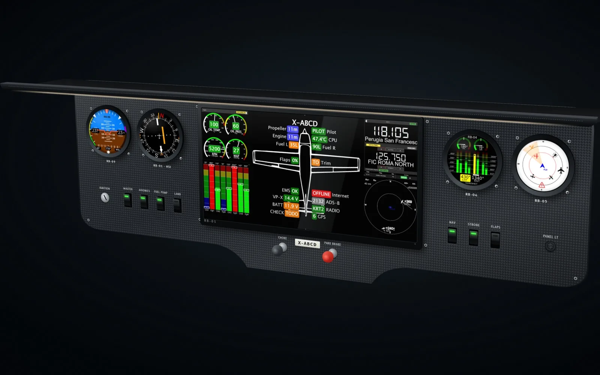
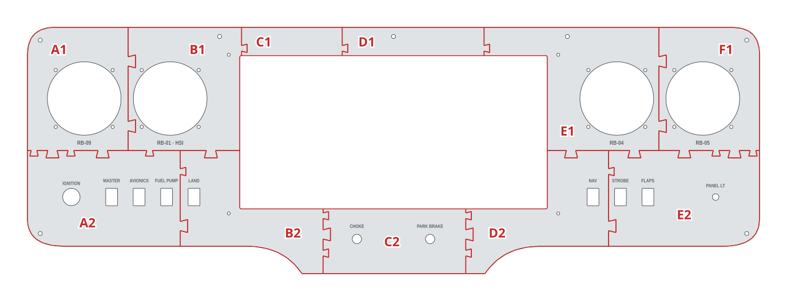
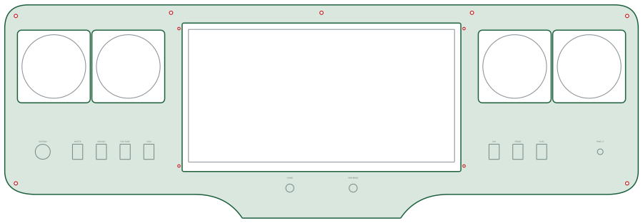

# Ultralight rehearsal

Your own panel on the ground: the RB-01 wide display with the aircraft, engine and radio pages, an RB-09, RB-01 HSI, RB-04 and RB-05, in carbon like the one you fly.

| | |
|---|---|
| Author | RB-Avionics |
| License | Free for personal use; commercial use requires an agreement, see [LICENSE.md](../../LICENSE.md) |
| Concept | [www.rbavionics.com, RB-Simulator](https://www.rbavionics.com/#rb-simulator) |

> **Printing for an aircraft:** these panels are made for simulators, where PLA or PETG is fine. Printed for an aircraft, they must withstand 100 °C in cruise on long flights: read [PRINTING.md](../../PRINTING.md).

A 3D-printable version of the panel in the concept render. Not included: the glare shield and the registration placard.
Print and assembly notes are in the [RB-Cockpits README](../README.md).

<!-- BEGIN parts: generated by tools/cockpit_panels.py, do not edit by hand -->
## Hardware

| Item | Qty | Panel cut-out |
|---|---:|---|
| RB 80 mm round instrument | 4 | Ø80.5 mm, 4 × M3 on a 62.25 mm square |
| RB-01 display, screen 336 × 168 mm (14.8") | 1 | window 336 × 168 mm, 4 × M3 beside the bezel |
| Key switch | 1 | Ø19 mm |
| Mini rocker switch (KCD1) | 7 | 12.9 × 19.2 mm |
| Panel mounting screw M4 | 7 | Ø4.5 mm |
| Potentiometer with knob | 1 | Ø7.2 mm |
| Push-pull control | 2 | Ø10.2 mm |

## Panel

800 × 270 mm, 4 mm thick, 11 tiles for a 200 mm bed.

| Tile | Size on the bed (mm) | File |
|---|---|---|
| A1 | 118 × 143 | [ultralight-rehearsal-A1.stl](files/ultralight-rehearsal-A1.stl) (182 KB) |
| B1 | 130 × 143 | [ultralight-rehearsal-B1.stl](files/ultralight-rehearsal-B1.stl) (196 KB) |
| C1 | 116 × 31 | [ultralight-rehearsal-C1.stl](files/ultralight-rehearsal-C1.stl) (3 KB) |
| D1 | 161 × 31 | [ultralight-rehearsal-D1.stl](files/ultralight-rehearsal-D1.stl) (12 KB) |
| E1 | 199 × 143 | [ultralight-rehearsal-E1.stl](files/ultralight-rehearsal-E1.stl) (155 KB) |
| F1 | 110 × 143 | [ultralight-rehearsal-F1.stl](files/ultralight-rehearsal-F1.stl) (167 KB) |
| A2 | 175 × 105 | [ultralight-rehearsal-A2.stl](files/ultralight-rehearsal-A2.stl) (378 KB) |
| B2 | 164 × 135 | [ultralight-rehearsal-B2.stl](files/ultralight-rehearsal-B2.stl) (55 KB) |
| C2 | 164 × 71 | [ultralight-rehearsal-C2.stl](files/ultralight-rehearsal-C2.stl) (175 KB) |
| D2 | 164 × 135 | [ultralight-rehearsal-D2.stl](files/ultralight-rehearsal-D2.stl) (42 KB) |
| E2 | 165 × 105 | [ultralight-rehearsal-E2.stl](files/ultralight-rehearsal-E2.stl) (255 KB) |

Whole panel for laser or CNC cutting, layers CUT and ENGRAVE, mm: [ultralight-rehearsal.dxf](files/ultralight-rehearsal.dxf)

FreeCAD model with the whole panels and the tiles: [ultralight-rehearsal.FCStd](files/ultralight-rehearsal.FCStd)
<!-- END parts -->

<!-- BEGIN kicad: generated by tools/kicad_templates.py, do not edit by hand -->
## KiCad board template

A KiCad project as the starting point for your own electronics.

[kicad/ultralight-rehearsal-backplane/ultralight-rehearsal-backplane.kicad_pro](kicad/ultralight-rehearsal-backplane/ultralight-rehearsal-backplane.kicad_pro): A backplane behind the ultralight rehearsal: same outline, cut-outs for the instruments and displays, holes on the panel screws.

- Seen from the front; the F side faces the back of the panel. Outline = the panel outline.
- Cut-outs clear the instrument bodies and display modules by 1 mm: 92 mm squares for the 80 mm RB cases, 79 x 85 mm for the 57 mm shells with the GPS hood, display bezel + 2 mm.
- Holes on the panel screws (M4) and the display screws (M3): stand the board off the panel on them.
- Switches, keys, push-pulls and knobs are drawn on Dwgs.User at their panel cut-outs: place PCB-mount parts there, or add cut-outs for panel-mount parts.
- PCB fabs limit the board size (often 500 mm or less): split the board along the print tile seams.

<!-- END kicad -->
